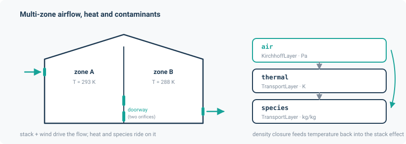

# Building physics

Multi-zone airflow, heat balance and contaminant transport in buildings, in a differentiable and batched form.

Rooms are nodes; leaks, doorways, fans, ducts and dampers are edges. The air layer solves for the zone pressures so that mass is conserved at every zone: air moves under buoyancy, wind pressure and mechanical pressure, and each edge's constitutive law turns the pressure difference across it into a mass flow. Heat rides on that airflow and conducts through walls with thermal mass; contaminants ride on it too: generated by sources, removed by deposition sinks and filters, and transformed by first-order reactions. Schedules, weather and ambient-concentration files drive a run over time. Mechanical ventilation (simple air-handling systems and duct networks with fans, dampers and terminals) and measured airflow curves are read from a `.prj` or built in Python. Occupants move between zones on occupancy schedules and generate contaminants where they are; a run reports their exposure, the local mean age of air and the building air change rate as ContamX does, and, as additions of noodl, the inhaled dose, the Wells-Riley infection probability and each zone's air change rate.



**Equivalent to.** NIST's CONTAM (the ContamX engine) for multi-zone airflow, contaminants, occupants, controls, duct networks and simple air-handling systems, and the multizone airflow models of the Modelica Buildings Library (`Buildings.Airflow.Multizone`). It reads CONTAM `.prj`, `.wth` and `.ctm` files and OpenModelica exports of Buildings Library models; see [Importing CONTAM](contam.md) and [Importing Modelica Buildings](modelica.md).

**Maturity: Verified on a stated subset.** noodl's results are compared with ContamX 3.4.1.7, run live through `contamxpy`, on projects covering stack and wind flow, schedules and weather files, kinetic reactions, filters (including UVGI), sources and sinks, fan curves, duct networks, air-handling systems, control networks, occupants, age of air and the building air change rate. The flows and mass fractions agree to a few float32 roundoffs of ContamX's own inputs. 22 Modelica Buildings Library models are compared with OpenModelica at 1e-6 relative, and the coupled airflow-heat physics with closed-form solutions. Two further Buildings Library models import but are not compared as dynamic models, so the label is not "Verified" without the qualification. Everything outside the subset below is refused by name. The tables are on the [verification page](../../reference/verification/building.md).

## Supported and not supported

| Supported | Not supported |
|---|---|
| Multi-zone airflow: power-law, quadratic, tabulated and cubic-spline elements, doorways (two lumped orifices, closed-form and discretised doors), dampers, fans (constant flow, cubic curve with speed ratio), stack and wind pressure | Transient airflow dynamics: airflow is quasi-steady within a step (the Modelica route stores air mass; the CONTAM route does so only with `dodMdt`) |
| Duct networks, simple air-handling systems and prescribed flows | Duct leakage, duct balancing, `sup_afe` super elements, CFD and 1-D convection/diffusion zones |
| Heat balance with lumped wall mass, coupled to the airflow by ping-pong or iteration | Thermal data in a `.prj` (it carries none); Modelica `Buildings.ThermalZones`, HVAC or district networks |
| Contaminants: sources and sinks, first-order reactions, particle, constant-efficiency, super and UVGI filters | Boundary-layer diffusion, resuspension, loading-dependent gaseous filters, non-trace species, schedule-triggered sources |
| Control networks: sensors, arithmetic, logic, switches, hysteresis, P and PI controllers; P-type `LimPID` from Modelica | Integration, delay, running-average and modifier control nodes, super nodes; PI, PD, PID `LimPID` and CDL blocks from Modelica |
| Occupants, exposure, age of air, building and zone air change rates, inhaled dose, Wells-Riley risk | Occupant coordinates in 1-D zones; generation from value files |
| Gradients through a solve and batches of scenarios | Gradients with respect to wall conductances |

The full list, with the reasons, is under [Limitations](limitations.md).

## A worked example

Two rooms joined by a doorway, one of them heated, with two leaks to ambient:

```python
import torch
from noodl.apps.building_physics import Zone, add_zone, add_large_opening, orifice_law_from_edges
from noodl.apps.building_physics import build_model, initial_drivers, initial_state
from noodl.heads import Stack
from noodl.topology import Network

F64 = torch.float64

net = Network(dtype=F64)
net.add_node("ambient", z_ref=0.0)
add_zone(net, Zone("A", volume=60.0, T0=288.15))
add_zone(net, Zone("B", volume=60.0, T0=285.15))

add_large_opening(net, "A", "B", H=2.0, W=0.9, z_mid=1.0, Cd=0.78)
net.add_edge("ambient", "B", kind="airpath", z_path=0.2, Cd=0.6, area=0.05)
net.add_edge("ambient", "B", kind="airpath", z_path=1.8, Cd=0.6, area=0.05)

el = orifice_law_from_edges(net, "airpath")
model = build_model(
    net,
    air_laws=[el],
    heads=[Stack.from_network(net, "airpath")],
    coupling="iterate",
    iterate_tol={"thermal": 0.01},
    iterate_max=50,
)

air, th = model.refs.air, model.refs.thermal
state = initial_state(model)                    # room temperatures from each zone's T0
drivers = initial_drivers(model, values={
    th.boundary_temperature: {"ambient": 283.15},
    th.sources: {"A": 1000.0},                  # a 1 kW heat source in room A
})
model.check(state, drivers).raise_for_errors(strict=True)
state = model.step(state, drivers, dt=60.0)

print(th.temperature.named(state[th.temperature]))   # {"A": T_A, "B": T_B} in K
print(state[air.flow][0])                             # doorway low-opening flow, kg/s
```

`state` and `drivers` are plain dictionaries of tensors. The references only name their keys (`th.temperature` is `"thermal.x"`, `th.sources` is `"thermal.sources"`, `air.flow` is `"air.q"`) and build each tensor in that key's node order: full node order for sources, the layer's boundary order for `boundary_temperature`, its active interior order for `temperature`. Hand-built tensors in those orders still work, and `model.check` catches one in the wrong shape. [Using noodl](../../guide/workflow.md) covers the details.

The node and edge attributes this example sets (`volume`, `T0`, `z_ref`, `z_path`, `Cd`, `area`), and the wind attributes a `Wind` term reads (`azimuth`, `Cp`, `Ch`, `profile`), are listed with their units under [Network attributes](../../reference/catalogue/building_physics.md#network-attributes).

Units are mass flow kg/s, temperature K, heat W, mass fraction kg/kg and pressure Pa. The whole application works in `float64` regardless of the network's default dtype. To install noodl, see [Installation](../../get-started/installation.md); the `contam` extra is needed only to run ContamX itself for a comparison.

## In this section

Guides:

- [Assembling a building](assembling.md): zones and walls, duct networks, air-handling systems, and reusable components.
- [Schedules, time and controls](schedules-and-controls.md): calendars and schedules, running a model over time, weather files, and control networks.
- [Contaminants, occupants and exposure](contaminants-and-occupants.md): sources and sinks, species and reactions, filters, occupants, exposure, age of air and air change rates.

Explanation and reference:

- [Equations and modelling](physics.md): heat as a transport layer, heads, coupling, and how the layers are assembled.
- [Airflow elements](elements.md): the constitutive laws and where they differ.
- [Importing CONTAM](contam.md) and [Importing Modelica Buildings](modelica.md): what is read and what is refused.
- [Limitations](limitations.md): what is not modelled and where noodl differs from CONTAM and Modelica.
- [Verification](../../reference/verification/building.md): the comparison tables.
- [Catalogue](../../reference/catalogue/building_physics.md) and [API reference](../../reference/api/index.md): every class and function with its parameters. Electrical circuits that Modelica models describe are under [Electrical circuits](../electrical/index.md).
