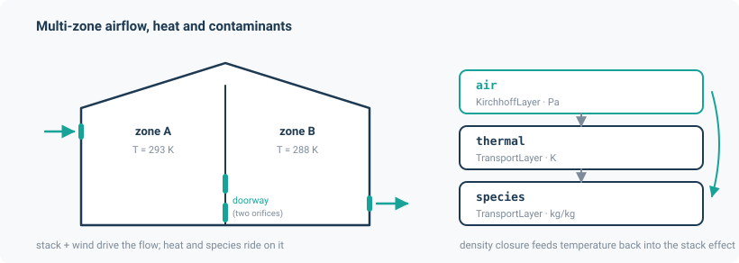

# Building physics

Multi-zone airflow, heat balance and contaminant transport in buildings, in a differentiable and
batched form.

Rooms are nodes; leaks, doorways, fans, ducts and dampers are edges. The air layer solves for
the zone pressures so that mass is conserved at every zone: air moves under buoyancy, wind
pressure and mechanical pressure, and each edge's element turns the pressure difference across
it into a mass flow. Heat rides on that airflow and conducts through walls with thermal mass;
contaminants ride on it too: generated by sources, removed by deposition sinks and filters, and
transformed by first-order reactions. Because air density depends on temperature and the stack
effect depends on density, the airflow and heat problems are genuinely two-way coupled.
Schedules, weather and ambient-concentration files drive a run over time (`simulate`,
`simulate_project`). Mechanical ventilation (simple air-handling systems and duct networks with
fans, dampers and terminals) and measured airflow curves are read from a `.prj` or built in
Python. Occupants move between zones on occupancy schedules and generate contaminants where
they are; a run reports their exposure, the local mean age of air and the building air change
rate as ContamX does, and, as additions of noodl, the inhaled dose, the Wells-Riley infection
probability and each zone's air change rate.

**Units.** Mass flow kg/s, temperature K, heat W, mass fraction kg/kg, pressure Pa. The whole
application works in `float64` regardless of the network's default dtype.

```python
from noodl.apps.building_physics import (
    Zone, WallMass, add_zone, build_model, initial_state,
    add_large_opening, orifice_elements_from_edges,
)
```



Every type this application offers — what it does and how to call it — is listed in its [catalogue](../catalogue/building_physics.md). It is set up and run like every other model; see [Using noodl](../usage.md).

## Building a model in Python

Two rooms joined by a doorway, one of them heated, with two leaks to ambient:

```python
import torch
from noodl.apps.building_physics import Zone, add_zone, add_large_opening, orifice_elements_from_edges
from noodl.apps.building_physics import build_model, initial_drivers, initial_state
from noodl.drives import Stack
from noodl.topology import Network

F64 = torch.float64

net = Network(dtype=F64)
net.add_node("ambient", z_ref=0.0)
add_zone(net, Zone("A", volume=60.0, T0=288.15))
add_zone(net, Zone("B", volume=60.0, T0=285.15))

add_large_opening(net, "A", "B", H=2.0, W=0.9, z_mid=1.0, Cd=0.78)
net.add_edge("ambient", "B", kind="airpath", z_path=0.2, Cd=0.6, area=0.05)
net.add_edge("ambient", "B", kind="airpath", z_path=1.8, Cd=0.6, area=0.05)

el = orifice_elements_from_edges(net, "airpath")
model = build_model(
    net,
    air_elements=[el],
    drives=[Stack.from_network(net, "airpath")],
    coupling="iterate",
    iterate_tol={"thermal": 0.01},
    iterate_max=50,
)

air, th = model.refs.air, model.refs.thermal
state = initial_state(model)                    # room temperatures from each zone's T0
drivers = initial_drivers(model, values={
    th.boundary_temperature: {"ambient": 283.15},
    th.sources: {"A": 1000.0},                  # a 1 kW heat source in room A
})
model.check(state, drivers).raise_for_errors(strict=True)
state = model.step(state, drivers, dt=60.0)

print(th.temperature.named(state[th.temperature]))   # {"A": T_A, "B": T_B} in K
print(state[air.flow][0])                             # doorway low-opening flow, kg/s
```

*(Adapted from `benchmarks/natural_ventilation.py`, the golden reference case.)*

`state` and `drivers` are plain dictionaries of tensors. The references only name their keys
(`th.temperature` is `"thermal.x"`, `th.sources` is `"thermal.sources"`, `air.flow` is
`"air.q"`) and build each tensor in that key's node order: full node order for sources,
the layer's boundary order for `boundary_temperature`, its active interior order for
`temperature`. Hand-built tensors in those orders still work, and `model.check` catches one
in the wrong shape. [Using noodl](../usage.md) covers the details.

The node and edge attributes this example sets (`volume`, `T0`, `z_ref`, `z_path`, `Cd`,
`area`), and the wind attributes a `Wind` drive reads (`azimuth`, `Cp`, `Ch`, `profile`),
are listed with their units under [Network attributes](../catalogue/building_physics.md#network-attributes).

Models can also be read from CONTAM `.prj`/`.wth` files or from a Modelica Buildings Library
export — see [File formats](../formats/index.md).

## Duct networks

A duct system is described with `DuctNetwork` and then added to a `Network` or a
`Component`. It has three parts, built the way CONTAM builds them:

- a **junction** (`junction(name, z_ref=, T0=)`) is a node at height `z_ref`. It holds half
  the volume of every segment that meets it (the segment's length times its area). A
  terminal adds nothing to it. The volume is why the system is described first and added
  afterwards: it is known only once every segment is;
- a **segment** (`segment(a, b, length=, diameter=, roughness=, loss=, area=)`) is an
  `AirDuct` edge between two junctions, with the hydrostatic term `DuctStack` (the column at
  the junctions' mean temperature). The roughness defaults to CONTAM's 9e-5 m
  (`DEFAULT_ROUGHNESS`) and the area to the circle of the diameter;
- a **terminal** (`terminal(junction, zone, area=, loss=)`) is a `DuctTerminal` edge from a
  junction into a zone, with a `Stack` at the junction's height. Its loss defaults to
  CONTAM's 0.125 (`DEFAULT_TERMINAL_LOSS`). A terminal in the ambient takes the wind as an
  envelope path does: from the `WindProfile` numbered `profile` at the wall's `azimuth` (or a
  component's `facade`), or from a constant pressure coefficient `Cp`, either scaled by the
  speed modifier `Ch`. Wind data that would act on nothing is refused, naming the terminal:
  `Ch`, `azimuth` or `facade` without a `profile` or with `Cp=0`, a `profile` and a `Cp`
  together, and wind on a terminal into any zone but the ambient (`DuctNetwork(ambient=...)`
  names it, `"ambient"` by default; inside a component, `outer` of that name).

Every value is checked when the segment or terminal is described, and an error names it (its
`name`, or its two ends): lengths, diameters, roughnesses and areas must be positive, a
roughness below 3.7 diameters, a segment's loss non-negative and a terminal's positive.

The laws are those under [Duct elements](#duct-elements). A fan, a damper or any other
element in a duct is an ordinary edge between two junctions, added by the caller with its own
element. `duct_elements_from_edges(net, profiles=...)` returns the segments' and terminals'
elements and drives, with a `Wind` drive when a terminal has a profile or a nonzero `Cp`.

A fan draws 0.05 kg/s from the ambient through a 10 m duct and blows it through a 5 m duct
into a room, which leaks it back to the ambient:

```python
import torch
from noodl.apps.building_physics import DuctNetwork, duct_elements_from_edges
from noodl.elements import FixedFlow, PowerLaw
from noodl.layers.potential import PotentialFlowLayer
from noodl.topology import Network

F64 = torch.float64
net = Network(dtype=F64)
net.add_node("ambient", z_ref=0.0, T0=293.15)
net.add_node("room", z_ref=0.0, T0=293.15, volume=300.0)
ducts = DuctNetwork()
for j in ("inlet", "fan_in", "fan_out", "outlet"):
    ducts.junction(j, z_ref=1.5)
ducts.segment("inlet", "fan_in", length=10.0, diameter=0.2)
ducts.segment("fan_out", "outlet", length=5.0, diameter=0.2)
ducts.terminal("inlet", "ambient", area=0.0314)
ducts.terminal("outlet", "room", area=0.0314)
ducts.add_to(net)
net.add_edge("fan_in", "fan_out", kind="fan")
net.add_edge("room", "ambient", kind="leak")
elements, drives = duct_elements_from_edges(net)
elements += [FixedFlow(torch.tensor([0.05], dtype=F64), kind="fan"),
             PowerLaw(torch.tensor([0.5], dtype=F64), torch.tensor([0.5], dtype=F64),
                      kind="leak")]
air = PotentialFlowLayer(net, "air", elements, drives=drives, boundary=["ambient"])
rho = torch.full((net.n,), 1.204097, dtype=F64)
phi, q = air.solve(torch.zeros(1, dtype=F64), {"rho": rho})
print([round(v, 4) for v in air.flows_of_kind(q, "duct_terminal").tolist()], "kg/s")
print(f"room at {phi[net.node_index('room')].item():.4f} Pa")
print({j: round(v * 1e3, 1) for j, v in ducts.volumes().items()}, "litres")
```

```text
[-0.05, 0.05] kg/s
room at 0.0100 Pa
{'inlet': 157.1, 'fan_in': 157.1, 'fan_out': 78.5, 'outlet': 78.5} litres
```

The terminal in the ambient carries the fan's flow into the duct (negative: its positive
direction is out of the duct) and the room's terminal delivers it. Each junction holds half
of its segment: 157.1 litres for the 10 m duct of 0.2 m, 78.5 for the 5 m one. The junction
nodes also carry `heat_capacity=0`: no lumped heat capacity beyond their air.

From a `.prj`: `read_prj` reads a CONTAM duct network (duct elements, junctions, terminals,
segments; see [CONTAM](../formats/contam.md)) into the same kinds of edges, one kind per duct
element (`duct_<nr>`) and one for all terminals (`duct_terminal`). Its junctions are nodes
named `"junction <nr>"`, after the zones, so a species state carries the zones' rows first;
`project.zone_mass_fractions(x)` selects them. `project.terminal_flows(q)` is the flow out of
each terminal into its zone in junction-number order (ContamX's order and sign), and
`project.segment_flows(q)` the flow along each segment. `duct_three_zone.prj` supplies the
three-zone building from a wind-exposed intake through a fan and exhausts zone three through a
constant-volume fan:

```python
from noodl.apps.building_physics import project_to_model, read_prj
from noodl.apps.building_physics.prj import steady

project = read_prj("duct_three_zone.prj")
model, state, drivers = project_to_model(project)
solved = steady(model, state, drivers)
print(project.junctions[:3], "...")
print([round(v, 4) for v in project.terminal_flows(solved["air.q"]).tolist()], "kg/s")
x = solved["species.x"]
print(tuple(x.shape), tuple(project.zone_mass_fractions(x).shape))
```

```text
['junction 1', 'junction 2', 'junction 3'] ...
[-0.3169, 0.2088, 0.108, -0.0482, 0.0482] kg/s
(12, 1) (3, 1)
```

The intake (junction 1) draws 0.317 kg/s from the ambient, split between zone one (0.209) and
zone two (0.108); the exhaust takes 0.04 m3/s of 293.15 K air, 0.0482 kg/s, from zone three.
`simulate_project` returns the terminal flows of every step as `"terminal_flow"`.

## Air-handling systems

CONTAM's simple air-handling system is not a black box in noodl: `add_air_handler` expands it
into the network. Its supply plenum and return plenum are nodes, with their volumes. Edges of
one kind join them: a supply point from the supply plenum into each supplied zone, a return
point from each zone it draws from into the return plenum, the recirculation from the return
to the supply plenum, the outdoor air from the ambient into the supply plenum, and the exhaust
from the return plenum to the ambient. Every edge's flow is prescribed (a `PrescribedFlow`
element). The closure `AirHandlerFlows` computes the flows each step, by CONTAM's algorithm
(TN 1887 section 3.6, checked against ContamX 3.4.1.7), from the supply and return points'
design flows and the outdoor-air fraction $f_o$. With $W_s$ the supplied flow, $W_{ret}$ the
returned flow and $W_{o,min}$ the minimum outdoor air (kg/s):

$$
W_o' = \max\left(f_o W_s,\ \min(W_s, W_{o,min})\right), \qquad
W_{rec} = \min(W_{ret},\ W_s - W_o'),
$$

$$
W_o = W_s - W_{rec}, \qquad W_{ex} = W_{ret} - W_{rec}.
$$

When more air returns than is supplied, the surplus leaves through the exhaust. A minimum
outdoor-air flow above the supply is capped at the supply. An outdoor-air fraction above 1
would make the recirculation negative: ContamX stops there, and the closure raises, naming
the air handler. A negative fraction is no error: it acts through the maximum.

A schedule or a control acts through two inputs, declared in `model.refs.inputs`:
`"flow_multiplier.<kind>"` (one value per edge of the kind) multiplies the supply and return
points' design flows and is ignored on the other three edges, and
`"outdoor_air_fraction.<kind>"` sets $f_o$. Without them the multipliers are 1 and $f_o$ is
the `outdoor_air_fraction` given to `add_air_handler` (1 by default, all outdoor air). Both
take leading batch dimensions. An air handler whose multipliers are all 0 moves no air; its
plenums keep their last values.

Only these balanced flows touch the plenums, so the airflow solve does not need their
pressure: `build_model(flow_balanced=plenums)` puts them on the air layer's boundary at zero
gauge pressure, while they stay ordinary nodes of the heat and species layers. An edge whose
element depends on the pressure (a leak into a plenum, say) would let a pinned plenum absorb
an imbalance unseen, and a fixed flow lies outside the air handler's balance, so
`build_model` refuses any edge but a `PrescribedFlow` on a `flow_balanced` node, naming the
node and the edge; CONTAM, too, joins only the air handler's own paths to its plenums. They are
well-mixed nodes with air mass $\rho V$. A plenum of zero volume (CONTAM's default) holds no
air and must also be named in `storage_free=`: its balance is then algebraic, the mix of what
flows in, and the heat and species layers use the implicit scheme (`build_model` selects it
for heat; the species layer's default is already implicit). A plenum left out of
`flow_balanced=` or `storage_free=` is refused, naming it and the option. While an air
handler is switched off, nothing passes through a zero-volume plenum: it keeps its value, and
a heat or contaminant source there (a coil) is dropped for those steps, as it delivers
nothing without airflow; `model.step(..., diagnostics=d)` counts the dropped entries at
`d["layers"][layer]["held_sources_dropped"]`.
`closures=[closure]` adds the air handler's closure after the density closure. In a
`Component`, the outdoor air and the exhaust reach the shared ambient through
`outer("ambient")`. Give each air handler of a building its own `kind` (and its own plenum
names).

An office supplied with 0.1 kg/s, 30 % outdoor air, and stepped once with outdoor air at a
mass fraction of 1e-3:

```python
import torch
from noodl.apps.building_physics import (
    add_air_handler, air_handler_from_edges, air_handler_plenums, build_model,
    initial_drivers, initial_state, orifice_elements_from_edges,
)
from noodl.drives import Stack
from noodl.topology import Network

F64 = torch.float64
net = Network(dtype=F64)
net.add_node("ambient", z_ref=0.0, T0=293.15)
net.add_node("office", z_ref=0.0, T0=293.15, volume=300.0)
net.add_edge("ambient", "office", kind="airpath", z_path=1.0, Cd=0.6, area=0.01)
add_air_handler(net, supplies={"office": 0.1}, returns={"office": 0.1},
                outdoor_air_fraction=0.3)
element, closure = air_handler_from_edges(net, "air_handler")
plenums = air_handler_plenums(net, "air_handler")
model = build_model(net, air_elements=[orifice_elements_from_edges(net, "airpath"), element],
                    drives=[Stack.from_network(net, "airpath")], thermal=False, species=1,
                    closures=[closure], flow_balanced=plenums, storage_free=plenums)
drivers = initial_drivers(model)
drivers["rho"] = torch.full((net.n,), 1.2041, dtype=F64)
flows = closure({}, drivers)["prescribed_flow.air_handler"]
print([round(v, 3) for v in flows.tolist()])
sp = model.refs.species
drivers[sp.boundary_mass_fraction] = torch.tensor([1e-3], dtype=F64)  # outdoor air
state = model.step(initial_state(model), drivers, 300.0)
x = sp.mass_fraction.named(state[sp.mass_fraction])
print({node: f"{v.item():.4e}" for node, v in x.items()})
```

```text
[0.1, 0.1, 0.07, 0.03, 0.03]
{'office': '2.4309e-05', 'ahs_supply': '3.1702e-04', 'ahs_return': '2.4309e-05'}
```

The flows are in edge order: supply, return, recirculation, outdoor air, exhaust. The office
exchanges 0.03 kg/s with the outdoor air through the air handler. The zero-volume return
plenum is at the office's value, and the supply plenum at the mix, 0.3 of the outdoor air plus
0.7 of the returned air.

From a `.prj`: `read_prj` reads CONTAM's simple air-handling systems (see
[CONTAM](../formats/contam.md)) into the same edges, one kind per system (`ahs_<nr>`), with
its closure in `project.closures`, its plenum zones in `project.flow_balanced` and the
zero-volume ones in `project.storage_free`; `project_to_model` passes all three on. The
supply and return points carry their design flows, and their schedules become
`"flow_multiplier.ahs_<nr>"` inputs. The outdoor-air fraction schedule and the minimum
outdoor-air flow are read from the recirculation path, where ContamX reads them. Filters on
any of the system's paths act on the air passing through, as on any path.
`ahs_three_zone.prj` supplies zones one (0.1 kg/s) and two (0.05 kg/s) and draws 0.12 kg/s
from zone three, with 30 % outdoor air and a minimum of 0.02 kg/s; its return plenum has no
volume:

```python
from noodl.apps.building_physics import project_to_model, read_prj
from noodl.apps.building_physics.prj import steady

project = read_prj("ahs_three_zone.prj")
print(project.flow_balanced, project.storage_free)
model, state, drivers = project_to_model(project)
solved = steady(model, state, drivers)
print([round(v, 3) for v in project.path_flows(solved["air.q"])[4:].tolist()], "kg/s")
```

```text
['ahs(Ret)', 'ahs(Sup)'] ['ahs(Ret)']
[0.1, 0.05, 0.12, 0.105, 0.045, 0.015] kg/s
```

Paths 5 to 10 are the two supply points, the return point, the recirculation, the outdoor air
and the exhaust: 30 % of the 0.15 kg/s supplied is 0.045 kg/s of outdoor air, and the
0.12 kg/s returned splits into 0.105 kg/s recirculated and 0.015 kg/s exhausted.

## Building from components

A larger building is easier to assemble from parts than to write out node by node. The
functions below return components (see [Components](../concepts/components.md)): you place
them, connect their ports, and `flatten()` gives the same `Network` you would have built by
hand, ready for `build_model`.

| Factory | Parameters | Ports |
|---|---|---|
| `room(name, ...)` | `volume` (m3), `T0` (K), `z_ref` (m), `wall` (a `WallMass`, optional) | `air` |
| `door(name, ...)` | `H`, `W` (m), `z_mid` (m, relative to the placement), `Cd` | `a`, `b` |
| `crack(name, ...)` | `area` (m2), `z_path` (m), `Cd`, `exterior` (default `False`), wind: `azimuth` or `facade`, `Cp`, `Ch`, `profile` | `a`, `b`; only `a` if exterior |
| `window(name, ...)` | as `crack`, but `exterior` defaults to `True` | `a` (and `b` with `exterior=False`) |
| `shaft(name, ...)` | `levels`, `level_height` (m), `volume` (m3 per level), `area` (m2 of each slab opening), `T0`, `Cd` | `levels[0]`, `levels[1]`, ... |
| `fan(name, ...)` | `flow` (kg/s, not negative; swap the ports to reverse; the height does not matter to a fixed-flow fan), `exterior` (`None`, `"supply"` or `"exhaust"`) | `a`, `b`; only `a` if exterior |
| `duct(name, ...)` | `length`, `diameter`, `roughness` (m), `loss`, `terminal_area` (m2), `terminal_loss`, `z_a`, `z_b` (m), `T0` (K), `exterior`, wind (exterior only, needs `profile`): `azimuth` or `facade`, `Ch`, `profile` | `a`, `b`; only `b` if exterior |
| `air_handler(name, ...)` | `supplies`, `returns` (design flows, kg/s), `outdoor_air_fraction`, `min_outdoor_air` (kg/s), `supply_volume`, `return_volume` (m3), `T0` (K), `kind` | `supplies[i]`, `returns[j]` |

A `door` has two edges, `low` and `high`, as `add_large_opening` does. An exterior `crack` or
`window` has one edge, `path`, from the shared `ambient` node, so the building must declare
`inner("ambient", ...)`. A `shaft` is a stack of zones, one per level, joined by openings
`slab[i]` (how stairwells are usually represented in multizone models). A door's or window's height is
relative to the component's placement, so the same factory call serves every floor.
`add_air_handler` adds an air handler to a component as it does to a network (see
[Air-handling systems](#air-handling-systems)).

A stairwell serving two flats, one per floor. A door joins each shaft level to its flat:
connecting `stair.levels[i]` straight to `flat.air` would merge two real nodes, which
`flatten` refuses (see [Ports and connect](../concepts/components.md#ports-and-connect)).


```python
from noodl.apps.building_physics import door, room, shaft, window
from noodl.components import Component

block = Component("block")
block.inner("ambient", z_ref=0.0, T0=283.15)
stair = block.add(shaft("stair", levels=2, level_height=3.0, volume=30.0, area=0.5))
for i in range(2):
    at = (0.0, 0.0, 3.0 * i)
    flat = block.add(room(f"flat{i}", volume=60.0), at=at)
    d = block.add(door(f"door{i}", H=2.0, W=0.9, z_mid=1.0), at=at)
    win = block.add(window(f"win{i}", area=0.02, z_path=1.5, azimuth=180.0), at=at)
    block.connect(stair.ports[f"levels[{i}]"], d.ports.a)
    block.connect(d.ports.b, flat.ports.air)
    block.connect(win.ports.a, flat.ports.air)
block_net, block_names = block.flatten(dtype=F64)
print(block_net.nodes)
```

```text
['ambient', 'stair.levels[0]', 'stair.levels[1]', 'flat0.air', 'flat1.air']
```

The second flat, its door and its window are placed at `z = 3`, so their heights come out
right without being repeated in the factory calls.

A `fan` edge is built with `fan_elements_from_edges`, a `duct` with `duct_elements_from_edges`,
and an `air_handler` with `air_handler_from_edges` and `air_handler_plenums` (see
[Air-handling systems](#air-handling-systems)). An office is served by an air handler, joined
to a store by a transfer duct, and the store is exhausted by a fan:

```python
import math

import torch

from noodl.apps.building_physics import (
    air_handler,
    air_handler_from_edges,
    air_handler_plenums,
    build_model,
    crack,
    duct,
    duct_elements_from_edges,
    fan,
    fan_elements_from_edges,
    initial_drivers,
    initial_state,
    orifice_elements_from_edges,
    room,
)
from noodl.components import Component
from noodl.drives import Stack

F64 = torch.float64

b = Component("building")
b.inner("ambient", z_ref=0.0, T0=293.15)
office = b.add(room("office", volume=300.0))
store = b.add(room("store", volume=100.0))
ahu = b.add(air_handler("ahu", supplies=[0.1], returns=[0.1], outdoor_air_fraction=0.3,
                        supply_volume=0.0, return_volume=0.0))
b.connect(ahu.ports["supplies[0]"], office.ports.air)
b.connect(ahu.ports["returns[0]"], office.ports.air)
transfer = b.add(duct("transfer", length=4.0, diameter=0.15, z_a=2.5, z_b=2.5))
b.connect(transfer.ports.a, office.ports.air)
b.connect(transfer.ports.b, store.ports.air)
exhaust = b.add(fan("exhaust", flow=0.02, exterior="exhaust"))
b.connect(exhaust.ports.a, store.ports.air)
leak = b.add(crack("leak", area=0.01, z_path=1.0, exterior=True))
b.connect(leak.ports.a, office.ports.air)

net, _ = b.flatten(dtype=F64)
element, closure = air_handler_from_edges(net, "air_handler")
plenums = air_handler_plenums(net, "air_handler")
ducts, drives = duct_elements_from_edges(net)
model = build_model(
    net,
    air_elements=[orifice_elements_from_edges(net, "airpath"), *ducts,
                  fan_elements_from_edges(net), element],
    drives=[Stack.from_network(net, "airpath"), *drives],
    thermal=False, species=1, closures=[closure],
    flow_balanced=plenums, storage_free=plenums,
)
drivers = initial_drivers(model)
drivers["rho"] = torch.full((net.n,), 1.2041, dtype=F64)
out = model.steady(initial_state(model), drivers, atol=1e-14, rtol=1e-14)
air = model.potential["air"]
print([round(v, 4) for v in air.flows_of_kind(out["air.q"], "duct_terminal").tolist()])
print([round(v, 4) for v in air.flows_of_kind(out["air.q"], "air_handler").tolist()])
```

```text
[-0.02, 0.02]
[0.1, 0.1, 0.07, 0.03, 0.03]
```

The transfer duct carries the fan's 0.02 kg/s from the office to the store. Of the air handler's
0.1 kg/s supply, 0.03 kg/s is outdoor air and 0.07 kg/s recirculated.

## Time, schedules and inputs

Time in a building run is seconds since the start. A `Calendar` says where that start sits:
day of the year, time of day, and the CONTAM *day type* (1–12) of each day, which picks one
of a week schedule's twelve day schedules. Day types come from the weather file when there
is one. Otherwise they start at a given type and cycle through 1–7, as ContamX does.

A schedule's value is taken at the **end** of each step, and where it jumps, the value *at*
the jump is the one before it. A fan switched on at 08:00 is therefore off over the step
ending 08:00 and on over the next one. This matches ContamX 3.4 (measured); at the start
time itself the value at that instant is used.

```python
from noodl.apps.building_physics import Calendar, DaySchedule, WeekSchedule

office = DaySchedule([0.0, 8 * 3600.0, 18 * 3600.0, 86400.0], [0.0, 1.0, 0.0, 0.0])
closed = DaySchedule([0.0, 86400.0], [0.0, 0.0])
# day type 1 Sunday, 2-6 weekdays, 7 Saturday, 8-12 holidays
week = WeekSchedule([office, closed], day_types=[2, 1, 1, 1, 1, 1, 2, 2, 2, 2, 2, 2])
calendar = Calendar(start_day=1, start_day_type=2)        # 1 January is a Monday
times = (8 * 3600.0, 9 * 3600.0, 6 * 86400 + 9 * 3600.0)
print([week.value(t, calendar).item() for t in times])
```

```text
[0.0, 1.0, 0.0]
```

`TimeSeries(times, values, interpolation="linear" | "step")` is the same kind of input built
from data (seconds since the start, never extrapolated); its values may carry gradients.

### Running over time

An `Input(signal, key, at=... | index=...)` writes a signal's value into a driver: the whole
driver, the entries named by `at` (node names for the node temperatures `"T"`, source names,
edge labels), or positions `index`. `simulate(model, state, drivers, times, inputs=...)`
evaluates every input at the **end** of each step, sets `drivers["time"]`, and steps the model.
It returns the time histories at `times`, which start at 0 (a `Calendar` places that start
in the year). Steps are split at every jump or kink of an input unless
`land_on_breakpoints=False`. Each step's airflow solve starts from the previous step's
pressures; when it does not converge from there (a fan curve after a large speed change can
swing between the ends of its curve, where its slope is zero), the step is retried once from
the linear initial guess, and a retry that fails too raises, naming the step.
`simulate(..., diagnostics={})` lists the retried steps' end times under
`"airflow_retries"`. A signal with a step mean, an occupant's `Presence` (see
[Occupants](#occupants)), is written as its mean over each step (or sub-step) instead of its
value at the step's end. The histories have one row per output time either way.

```python
import torch
from noodl.apps.building_physics import (
    Input, TimeSeries, project_to_model, read_prj, simulate,
)

project = read_prj("valThreeZonesWthCtm-UseApi.prj")
model, state, drivers = project_to_model(project)
cold_snap = TimeSeries([0.0, 1800.0, 3600.0], [293.15, 273.15, 273.15])
out = simulate(model, state, drivers, torch.arange(13, dtype=torch.float64) * 300.0,
               inputs=[Input(cold_snap, "T", at="ambient")])
print(out["air.q"].shape, out["species.x"].shape)
```

```text
torch.Size([13, 4]) torch.Size([13, 3, 1])
```

`simulate` adds each zone's air-mass change to its airflow balance (CONTAM's `dodMdt`)
exactly when the model carries a `ZoneAirMassChange` node source, which `project_to_model`
attaches for a project that sets `dodMdt` (the default `air_mass_change=None`;
`air_mass_change=False` opts out, and `True` on a model without the source is refused): a zone whose temperature rises pushes out the air it no longer holds. The mass is
taken at the zone's absolute pressure, (P_b + P_zone) V / (R T), as ContamX's is, so a zone
depressurised by an exhaust fan switching on also gives up a little air. For a project that
sets `dodMdt`, `project_to_model` gives the contaminants that same zone air mass. The term is
part of the airflow solve itself (the `ZoneAirMassChange` node source `project_to_model`
attaches), so a step of any length converges. When the model carries a `ZonePressureDensity`
closure (CONTAM's `densZP`), `simulate` repeats each step with the latest zone pressures until
they no longer move; the same repetition runs when a pressure-driven source is present, so the
source sees the step's own pressures.

`simulate_project(project)` runs a `.prj` the way ContamX does: its run control, its
schedules, and its weather and ambient files, read from next to the project.

```python
from noodl.apps.building_physics import simulate_project

project = read_prj("scheduled_three_zone.prj")
out = simulate_project(project)
fan = out["path_flow"][:, 4]
print(out["time"].shape, f"fan at 07:55 {fan[95].item():.6f} kg/s, at 08:05 {fan[97].item():.6f} kg/s")
```

```text
torch.Size([289]) fan at 07:55 0.000000 kg/s, at 08:05 0.100342 kg/s
```

A weather file and an ambient-concentration file become inputs the same way:

```python
from noodl.apps.building_physics import Calendar, read_ctm, read_wth

weather = read_wth("test_OneZoneWthCtm.wth")
print(weather.day_types, weather.signal("Ta").value(6 * 3600.0 + 300.0, Calendar()).item())
outdoor = read_ctm("test_OneZoneWthCtm.ctm")
print(outdoor.species, outdoor.signal(["sarin"]).value(15 * 3600.0, Calendar()).tolist())
```

```text
{1: 4, 2: 5} 293.15
('sarin',) [0.0]
```

## Controls

A `ControlNetwork` reads the model's state, computes signals and writes them into drivers:
a fan's flow multiplier, a damper's opening, a heat input. It is built from three kinds of
part:

- a **reading** names one value of the state or the drivers: `StateReading(key, index)`,
  `DriverReading(key, index)` or `FunctionReading(fn)`. The sensors by name name what they
  read instead: `node_mass_fraction(node, species)` (kg/kg), `node_temperature(node)` (K),
  `node_pressure(node)` (gauge, Pa), `edge_flow(kind, position)` (kg/s) and
  `edge_pressure_difference(kind, position)` (Pa). `build_model(..., controls=network)`
  resolves them against the model it builds, so they read that model's own rows and
  columns; a name the model lacks is refused there, and so is a network already resolved
  for another model (build one network per model). A temperature is the thermal layer's
  state, a boundary node's boundary temperature, or, without a thermal layer, the
  prescribed temperature driver `"T"`, which the model must then declare (a `.prj` model
  does; `node_temperature` on a model with neither is refused);
- a **block** computes one output from the outputs of the blocks it names by position in the
  network's list, or from a reading (`Sensor`);
- an **actuator**, `Actuator(block, key, index=None, mode="set" | "add")`, writes a block's
  output into a driver: the whole driver, or the positions `index` on its last axis; `"add"`
  adds it to those entries (a heat flow into `"thermal.sources"`, W).

| Block | Output |
|---|---|
| `Constant(value)` | the value |
| `DriverValue(key, index)` | a driver's value at this evaluation, such as a schedule an `Input` writes into `"controls.input"` |
| `Identity(a)` | its input |
| `Sensor(reading, offset, scale, time_constant)` | `(value - offset) * scale`, lagged with `time_constant` (s) when it is > 0 |
| `Sum(*inputs, weights)` | `sum_i w_i u_i` |
| `Average`, `Maximum`, `Minimum`, `Product` | the mean, largest, smallest, product of its inputs |
| `Divide(numerator, denominator)` | the quotient; a zero denominator raises, naming the block |
| `Absolute(a)`, `Complement(a)` | `abs(u)`, `1 - u` |
| `Positive(a)` | 1 where `u > 0`, else 0 |
| `Affine(a, offset, gain)` | `(u - offset) * gain` |
| `And`, `Or`, `ExclusiveOr` | logic on `u > 0` |
| `BelowLimit(a, limit)`, `AboveLimit(a, limit)` | 1 where `u < limit` (or `u > limit`), else 0 |
| `Shortfall(a, limit)`, `Excess(a, limit)` | `max(0, limit - u)`, `max(0, u - limit)` |
| `LowerBandSwitch(a, limit, band)` | on above `limit + band`, off below `limit`, unchanged in between |
| `UpperBandSwitch(a, limit, band)` | on below `limit - band`, off above `limit`, unchanged in between |
| `Hysteresis(a, slack, slope, initial)` | ContamX's hysteresis between a rising and a falling line |
| `ProportionalControl(a, gain)` | `clip(gain u, 0, 1)` on an error `u` |
| `IncrementalPI(a, kp, ki)` | ContamX's PI controller: `y = clip(y_prev + kp (e - e_prev) + ki dt (e + e_prev)/2, 0, 1)` |
| `LimitedPID(setpoint, measurement, gain, y_max, y_min, integral_time)` | MSL's `LimPID` as P or PI: `clamp(gain (u_s - u_m + xi), y_min, y_max)` with anti-windup |

A network is **sampled** (the default) or **continuous** (`sampled=False`). A sampled network
is evaluated once per step, as ContamX evaluates its control nodes; the switches with memory,
the hysteresis, the incremental PI and a lagged sensor need one. A continuous network is
algebraic in the state at every call, and its integrators (`LimitedPID` with an
`integral_time`) advance by one explicit Euler step of their rate per step; `LimitedPID` needs
one. That step holds the controller's output over the whole model step, so a stiff loop
(a large gain on a fast zone) run with long steps can overshoot or oscillate where the
continuous controller would not: take steps short against the loop's time constant.

A block's parameters are differentiable: a gain, a limit, an offset, a weight, a band or a
constant's value may be a float64 tensor, and the outputs carry its gradient as they carry
those of the state and the drivers (`IncrementalPI(0, kp=torch.tensor(2.0,
requires_grad=True), ki=2e-3)` in the example below gives d(CO2)/d(kp) through `simulate`).
A float stays a float. A band or a switch's threshold only moves where the switch flips, so
the gradient through a switch is zero wherever it does not flip; a hysteresis's slope and
slack and a controller's limits enter its output directly and have gradients on the pieces
where they act.

The network is a closure of the model, the first one: `build_model(..., controls=network)`
puts it ahead of the density closure, so its writes reach every other closure. Its block
outputs, its blocks' memory and whether it has been evaluated travel in the state as
`"controls.outputs"`, `"controls.memory"` and `"controls.evaluated"`, which
`build_model(..., return_inputs=True)` and `project_to_model` seed. The seed says "not
evaluated" (and its outputs are NaN): until the network is first evaluated it writes nothing,
so a query or `Model.check` on the initial state sees the drivers as the inputs leave them.
In a batch, a member not evaluated yet keeps its drivers the same way.
Inputs are applied before the closures run, so a control overrides a schedule on the same
driver entry, as in CONTAM.

Timing in a sampled network follows ContamX:

- sensors read the state the step starts from, so the value acting over a step comes from
  the end of the previous one;
- a flow or pressure sensor reads the last airflow solve, and 0 before the first;
- a sensor of a driver (a prescribed temperature, an outdoor mass fraction) reads the value
  the previous step used; the first evaluation reads the current value;
- a block that reads a block later in the list gets that block's previous output; before
  the first evaluation it gets 0, or a `Constant`'s value (ContamX presets its constant
  nodes). The network evaluates in the order given and never reorders.

`simulate` evaluates a sampled network once before the initial airflow, with the first
step's length, so a control acts in the first row already while its flow and pressure
sensors read 0 there. It then evaluates it once at the start of every output step, with the
inputs at the step's end, and holds it over the step's zone-pressure passes and the
sub-steps an input breakpoint makes; a sensor of `"air.phi"` therefore reads the pressures
that ended the previous step. The edges' pressure differences are recorded as `"air.dp"`
after every airflow solve when a sensor reads them, a controlled zone temperature enters the
zone air-mass change (`air_mass_change`) as a scheduled one does, and the histories carry
the block outputs as `"controls.outputs"`.

A room of 60 m³ with a CO2 source (4e-5 kg/s) takes its air through a leak and loses it
through an exhaust fan of 0.1 kg/s, wrapped in `Scaled` so that a driver scales its flow. A PI
controller on the room's CO2 above 1.2 g/kg sets the fan's multiplier:

```python
import torch
from noodl.apps.building_physics import (
    Actuator, ControlNetwork, IncrementalPI, Sensor, Zone, add_zone, build_model,
    node_mass_fraction, orifice_elements_from_edges, simulate,
)
from noodl.drives import Stack
from noodl.elements import FixedFlow, Scaled
from noodl.topology import Network

F64 = torch.float64
net = Network(dtype=F64)
net.add_node("ambient", z_ref=0.0)
add_zone(net, Zone("room", volume=60.0, T0=293.15))
net.add_edge("ambient", "room", kind="airpath", z_path=1.0, Cd=0.6, area=0.05)
net.add_edge("room", "ambient", kind="fan")
fan = Scaled(FixedFlow(torch.tensor([0.1], dtype=F64), kind="fan"), "flow_multiplier.fan")

network = ControlNetwork(
    [Sensor(node_mass_fraction("room", "CO2"),     # CO2 above 1.2 g/kg, in g/kg
            offset=1.2e-3, scale=1e3),
     IncrementalPI(0, kp=2.0, ki=2e-3)],           # the fan multiplier, 0..1
    [Actuator(1, "flow_multiplier.fan")])
model, state, drivers = build_model(
    net, air_elements=[orifice_elements_from_edges(net, "airpath"), fan],
    drives=[Stack.from_network(net, "airpath")], species=("CO2",),
    controls=network, return_inputs=True)
state["species.x"] = torch.tensor([6e-4], dtype=F64)
drivers["species.x_boundary"] = torch.tensor([6e-4], dtype=F64)  # outdoor CO2, kg/kg
drivers["species.sources"] = torch.tensor([0.0, 4e-5], dtype=F64)  # kg/s in the room

times = torch.arange(13, dtype=F64) * 300.0
out = simulate(model, state, drivers, times)
q_fan = out["air.q"][:, model.potential["air"].kind_slice("fan")][:, 0]
signal = out["controls.outputs"][:, 1]                            # the PI's output
for k in range(len(times)):
    print(f"{times[k] / 60:4.0f} min  CO2 {out['species.x'][k, 0] * 1e3:.4f} g/kg  "
          f"PI {signal[k]:.4f}  fan {q_fan[k]:.4f} kg/s")
```

```text
   0 min  CO2 0.6000 g/kg  PI 0.0000  fan 0.0000 kg/s
   5 min  CO2 0.7661 g/kg  PI 0.0000  fan 0.0000 kg/s
  10 min  CO2 0.9292 g/kg  PI 0.0220  fan 0.0022 kg/s
  15 min  CO2 1.0687 g/kg  PI 0.1368  fan 0.0137 kg/s
  20 min  CO2 1.1655 g/kg  PI 0.2951  fan 0.0295 kg/s
  25 min  CO2 1.2188 g/kg  PI 0.4390  fan 0.0439 kg/s
  30 min  CO2 1.2409 g/kg  PI 0.5409  fan 0.0541 kg/s
  35 min  CO2 1.2454 g/kg  PI 0.6031  fan 0.0603 kg/s
  40 min  CO2 1.2416 g/kg  PI 0.6379  fan 0.0638 kg/s
  45 min  CO2 1.2347 g/kg  PI 0.6563  fan 0.0656 kg/s
  50 min  CO2 1.2274 g/kg  PI 0.6654  fan 0.0665 kg/s
  55 min  CO2 1.2209 g/kg  PI 0.6695  fan 0.0670 kg/s
  60 min  CO2 1.2155 g/kg  PI 0.6710  fan 0.0671 kg/s
```

Each row's PI output is the one its fan flow used: at 0 min the evaluation before the
initial airflow, later the one decided from the state the step ending there started from.
The fan starts before the room reaches the set point: the proportional part answers the
rising CO2 while the integral part still pulls down. It settles where it removes the source:
4e-5 kg/s over the set point's 0.6 g/kg above the outdoor air is 0.067 kg/s.

**From a `.prj`.** `read_prj` reads a project's control nodes (`Project.control_nodes`) and
plans, when some record references a control node, the ones that a zone's, path's,
source's, duct segment's, terminal's or air-handler path's control reference, or a named
report node, needs (`Project.control_plan`), in the file's sequence order (a project whose
control nodes only report plans none: it runs as without them); `project_to_model` builds them into a new sampled network, first among
the closures, for every model. A control reference acts on what a schedule on the same record
acts on (a zone's `"T"`, a path's flow multiplier or fan speed, a source's multiplier, a
terminal's opening, an air handler's flows), and a schedule node is an `Input` on
`"controls.input"`. `project.control_outputs(out["controls.outputs"])` picks the named report
nodes, ContamX's control outputs, from a history; `simulate_project` returns them as
`"control"` (when there is a plan). `dcv_three_zone.prj` (in `tests/data/contam`) is demand-controlled ventilation:
a PI controller on zone one's CO2 above 650 ppm (by mass) drives an exhaust fan, never below
0.2 of its flow, while the occupants are in from 08:00 to 18:00:

```python
from noodl.apps.building_physics import read_prj, simulate_project

project = read_prj("dcv_three_zone.prj")
print([name for name, _ in project.control_plan.outputs])
out = simulate_project(project)
for k in (96, 108, 120, 144, 216, 240):                 # 300 s steps from midnight
    co2, pi, fan, excess = out["control"][k].tolist()
    print(f"{k * 5 // 60:02d}:00  CO2 {co2:6.1f} ppm  PI {pi:.3f}  fan {fan:.3f}")
```

```text
['co2', 'pi', 'fan', 'excess']
08:00  CO2  600.0 ppm  PI 0.000  fan 0.200
09:00  CO2  644.1 ppm  PI 0.003  fan 0.200
10:00  CO2  660.6 ppm  PI 0.313  fan 0.313
12:00  CO2  653.7 ppm  PI 0.846  fan 0.846
18:00  CO2  650.0 ppm  PI 0.898  fan 0.898
20:00  CO2  605.2 ppm  PI 0.000  fan 0.200
```

The fan runs at its 0.2 floor until the CO2 nears the set point, around 09:00; the PI
output then rises until the exhaust holds zone one at 650 ppm, and falls back to 0 once the
occupants leave.

**From Modelica.** `read_modelica` reads a `LimPID` whose measurement is a temperature sensor
on a volume, and the Math blocks between it and a `PrescribedHeatFlow`, into a continuous
network: a `LimitedPID` (a P controller; the integral and derivative parts are refused by
name) and `Affine`/`Sum`/`Product`/`Divide` blocks. Its heat flow does not go through an
actuator. On each piece of the limiter it is affine in the zone temperature, `A + B T`, and
the closure `FeedbackHeat` hands it to the thermal layer as the source `A` and the removal
rate `-B/C`, so that each transport step treats it implicitly: the MBL examples' loop, 15000
W/K on a 75 kJ/K room, settles in 5 s, shorter than their steps. `simulate(...,
scheme="midpoint")` takes both halves of a step on the step's piece and splits a step where the
limiter reaches a limit. A removal rate you pass as the driver `"thermal.removal"` (1/s) adds to
the network's in either scheme, each half of a midpoint step taking the driver's value at its own
end. `names.controls` maps each block to its column of `simulate`'s
`"controls.outputs"` (the block outputs, under the same key as the Python `simulate`). The
blocks are the network's (`FeedbackHeat.network.blocks`, the closure among
`model.closures`): a `LimitedPID`'s `gain` or limits set to a tensor carry their gradient
into the heat flows and the zone's energy balance. MBL's
`ChimneyShaftWithVolume` holds its room at 293.15 K while its volumes release their start
imbalance:

```python
from noodl.apps.building_physics import read_modelica
from noodl.apps.building_physics.modelica import simulate

model, state, drivers, names = read_modelica("ChimneyShaftWithVolume.json", return_names=True)
out = simulate(model, state, drivers, names.times[:3])
print(names.controls)
heat = out["controls.outputs"][:, names.controls["gain"]]  # the heat into the room, W
room = out["T"][:, names.nodes["roo"]]
for k in range(3):
    print(f"{float(names.times[k]):4.1f} s  room {float(room[k]):.4f} K  heat {float(heat[k]):6.1f} W")
```

```text
{'con': 2, 'gain': 3}
 0.0 s  room 293.1500 K  heat    0.0 W
 7.2 s  room 293.1558 K  heat  -86.9 W
14.4 s  room 293.1514 K  heat  -20.9 W
```

The compressed air warms the room at first, and the controller cools it back (MBL's room is
at 293.1558 K at 7.2 s too).

## The API

### Zones and walls

| Object | Purpose |
|---|---|
| `Zone(name, volume, T0=293.15, z_ref=0.0, wall=None)` | A room. `volume` in m³, `T0` the initial temperature, `z_ref` its reference height. |
| `WallMass(name, capacity, ua_zone, ua_ambient)` | A lumped wall node: heat capacity J/K, conductances W/K to the zone and to ambient. |
| `add_zone(net, zone, ambient="ambient")` | Adds the zone's air node and, if `zone.wall` is set, the wall node plus `kind="wall"` edges `zone → wall → ambient`. |

`WallMass` refuses a non-positive `ua` at construction. A negative conductance makes the
conduction operator anti-diffusive — it violates the maximum principle — and *every solve still
reports success*, because nothing downstream looks at the sign. Zero is refused as "a wall that
conducts nothing".

### Layers and model assembly

| Function | Returns |
|---|---|
| `thermal_layer(net, *, ambient, name="thermal", flow_kinds=("airpath",), conduction_kind="wall", c_p=1005.0, rho=1.2041, scheme=None, fixed_temperature=(), storage_free=())` | The heat `TransportLayer`. Capacity is $\rho c_p V + C_{\text{node}}$ per active interior node. Raises naming any node with zero heat capacity that is not storage-free. `scheme` defaults to `"exact"`, or to `"implicit"` when `storage_free` names a node (the only scheme that holds them). |
| `species_layer(net, *, ambient, name="species", flow_kinds=("airpath",), rho=1.2041, n_species=1, scheme="implicit", species_names=None, transmission=None, kinetics=None, storage_free=())` | The contaminant layer, as mass fractions, capacity = zone air mass $\rho V$ (CONTAM's convention). `transmission` `(b_flow, K)` is each flow edge's filter pass fraction; `kinetics` `(n_i, K, K)` each zone's first-order reactions (`reaction_kinetics` builds it). |
| `build_model(net, *, air_elements, drives, ambient="ambient", thermal=True, species=0 (a count or a list of names), density="ideal_gas", density_kwargs=None, coupling="pingpong", iterate_tol=None, iterate_max=20, thermal_scheme=None, species_scheme="implicit", flow_kinds=None, closures=(), flow_balanced=(), storage_free=(), return_inputs=False)` | The assembled `Model`; with `return_inputs=True`, `(model, state, drivers)` like the other applications. `closures` follow the density closure; `flow_balanced` nodes join the air layer's boundary; `storage_free` nodes hold no air (see [Air-handling systems](#air-handling-systems)). |
| `add_air_handler(target, *, supplies, returns, kind="air_handler", supply_plenum="ahs_supply", return_plenum="ahs_return", outdoor_air_fraction=1.0, min_outdoor_air=0.0, supply_volume=0.0, return_volume=0.0, T0=293.15, ambient="ambient")` | Adds an air handler's plenums and edges to a `Network` or a `Component`. `supplies` and `returns` map zones to design flows (kg/s). |
| `air_handler_from_edges(net, kind)` | `(PrescribedFlow, AirHandlerFlows)`: the air handler's element and closure, from its edges' attributes. |
| `air_handler_plenums(net, kind)` | `(supply plenum, return plenum)`. |
| `initial_state(model, *, values=None)` | Temperatures from each node's `T0`, zeros for species; then `values` by node name. |
| `initial_drivers(model, *, values=None)` | Zero boundary pressures, boundary temperatures from `T0`, zero boundary species; then `values` by node name. See [Using noodl](../usage.md). |

`species_layer(..., storage_free=[...])` and `thermal_layer(..., storage_free=[...])` accept
zero-volume nodes that hold no air, such as an air-handler plenum (see [Air-handling systems](#air-handling-systems)).
A contaminant source or sink on such a node is refused by name: it holds no air to emit into.

`density` selects the closure relating temperature to air density:

- `"ideal_gas"` → `IdealGasDensity`: $\rho = P_{\text{ref}} / (R T)$, with `P_ref` overridable per
  call through `drivers["P_ref"]`.
- `"linear"` → `LinearDensity`: the Boussinesq form
  $\rho = \rho_0\,(1 - (T - T_0)/T_0)$, which is what the Li and Delsante analytical solutions
  assume.

`flow_kinds` narrows which edge kinds advect heat and species; it defaults to every air element's
kind. Naming a kind no air element provides raises — a kind the air layer does not solve carries
no flow, so heat and species would silently not advect on it.

### Contaminant sources

CONTAM's source and sink models, all in `noodl.apps.building_physics.sources`:

| Source | Model |
|---|---|
| `ConstantSource(node, G, R=0.0)` | $S = G - R x$; $R$ in kg/s per unit mass fraction |
| `CutoffSource(node, G, x_cut)` | $S = G(1 - x/x_{\text{cut}})$, which removes above the cutoff, as in ContamX |
| `DecayingSource(node, G0, tau, t0=0.0)` | $S = G_0 e^{-(t-t_0)/\tau}$ for $t \ge t_0$ |
| `BurstSource(node, mass, t_burst, dt)` | `mass` delivered over the step(s) covering $[t_{\text{burst}}, t_{\text{burst}} + dt)$ |
| `DepositionVelocitySink(node, velocity, area)` | removal $R = v_d A \rho$: the rate $v_d A / V$ |
| `DepositionRateSink(node, rate)` | removal at the rate $k_d$ (1/s) |
| `PowerLawDecaySource(node, coefficient, exponent, t_p)` | $S = a\,(\max(t, t_p)/1\,\text{h})^{-b}$, $t$ since the start |
| `PeakEmissionSource(node, peak, width, t_peak)` | $S = a \exp(-\tfrac12 (\ln(t/t_p)/b)^2)$ |
| `PressureDrivenSource(node, coefficient, exponent)` | $S = G \max(\Delta P, 0)^n$, $\Delta P$ = ambient static pressure at the zone's height minus the zone's |

A source's concentration-proportional part (the $R$ of `ConstantSource`, $G/x_{\text{cut}}$ of
`CutoffSource`, the two sinks) is handed to the species step as the per-step removal rate
`"species.removal"` (1/s) and held implicitly, as ContamX holds it; `SpeciesSources` divides it
by the zone's air mass, and it replaces the layer's construction-time `removal` (a layer with a
nonzero one is refused). A source on the ambient or on a zone no airflow path touches is refused
by name. A source's schedule multiplies the whole source, sinks included. A
source of your own is a callable `source(t, x_full) -> kg/s per node`, or an object with
`generation(t, x, pressure_difference)` and `removal(t, x, air_mass, density)` methods.
`SpeciesSources(..., heights=net.node_attr("z_ref"), g=...)` supplies the pressure difference;
`simulate` and `prj.steady` repeat a step until the source has seen the step's own pressures,
as ContamX evaluates it.

Place `SpeciesSources` after the closures that write the density and the capacity: it reads
`"species.capacity"` and `"rho_amb"` as they stand when it runs, and a hand-built model that
lists it earlier uses stale values.

`SpeciesSources(sources, species=..., layer=...)` is the closure that adds the sources to the
species layer's `"species.sources"` each step, each on its own species, keeping what a driver
or another closure (an occupant's generation) put there. It evaluates them at
`drivers["time"]` (set by `simulate` to the step's end) and multiplies each by its entry of
`"species.source_multiplier"`, one per source, which is where a schedule or a control acts. A
`BurstSource` releases its mass over the steps that overlap its burst (it reads the step length
from `drivers["time_step"]`, which `simulate` sets), so no step length misses it. The burst's
duration, `dt`, is the run control's time step for a project's sources; a coarser `simulate`
step spreads the same mass over its own length.
`sources_from_project(project, dt=60.0)` builds the source objects from a `.prj`'s own source
records, and `project_to_model` attaches them with `SpeciesSources` automatically, with the
multipliers at one. `assemble_sources(sources, t, x_full)` sums the callable sources outside a
model (a `ConstantSource` or `CutoffSource` at the `x_full` given) and refuses a sink by name.

A `.prj` project's sources and sinks are attached by `project_to_model`. The three-zone
project `sinks_three_zone.prj` has a deposition velocity sink, a scheduled deposition rate
sink, a constant-coefficient source with a removal term, a cutoff source and the two NRCC
emission models. Its species carries a decay constant, which ContamX ignores, so reading it
warns (see the next section); the example silences that warning:

```python
import warnings

from noodl.apps.building_physics import ContamCompatibilityWarning, read_prj, simulate_project

with warnings.catch_warnings():
    warnings.simplefilter("ignore", ContamCompatibilityWarning)
    project = read_prj("sinks_three_zone.prj")
out = simulate_project(project)
print([f"{v:.4e}" for v in out["species.x"][-1, :, 0].tolist()])
```

```text
['1.5688e-05', '1.0336e-05', '6.4669e-05']
```

ContamX gives 1.568757e-05, 1.033583e-05 and 6.466919e-05.

### Occupants

An occupant's movements are an `Occupancy`: one `OccupancyDay(times, zones)` per CONTAM day
type, each listing the zone (a node name, or `None` for out of the building) from each time
of day, 00:00:00 to 24:00:00 (s after midnight). `day_types` picks the occupancy day of each
day type, as for a `WeekSchedule`. The occupant is in a zone from the listed time exactly,
also in the middle of a step, as in ContamX. `Presence(occupancy, net)` is the occupancy as a
dimensionless signal over the nodes: an `Input` on it writes, for each step, the fraction of
the step the occupant spent at each node. A zone that is not a node of the network is
refused by name.

```python
from noodl.apps.building_physics import (
    Calendar, Occupancy, OccupancyDay, Presence, project_to_model, read_prj,
)

model, state, drivers = project_to_model(read_prj("valThreeZonesWthCtm-UseApi.prj"))
visit = OccupancyDay([0.0, 8 * 3600.0, 8 * 3600.0 + 120.0, 17 * 3600.0, 86400.0],
                     [None, "one", "two", None, None])
away = OccupancyDay([0.0, 86400.0], [None, None])
# day type 1 Sunday, 2-6 weekdays, 7 Saturday, 8-12 holidays
occupancy = Occupancy([visit, away], day_types=[2, 1, 1, 1, 1, 1, 2, 2, 2, 2, 2, 2])
presence = Presence(occupancy, model.net, name="visitor")
calendar = Calendar(start_day_type=2)                       # a Monday
step = presence.step_mean(8 * 3600.0, 8 * 3600.0 + 300.0, calendar)
print({n: round(v, 2) for n, v in zip(model.net.nodes, step.tolist()) if v})
```

```text
{'one': 0.4, 'two': 0.6}
```

An `Occupant(occupancy, generation={"CO2": 5.2e-6}, multiplier=2.0, schedules=...,
name="staff")` generates each species at the given rate (kg/s per person, times `multiplier`
persons, times its optional schedule, a signal per species) in the zone it is in. A move in
the middle of a step splits that step's generation by the time spent in each zone, as ContamX
does. Generation reaches the model through the `OccupantGeneration(occupants, layer=...)`
closure on the species layer, which adds it to `"species.sources"` (before or after
`SpeciesSources`, which adds too), and the inputs `occupant_inputs(occupants, net)` gives
`simulate`: each occupant's presence on `"presence.<name>"` and its schedules on
`"generation_multiplier.<name>"`. A zone where the layer holds no air is refused by name when
the closure is built: the ambient, a zone no airflow path reaches, or a storage-free node such
as a zero-volume plenum. Add the closure before the model's first run.

```python
import torch

from noodl.apps.building_physics import (
    Occupancy, OccupancyDay, Occupant, OccupantGeneration, occupant_inputs, project_to_model,
    read_prj, simulate,
)

model, state, drivers = project_to_model(read_prj("valThreeZonesWthCtm-UseApi.prj"))
day = OccupancyDay([0.0, 450.0, 86400.0], ["one", "two", "two"])    # moves at 00:07:30
staff = Occupant(Occupancy([day]), generation={"sarin": 1e-6}, multiplier=2.0, name="staff")
model.closures.append(OccupantGeneration([staff], layer=model.transport["species"]))
out = simulate(model, state, drivers, torch.arange(4, dtype=torch.float64) * 300.0,
               inputs=occupant_inputs([staff], model.net), land_on_breakpoints=False)
print([f"{x:.3e}" for x in out["species.x"][-1, :, 0].tolist()])   # zones one, two, three
```

```text
['2.014e-06', '1.401e-06', '5.376e-08']
```

A `.prj` project's occupants (CONTAM's exposures) are `project.occupants` (`"occupant 1"`,
`"occupant 2"`, ... by exposure number), their inputs are among `project.inputs`, and
`project_to_model` attaches their `OccupantGeneration`; `simulate_project` reports their
exposure as `"exposure"`, `(N - 1, ..., n_occupants, K)`, on the run's own calendar.
`project_calendar(project)` is that calendar: the run control's start, and the day types of
the project's weather file, read next to its `.prj` (a weather file it cannot find there is
refused by name; `weather=` overrides it). A project with occupants needs a transient
contaminant run with at least one simulated species to be simulated, and an occupant who
only breathes is refused by `project_to_model` in a zone where the species layer holds no
air, as one who generates is.

### Outputs

`noodl.apps.building_physics.outputs` turns `simulate`'s histories into what a study
reports. Exposure follows CONTAM's exposure file: `occupant_exposure(history, occupant,
model, calendar=...)` is, for every step, the mean over the step of the mass fraction where
the occupant is, interpolated linearly between the step's start and end values, split at a
mid-step move and zero out of the building; shape `(N - 1, ..., K)`, in kg/kg.
`calendar` is required: it places t = 0 in the year and so decides the day's occupancy and
the time of every move; pass the run's own. The interpolation is between output rows, so the
result is exact for steps the solver takes whole, as `simulate_project` does; a run with
`land_on_breakpoints=True` splits steps internally at input breakpoints, which its history
does not show. `cumulative_exposure(exposure, times)` is the time integral from the start
(kg/kg s), over the actual step lengths. An occupant whose day schedules name a zone where
the species layer holds no air (the ambient, a zone no airflow path reaches, a storage-free
node) is refused by name, as for its generation.

The inhaled dose and the infection risk are **additions of noodl**, not CONTAM features.
ContamX has no infection model, and CONTAM 3.2 removed the inhalation fields.
`inhaled_dose(integrated_exposure, breathing_rate, density=1.2041)` gives
$p \rho \int x\,dt$ from the cumulative exposure (kg, or quanta for a quanta species);
pass as `density` the air density the species layer's mass fractions refer to (its capacity
over the zone volume; the default is CONTAM's 1.2041 kg/m³).
`infection_probability(dose) = 1 - exp(-dose)` is the Wells-Riley probability in its
quanta-concentration form, $P = 1 - \exp(-p \int c_q\,dt)$, for a species that carries quanta
(generation in quanta/s, an infector being an `Occupant` that generates it).
`wells_riley(I, q, p, Q, t)` is the classic steady single-zone form
$P = 1 - \exp(-I q p t / Q)$. The two agree in a well-mixed zone at steady state, which a
test checks. Continuing the run of the previous example, a visitor who follows the staff
member and generates nothing:

```python
from noodl.apps.building_physics import (
    Calendar, Occupancy, Occupant, cumulative_exposure, occupant_exposure, wells_riley,
)

calendar = Calendar()                       # the run above starts 1 January 00:00
visitor = Occupant(Occupancy([day]), name="visitor")
e = occupant_exposure(out, visitor, model, calendar=calendar)
print(f"{cumulative_exposure(e, out['time'])[-1, 0].item():.3e}")    # kg/kg s
print(f"{wells_riley(1, 10 / 3600, 0.5 / 3600, 0.1, 8 * 3600.0).item():.4f}")
```

```text
8.397e-04
0.1052
```

The air change rates and the age of air take the history and the model, and give a value
for every row of the run (or for one state: `prj.steady`'s result is a history of one
instant without the leading axis). They read the airflow layer's flows (`"air.q"`) on the
edges the species layer advects on, and the zones' air mass from `"species.capacity"`, which
`simulate` records whenever a closure writes it: a zone's air mass changes with its
temperature and pressure, and each row's own is used. `capacity=` (kg, the species layer's
interior order) overrides it; a history without it, from a model whose air mass can change,
is refused by name. A capacity given only as a driver to a model run by hand is not seen:
pass it as `capacity=`.

- `local_mean_age(history, model)` is the local mean age of air (s) of every interior row of
  the species layer, as ContamX writes it to its `.age` file (in hours there). noodl solves
  the steady age equation $\sum_{in} q\,\tau_{up} - \sum_{out} q\,\tau + M = 0$ as a transport
  problem with a uniform source of one second per second in every kilogram of air, the
  outdoor air at age zero. A zero-volume plenum holds no air: its age is the flow-weighted
  mix of the ages flowing in. A zone without airflow, or zones that exchange air only among
  themselves, have no age: refused by name with `UndefinedSteadyState`.
- `building_air_change_rate(history, model, conditioned=...)` is the building air change
  rate (1/h), as ContamX writes it to its `.ach` file: every flow entering the conditioned
  space from outside it, over 1.2041 kg/m³ times the space's volume. ContamX counts in that
  space every zone without its "outside the building volume" flag and the whole mechanical
  system: the duct junctions (their duct segments' volume) and the air handlers' plenums. Air
  a supply terminal or an air handler delivers to a zone then moves within the space, and what
  enters is the outdoor air drawn in through the envelope (the `.ach` file's `path` column),
  at an ambient duct terminal or an air handler's intake (its `duct` column). Only the
  total is returned, not the path/duct split. The default space is every interior row of
  the species layer except the zones the CONTAM reader marks as outside the building volume
  (the node attribute `in_building_volume`), which for a `.prj` project is
  `project.building_zones`.
- `zone_air_change_rate(history, model)` returns `(rate, zones)`: each zone's inflow from the
  ambient and from other zones alike over its air mass (1/h), the inverse of its nominal time
  constant, not an outdoor air change rate. It is an **addition of noodl**: ContamX writes no
  zone rate. `zones` names the last axis; a storage-free plenum, with no air to change, is
  left out. `local_mean_age`, by contrast, returns every interior row, plenums included.

Continuing the run above, whose three zones of 300, 600 and 900 m³ are in series:

```python
from noodl.apps.building_physics import (
    building_air_change_rate, local_mean_age, zone_air_change_rate,
)

age = local_mean_age(out, model)                          # s, (N, n_i): every row of the run
print([f"{a / 3600:.3f}" for a in age[-1].tolist()])     # h, zones one, two, three
rate, zones = zone_air_change_rate(out, model)            # 1/h, (N, n_z)
print(zones, [f"{r:.3f}" for r in rate[-1].tolist()])
print(f"{building_air_change_rate(out, model)[-1].item():.4f}")   # 1/h
```

```text
['1.000', '3.000', '6.000']
['one', 'two', 'three'] ['1.000', '0.500', '0.333']
0.1667
```

On a `.prj` project the same functions read `simulate_project`'s result. The fixture
`occupants_three_zone.prj` has two occupants, one of them generating on a schedule and
moving mid-step, and its zone three is outside the building volume, so the building air
change rate counts zones one and two (`project.building_zones`, the default). ContamX's own
result files for this project give cumulative exposures of 0.37964 and 0.13995 kg/kg s,
ages of 0.9044, 2.775 and 5.680 h, and an air change rate of 0.3564 /h at the end of the
run:

```python
from noodl.apps.building_physics import (
    building_air_change_rate,
    cumulative_exposure,
    local_mean_age,
    project_to_model,
    read_prj,
    simulate_project,
)

project = read_prj("occupants_three_zone.prj")
out = simulate_project(project)
model, _, _ = project_to_model(project)
total = cumulative_exposure(out["exposure"], out["time"])[-1, :, 0]   # kg/kg s, per occupant
print([f"{v:.2e}" for v in total.tolist()])
print([f"{v:.3g}" for v in (local_mean_age(out, model)[-1] / 3600).tolist()])   # h
print(f"{building_air_change_rate(out, model)[-1].item():.3g}")                 # 1/h
```

```text
['3.80e-01', '1.40e-01']
['0.904', '2.77', '5.68']
0.356
```

### Species and reactions

A `Species` holds CONTAM's species record: name, molar mass, mean diameter (0 for a gas),
effective density, decay constant, diffusivity, default (ambient) mass fraction. The decay
constant is kept as data and not applied, as in ContamX; reading a nonzero one raises a
`ContamCompatibilityWarning` (silence it with `warnings.filterwarnings("ignore",
category=ContamCompatibilityWarning)`). Model a decay with a `DepositionRateSink` in each zone
or with a kinetic reaction, a negative coefficient of the species on itself.

A `KineticReaction` holds first-order reactions between species, `(product, reactant) ->
k` in 1/s, on mass fractions: $\dot x_p \mathrel{+}= k_{pr}\,x_r$. A negative `(s, s)`
coefficient is a decay of `s`. `reaction_kinetics(net, species=..., reactions={zone:
reaction}, ambient=..., flow_kinds=...)` gives the species layer's `kinetics`, which the
transport step integrates implicitly, as ContamX does. A reaction on a zone that no airflow
edge touches is refused by name: the species layer holds no concentration there.

```python
from noodl.apps.building_physics import KineticReaction

fast = KineticReaction({("sarin", "sarin"): -1e-3, ("product", "sarin"): 1e-3})
print(fast.matrix(["sarin", "product"]).tolist())
```

```text
[[-0.001, 0.0], [0.001, 0.0]]
```

`read_prj` reads every species record into `Project.species_records` (the simulated ones, in the
order of `Project.species`) and each zone's kinetic reaction into `Project.zone_reactions`;
`project_to_model` builds the species layer's `kinetics` from them.

### Filters

A filter on an edge removes the fraction *efficiency* of each species from the air passing
through it, in whichever direction the air flows, as in ContamX. `ConstantEfficiencyFilter`
removes a fixed fraction of each species it lists; `ParticleFilter(diameters, efficiencies)`
removes by particle size, interpolating its curve at each species' mean diameter the way
ContamX does (a cubic spline in log-diameter, flat at both ends; a gas passes);
`FilterSeries(stages)` chains filters. `filter_transmission(net, flow_kinds, species,
{edge: filter})` gives the species layer's `transmission` (1 − efficiency per edge and
species). `read_prj` reads a project's constant-efficiency, particle, super and UVGI filters
and the filter on each path (`Project.edge_filters`), and `project_to_model` builds the
`transmission` from them; gaseous filters whose efficiency depends on their loading are
refused by name.

`UVGIFilter` is CONTAM's Penn State ultraviolet germicidal irradiation filter: it inactivates
each species with the efficiency 1 − exp(−k I<sub>t</sub>), k the species'
`uv_susceptibility` (m²/J) and I<sub>t</sub> the UV dose, the design dose
ln(S<sub>design</sub>) / −k<sub>design</sub> scaled by the lamp's output (a polynomial in the
air temperature and velocity, C0..C4 in percent, and optionally a lamp-age factor) and by the
residence time F<sub>design</sub> / F. Because the dose follows the flow, the filter has no
fixed transmission: its `efficiency(species, air)` takes an `AirThroughFilter` (mass flow,
temperature, density and time), and the closure `FilterTransmission` writes the species
layer's per-step `"species.transmission"` driver from the airflow layer's flows. A closure
runs before the airflow solve, so a model with one needs `coupling="iterate"` with the
airflow layer in `iterate_tol` and `iterate_flow_tol`: each pass is fed the previous pass's
flows, and the step converges when the flows the closure read are the flows the pass
produced (two passes, as the airflow does not depend on the contaminants). `Model` refuses
the closure, by name, under any other coupling (it declares `requires_coupling = "iterate"`
and `reads_flows_of`). `project_to_model` builds a project with a UVGI filter that way. Air
crossing the filter against its edge's direction gets ContamX's fixed dose of 1 J/m²
(efficiency 1 − exp(−k)), which `project_to_model` warns about once per filter. The
efficiency is differentiable in every parameter and in the flow; at zero flow it is 1, with a
finite gradient.

```python
from noodl.apps.building_physics import AirThroughFilter, Species, UVGIFilter

lamp = UVGIFilter(design_survival=0.1, design_velocity=2.5, design_mass_flow=0.1,
                  design_rate_constant=0.5, output_coefficients=[50, 0, 1, 0, 0])
bug = Species("bug", uv_susceptibility=0.2)
air = AirThroughFilter(mass_flow=0.1, temperature=293.15, density=1.2041)
print(round(lamp.efficiency([bug], air).item(), 4))
```

```text
0.3834
```

```python
from noodl.apps.building_physics import (
    ConstantEfficiencyFilter, FilterSeries, ParticleFilter, Species,
)

merv = ParticleFilter([0.3e-6, 0.5e-6, 1e-6, 2e-6, 3e-6, 5e-6],
                      [0.1, 0.1, 0.4, 0.65, 0.8, 0.8])
gas = Species("sarin", molar_mass=140.09)
pm = Species("pm", mean_diameter=1.5e-6, effective_density=1000.0)
both = FilterSeries([ConstantEfficiencyFilter({"sarin": 0.3}), merv])
print([round(v, 4) for v in both.efficiency([gas, pm]).tolist()])
```

```text
[0.3, 0.5447]
```

## Airflow elements

Every edge of the air layer carries an element: a law giving the flow $F$ through the edge from
the pressure difference $\Delta p$ (Pa) across it, together with its derivative for Newton. The
element classes live in `noodl.elements`; two builder helpers used below, `mass_orifice` and
`orifice_elements_from_edges`, come from this building application instead. They are grouped
here by the physics they express. Where two
elements describe the same physics they differ in two respects that matter in practice: how the
law is regularised near $\Delta p = 0$, where a power law with $n < 1$ has infinite slope, and
which air density enters its coefficient. The **Source** line under each group says where the
equations come from; `RegularizedPowerLaw`, `SplineFlowTable`, the door elements and
`AirMedium` follow the Modelica Buildings Library (MBL) v13.0.0.

### Power-law openings

Cracks, leaks, orifices and other small openings: $F = C\,\operatorname{sign}(\Delta p)\,\lvert\Delta p\rvert^{n}$.

| Element | What it computes |
|---|---|
| `PowerLaw(C, n, *, dp_transition=1e-3, regularised=None)` | The power law with flow coefficient $C$ and exponent $n$; $F$ is in whatever flow units $C$ carries. |
| `Orifice(Cd, A, *, rho=1.2)` | `PowerLaw` with $C = C_d A \sqrt{2/\rho}$, $n = 0.5$: the sharp-edged orifice, as a volume flow in m³/s ($A$ in m²). |
| `mass_orifice(Cd, A, *, rho=1.2041)` | `PowerLaw` with $C = C_d A \sqrt{2\rho}$, $n = 0.5$: the same orifice as a mass flow in kg/s (in `noodl.apps.building_physics`). |
| `orifice_elements_from_edges(net, kind, *, rho=1.2041)` | One mass-flow `PowerLaw` over every edge of a kind, $C_e = C_{d,e} A_e \sqrt{2\rho}$, reading `Cd` and `area` off each edge (in `noodl.apps.building_physics`). |
| `RegularizedPowerLaw(C, m, *, dp_turbulent=0.1, form, rho_default)` | The power law with exponent $m$, always returning mass flow in kg/s. `form="volume"`: $C$ is a volume-flow coefficient and the result is multiplied by `rho_default`. `form="mass"`: $C$ is a mass-flow coefficient, used as it is. |
| `regularized_orifice(A, CD=0.65, m=0.5, dp_turbulent=0.1, *, rho_default)` | Volume form, $C = C_D A \sqrt{2/\rho_{\text{default}}}$. |
| `effective_leakage_area(L, dpRat=4.0, CDRat=1.0, m=0.65, dp_turbulent=0.1, *, rho_default)` | Volume form from an effective leakage area $L$ (m²) at the reference pressure difference `dpRat` (Pa): $C = L\,C_{D,\text{Rat}} \sqrt{2/\rho_{\text{default}}}\;\text{dpRat}^{\,0.5 - m}$. |
| `power_law_from_point(dpMea, mMea_flow, m=0.5, dp_turbulent=0.1, *, rho_default)` | Mass form fitted to one measured pair: $k = \dot m_{\text{Mea}} / \Delta p_{\text{Mea}}^{\,m}$. |
| `power_law_from_points(dpMea, mMea_flow, dp_turbulent=0.1, *, rho_default)` | Mass form fitted to two measured pairs: $m = \ln(\dot m_0/\dot m_1) / \ln(\Delta p_0/\Delta p_1)$, then $k = \dot m_0 / \Delta p_0^{\,m}$. |
| `power_law_coefficient(C, m, form, dp_turbulent=0.1, *, rho_default)` | $C$ (or $k$) and $m$ given directly. |

The two families evaluate the same law but differ physically in two places.

- **Near zero pressure difference.** `PowerLaw` replaces the law below `dp_transition` (default
  $10^{-3}$ Pa) by the straight line $F = k\,\Delta p$ with $k = C\,\Delta p_t^{\,n-1}$, chosen so
  that the flow is continuous in value at the switch; this is the laminar blend CONTAM applies
  below a transition Reynolds number. Its slope changes there by the factor $n$. With
  `regularised=eps` it instead uses $F = C\,\Delta p\,(\Delta p^2 + \varepsilon^2)^{(n-1)/2}$,
  smooth everywhere. `RegularizedPowerLaw` replaces the law below `dp_turbulent` (default 0.1 Pa, a
  hundred times wider) by a seventh-order odd polynomial in $\pi = \Delta p / \Delta p_{\text{turb}}$,
  $F = C\,\Delta p_{\text{turb}}^{\,m}\,\pi\,(a + \pi^2(b + \pi^2(c + \pi^2 d)))$, whose
  coefficients depend only on $m$ and make the law twice continuously differentiable at the
  switch.
- **Density.** `Orifice` and `mass_orifice` fold one fixed density into $C$ when they build it
  (both produce a `PowerLaw`, which itself takes $C$ and $n$ as given). MBL's volume form
  multiplies by the medium's `rho_default`, its density at the medium's own fixed default
  state, which does not follow the zone temperatures; the mass form involves no density at
  all. Neither uses the density of the air actually passing through the opening;
  `UpstreamDensityPowerLaw`, below, does.

**Source:** `PowerLaw`/`Orifice`: CONTAM's power-law element (TN 1887r1). `RegularizedPowerLaw` and its
constructors: MBL's `Buildings.Airflow.Multizone` power-law elements (`Orifice`,
`EffectiveAirLeakageArea`, `Point_m_flow`, `Points_m_flow`, `Coefficient_V_flow`,
`Coefficient_m_flow`) and their shared regularisation, `BaseClasses/powerLaw.mo`.

### Density upwinding

`UpstreamDensityPowerLaw(C, n, *, src, tgt, m, rho_ref=1.2041, rho_key="rho", dp_transition=1e-3, regularised=None)`
is a `PowerLaw` whose coefficient tracks the density of the air entering the path:

$$
F = \left(\frac{\rho_{\text{up}}}{\rho_{\text{ref}}}\right)^{m} C\,\operatorname{sign}(\Delta p)\,\lvert\Delta p\rvert^{n},
\qquad
\rho_{\text{up}} = \begin{cases} \rho_{\text{src}} & \Delta p \ge 0 \\ \rho_{\text{tgt}} & \Delta p < 0 \end{cases}
$$

$C$ is the coefficient at the reference density $\rho_{\text{ref}}$ (kg/m³), and the node
densities are read from the full-node driver `drivers["rho"]`, the same one the `Stack` drive
reads. The exponent $m$ says how much density is folded into the coefficient: $m = 0$ for a
mass-flow rating, $m = 1/2$ for the orifice family ($C = C_d A \sqrt{2\rho}$, including both
openings of a two-orifice doorway), $m = 1$ for a volumetric rating. Air density changes by about
0.086 % per kelvin, so on a 20 K stack a coefficient held at reference density is about 1.7 %
wrong in mass flow. The flow stays continuous at $\Delta p = 0$, where the upstream node
switches; only its slope jumps there. `dp_transition` stays at reference conditions.

**Source:** CONTAM's evaluation of every power-law element with the density of the entering air
(TN 1887r1 section 3.2). The CONTAM reader builds every power-law path as this element.

### Quadratic and tabulated laws

| Element | What it computes |
|---|---|
| `Quadratic(a, b)` | The quadratic resistance law $\Delta p = a F + b \lvert F\rvert F$, inverted in closed form: $F = \operatorname{sign}(\Delta p)\, 2\lvert\Delta p\rvert / (\sqrt{a^2 + 4 b \lvert\Delta p\rvert} + a)$. Linear, with slope $1/a$, at small $\Delta p$ and quadratic at large, so it needs no separate regularisation. Requires $a > 0$ and $b > 0$. |
| `CubicSplineFlow(x, y, *, independent="pressure", volume=False, multiplier=1.0, src, tgt)` | An element given by measured points (at least four, every segment rising), fitted as ContamX fits them: straight first and last segments, a cubic spline clamped to them in between, extended straight beyond both ends at the signed argument. `independent="flow"` takes the points as $\Delta p$ against flow and inverts them; `volume=True` turns a volume flow into mass flow with the entering air's density. **Source:** CONTAM's cubic-spline elements, measured against ContamX 3.4.1.7. `SplineCurve(x, y)` is the fit itself. A fitted curve that is not increasing (the cubic part can overshoot even when every segment rises) is refused, since the inversion would be ambiguous. Both return float64 whatever the input dtype. |
| `SplineFlowTable(dp_points, flow_points, *, form, rho_default=None)` | A measured pressure-flow curve: a monotone cubic Hermite spline through the $(\Delta p, F)$ knots, linearly extrapolated outside them, returning mass flow in kg/s. `form="volume"` scales volume-flow knots by `rho_default` before fitting; `form="mass"` takes mass-flow knots as they are. |

**Source:** `Quadratic`: CONTAM's quadratic element family. `SplineFlowTable`: MBL's `Table_m_flow` and
`Table_V_flow`. `SplineFlowTable` is the Modelica Buildings Library's monotone Hermite table, a different
fit from `CubicSplineFlow`'s.

The same measured points as flow against $\Delta p$ (the forward form) and as $\Delta p$
against flow (`independent="flow"`, inverted) give the same element; `SplineCurve` evaluates
and inverts the fit directly.

```python
import torch
from noodl.elements import CubicSplineFlow, SplineCurve

F64 = torch.float64
dp = [0.0, 10.0, 25.0, 50.0, 100.0]                 # Pa
flow = [0.0, 0.02, 0.035, 0.05, 0.07]               # kg/s
forward = CubicSplineFlow(dp, flow, src=[0], tgt=[1])
inverted = CubicSplineFlow(flow, dp, independent="flow", src=[0], tgt=[1])
at = torch.tensor([25.0, 75.0], dtype=F64)
print(forward.flow(at))
print(inverted.flow(at))
curve = SplineCurve(dp, flow)
print(f"{curve.inverse(curve(torch.tensor(40.0, dtype=F64))).item():.6f} Pa")
```

```text
tensor([0.0350, 0.0600], dtype=torch.float64)
tensor([0.0350, 0.0600], dtype=torch.float64)
40.000000 Pa
```

### Large openings and doors

A doorway between two rooms at different temperatures carries flow both ways at once: warm air
out through the top, cool air in through the bottom. Three representations are available, at
increasing resolution of the pressure profile over the door's height.

**Two lumped orifices.** `add_large_opening(net, a, b, *, H, W, z_mid, Cd=0.78, kind="airpath")`
adds two edges, both oriented `a → b`, each an orifice of area $WH/2$ (m²) at height
$z_{\text{mid}} \mp 2H/9$ (m); build their element with `orifice_elements_from_edges`. The
`Stack` drive evaluates the hydrostatic pressure difference at each opening's own height, so a
temperature difference drives opposite flows through the low and the high opening. The
representation is exact for a neutral plane at mid-height. It uses `PowerLaw`'s laminar blend at
$10^{-3}$ Pa and the density convention of the element it is built with.
**Source:** CONTAM's two-opening doorway (`DR_PL2`, TN 1887r1 eq. 69–70).

**A closed-form door pair.** `OpenDoor` and `OperableDoor` (built with `open_door_pair` and
`operable_door_pair`) represent one door as two edges between the same two zones, both
oriented from side A to side B with the same $\Delta p = p_A - p_B$. Each edge carries half of a
regularised power-law flow on $\Delta p$, plus or minus a buoyancy exchange term
$\dot m_{ABt}$: a regularised square root of the temperature difference $T_A - T_B$ of the two
zones, read from `drivers["T"]`. At $\Delta p = 0$ the two edges carry $+\dot m_{ABt}$ and
$-\dot m_{ABt}$: pure exchange, with zero net flow. The flows depend on $(\Delta p, T_A, T_B)$
alone, and both terms use the medium's fixed `rho_default`. Parameters, with MBL's defaults: door
width `wOpe=0.9` m, height `hOpe=2.1` m, discharge coefficient `CD=0.65`, exponent `m=0.5`,
`dp_turbulent=0.01` Pa. `OperableDoor` blends the open door with the closed door's crack by an
opening signal $y$ from `drivers[y_key]`: the volume flow is $y V_{\text{open}} + (1 - y)
V_{\text{closed}}$, the buoyancy term is scaled by $y$ (the closed crack has none), and the
closed crack is an effective-leakage-area law with area `LClo` (m², no default).
**Source:** MBL's `DoorOpen` and `DoorOperable` (`BaseClasses/Door.mo`).

**Discretised compartments.** `DoorCompartment` and `OperableDoorCompartment`, with the
`DoorCompartmentHead` drive, cut the opening into `nCom` compartments of height
$\mathrm{d}h = h_{\text{Ope}} / n_{\text{Com}}$, one edge each;
`discretized_door(*, src, tgt, medium, nCom=10, wOpe=0.9, hOpe=2.1, hA=1.35, hB=1.35, CD=0.65, ...)`
and `discretized_operable_door` build a whole door. Compartment $i$ sees the pressure
difference at its own height,

$$
\Delta p_i = p_A - p_B + \rho_A g \left(h_A - (i - \tfrac12)\,\mathrm{d}h\right) - \rho_B g \left(h_B - (i - \tfrac12)\,\mathrm{d}h\right),
$$

with `hA`/`hB` the heights (m) of the zones' reference-pressure points above the bottom of the
door, so the neutral plane falls wherever the two pressure profiles cross rather than being
assumed at mid-height. Each compartment's volume flow is a power law with coefficient
$C_D\,\mathrm{d}A \sqrt{2/\rho_{\text{default}}}$, $\mathrm{d}A$ the compartment's area, and it is
converted to mass flow with the density of the zone the air comes from, selected per compartment
by a smoothed step of width $v_{\text{Zer}}\,\mathrm{d}A$ ($v_{\text{Zer}} = 0.001$ m/s). Unlike
the door pair, the densities $\rho_A$, $\rho_B$ are evaluated at the actual port pressure,
temperature and water content, read from `drivers["p_abs"]`, `drivers["T"]` and (for a moist
medium) `drivers["X_w"]`. The operable variant blends the open and closed coefficients,
exponents and areas by $y$.

`DoorPortStream(comp, head, direction, kind)` wraps a whole discretised door as MBL's two
port streams instead: one edge carrying `mAB_flow`, positive from A to B (`direction="ab"`), and
one carrying `-mBA_flow` (`"ba"`), with the compartments and their heads evaluated inside the
element. This is how the Modelica reader builds a discretised door. MBL moves the door's
enthalpy, moisture and trace substances on these two port flows, each upwinded on its own sign.
A transport over compartment edges would instead upwind each compartment's net flow, which
differs inside the smoothed step, where a compartment carries air both ways. The node mass
balance is the same either way, since the two streams sum to the compartments' net flow. Each
stream's `dflow` reports half the slope of the net flow, so that the pair's summed slope, the
only one the airflow Jacobian sees, is exact and each edge's slope stays nonnegative.
**Source:** MBL's `DoorDiscretizedOpen` and `DoorDiscretizedOperable`
(`BaseClasses/DoorDiscretized.mo`, `TwoWayFlowElement.mo`).

### Ducts, dampers, fans, fixed flows and conductances

| Element | What it computes |
|---|---|
| `Duct(L, D, eps, sum_C=0.0, *, A=None, Re_t=2000.0, rho=1.2041, mu=1.81625e-5, n_iter=4)` | Flow through a duct of length `L`, diameter `D` and roughness `eps` (m) with dynamic loss coefficients `sum_C`: $F = \sqrt{2 \rho A^2 \lvert\Delta p\rvert / (f L/D + \sum C)}$, the friction factor $f$ from the Colebrook equation iterated `n_iter` times, and a straight line through the origin below the transition Reynolds number `Re_t`. `rho` and `mu` are fixed at construction. **Source:** CONTAM TN 1887r1 section 8.3.3, eq. 50–52. |
| `Damper(C_pos, n_pos, C_neg, n_neg, *, dp_transition=1e-3, src=None, tgt=None, m=0.0, rho_ref=1.2041)` | A backdraught damper: a separate power law, with `PowerLaw`'s laminar blend, for each flow direction. With `src`/`tgt`/`m` each side's coefficient follows the entering air's density, $(\rho_{up}/\rho_{ref})^m$, as `UpstreamDensityPowerLaw`. **Source:** CONTAM's `PL_BDF`/`PL_BDQ` elements. |
| `FanCurve(coeffs, q_max)` | A fan with cubic pressure rise $P(q) = a_0 + a_1 q + a_2 q^2 + a_3 q^3$, decreasing on $0 \le q \le q_{\max}$; the branch law $\Delta p = -P(q)$ is inverted for $q$. The flow is 0 when the back-pressure exceeds the shutoff pressure $P(0)$, and $q_{\max}$ when it is below $P(q_{\max})$. **Source:** CONTAM's cubic fan element. |
| `AffinityFan(curve, *, src, tgt, rho_ref, speed_key=None, off=0.0, multiplier=1.0, shutoff=None)` | A `FanCurve` at speed ratio $s$ (`drivers[speed_key]`) and density ratio $r = \rho_{up}/\rho_{ref}$ by the fan laws, $F = s\,r\,F_0(\Delta p/(s^2 r))$, times `multiplier` (fans in parallel); below `off` the fan is stopped and the air passes `shutoff`. **Source:** CONTAM's performance-curve fan, measured against ContamX 3.4.1.7. |
| `FixedFlow(q0)` | A prescribed supply or exhaust, $F = q_0$ whatever $\Delta p$. A zone connected to the rest of the network only through fixed flows makes the Jacobian singular; `solvers.grounding.spd_certificate` reports that case. **Source:** CONTAM's constant-flow fans. |
| `PrescribedFlow(key, *, kind)` | $F$ = `drivers[key]` whatever $\Delta p$ (kg/s, one value per edge of the kind): a flow a closure or an input sets every step, such as an air handler's supply, return, recirculation, outdoor-air and exhaust flows (`AirHandlerFlows` writes them). |
| `Conductance(g)` | The linear law $F = g\,\Delta p$, used for thermal conduction and passive exchange. |

`Scaled(element, key)` multiplies any element's flow (and slope) by a per-edge driver,
`drivers[key]`: one value per edge of the element's kind, dimensionless. It is how a
schedule or a control acts on a path, in the way CONTAM's path schedule multiplies the path's
flow. The inner element's parameters are named `inner.<name>`, and a multiplier of zero closes
the edge: a zone left with no open path raises an error naming it.

```python
import torch
from noodl.elements import FixedFlow, Scaled

fan = Scaled(FixedFlow(torch.tensor([0.1], dtype=torch.float64), kind="fan"),
             "flow_multiplier.fan")
print(fan.flow(torch.zeros(1, dtype=torch.float64),
               {"flow_multiplier.fan": torch.tensor([0.5], dtype=torch.float64)}))
```

```text
tensor([0.0500], dtype=torch.float64)
```

A fan on a speed schedule follows the fan laws: at speed ratio 0.8, against 0.8² of the
pressure, it delivers 0.8 of the flow. A `PrescribedFlow` passes whatever its driver holds.

```python
import torch
from noodl.elements import AffinityFan, FanCurve, PrescribedFlow

F64 = torch.float64
curve = FanCurve(torch.tensor([400.0, 0.0, -400.0, 0.0], dtype=F64),
                 torch.tensor(1.0, dtype=F64), kind="fan")
fan = AffinityFan(curve, src=[0], tgt=[1], rho_ref=1.2041, speed_key="fan_speed")
drivers = {"rho": torch.full((2,), 1.2041, dtype=F64)}
rise = torch.tensor([-100.0], dtype=F64)            # the fan works against 100 Pa
full = fan.flow(rise, {**drivers, "fan_speed": torch.tensor([1.0], dtype=F64)})
slow = fan.flow(rise * 0.8**2, {**drivers, "fan_speed": torch.tensor([0.8], dtype=F64)})
print(f"{full.item():.4f} kg/s at full speed, flow ratio {(slow / full).item():.3f} at 0.8")
supply = PrescribedFlow("prescribed_flow.supply", kind="supply")
print(supply.flow(torch.zeros(2, dtype=F64),
                  {"prescribed_flow.supply": torch.tensor([0.1, 0.05], dtype=F64)}))
```

```text
0.8660 kg/s at full speed, flow ratio 0.800 at 0.8
tensor([0.1000, 0.0500], dtype=torch.float64)
```

### Duct elements

The laws ContamX evaluates for a duct system, measured against ContamX 3.4.1.7. Each takes
the density and the viscosity of the air entering it.

| Element | What it computes |
|---|---|
| `AirDuct(length, diameter, roughness, loss=0.0, *, area=None, src, tgt, temperature_key=None)` | A duct segment: $\Delta p = (f L/D + \sum C)\,F^2/(2\rho A^2)$ with $f = 64/Re$ up to Re 2300, the Colebrook equation $1/\sqrt f = -2\log_{10}(\varepsilon/3.7D + 2.51/(Re\sqrt f))$ from Re 3500, and $f$ linear in Re between them; inverted for $F$; `pressure_drop(F, drivers)` evaluates the law itself. |
| `DuctTerminal(area, loss, *, src, tgt, temperature_key=None, opening_key=None)` | The zero-length duct between a junction and its zone: $\Delta p = C_e F^2/(2\rho A^2)$, linear below $F_t = 30\,\mu\sqrt{A}$; $C_e = $ `loss` $+ (1-S)/S$ with the opening $S$ = `drivers[opening_key]` clamped to $[10^{-6}, 1]$. |
| `FixedVolumeFlow(volume_flow, *, src, tgt)` | A constant volume flow (m³/s) delivered at the density of the node it draws from. |
| `air_viscosity(T)` | ContamX's air viscosity, $1.81625\times10^{-5} + 4.92859\times10^{-8}\,(T - 293.15)$ Pa s. |

`DuctStack(kind, ...)` (in `noodl.drives`) is the hydrostatic term of a duct segment: the
air column between its two junctions at the density of their mean temperature.
`Damper(..., src=, tgt=, m=)` follows the entering air's density on each side, as ContamX's
duct dampers do. `Duct` remains the TN 1887 form of the Colebrook law (used by the water
application); it differs from ContamX's by about 0.1 %.

```python
import torch
from noodl.elements import AirDuct

F64 = torch.float64
duct = AirDuct(torch.tensor([10.0], dtype=F64), torch.tensor([0.2], dtype=F64),
               torch.tensor([9e-5], dtype=F64), src=[0], tgt=[1])
drivers = {"rho": torch.full((2,), 1.204097, dtype=F64)}
print(f"{duct.flow(torch.tensor([1.4536846], dtype=F64), drivers).item():.5f} kg/s")
```

```text
0.05000 kg/s
```

A terminal half open, a constant-volume fan drawing 0.05 m³/s of 20 °C air, and the
hydrostatic term of a 3 m vertical duct between junctions at 20 °C and 30 °C:

```python
import torch
from noodl.drives import DuctStack
from noodl.elements import DuctTerminal, FixedVolumeFlow

F64 = torch.float64
rho = torch.tensor([1.2041, 1.1630], dtype=F64)       # 20 C and 30 C at node 0 and 1
drivers = {"rho": rho, "terminal_opening": torch.tensor([0.5], dtype=F64)}
terminal = DuctTerminal(0.01, 1.0, src=[0], tgt=[1], opening_key="terminal_opening")
print(f"{terminal.flow(torch.tensor([5.0], dtype=F64), drivers).item():.5f} kg/s")
fan = FixedVolumeFlow(0.05, src=[0], tgt=[1])
print(f"{fan.flow(torch.zeros(1, dtype=F64), drivers).item():.6f} kg/s")
stack = DuctStack("duct", src=[0], tgt=[1], z_ref=torch.tensor([3.0, 0.0], dtype=F64))
print(f"{stack(drivers).item():.4f} Pa")
```

```text
0.02454 kg/s
0.060205 kg/s
34.8095 Pa
```

### Air properties

The CONTAM-form elements carry one fixed reference density in their coefficients:
`RHO_0 = 1.2041` kg/m³ in the building application (`mass_orifice`,
`orifice_elements_from_edges`, the default of `Duct`, and the reference density of
`UpstreamDensityPowerLaw`); the core `Orifice` defaults to 1.2 kg/m³. A temperature-dependent
density reaches the airflow through the `density` closure of `build_model` (above), which feeds
the `Stack` drive and `UpstreamDensityPowerLaw`.

The MBL-derived elements take their densities from a medium. `medium(name)` returns an
`AirMedium` for one of `"moist_air"` (`Buildings.Media.Air`), `"moist_air_ideal_gas"`
(`Buildings.Media.Specialized.Air.PerfectGas`) and `"dry_air_ideal_gas"`
(`Modelica.Media.Air.SimpleAir`); the Modelica class path is accepted too, and is what the
medium's `name` reports. Each carries:

- `p_default`, `T_default`, `X_default` — the medium's fixed default state;
- `rho_default` — its density at that state, a plain number computed once and used in the
  coefficients of every MBL-derived power-law, table and door element. For `Buildings.Media.Air` it is
  about 1.2 kg/m³ whatever the temperature, because that medium's density depends on pressure
  only;
- `buoyancy_density(T, X_w)` — the density at `p_default` but at the actual temperature and
  water content;
- `density(p, T, X_w)` — the medium's own density function at pressure `p`;
- `specific_heat_cp(X_w)` — in J/(kg K).

**Source:** the media models of MBL v13.0.0 and the Modelica Standard Library v4.1.0.

## Verification

### Against ContamX

The reference is NIST's ContamX 3.4.1.7, driven through `contamxpy` (the `contam` extra, Windows
x86-64 only — the wheel bundles the engine). `noodl.apps.building_physics.contamx` provides `run_steady`
and `run_transient`, which run the engine on a scratch copy of the project with the ambient
conditions set through the API, and `run_project`, which runs a project as written: its own run
control, schedules, and weather and ambient-concentration files. None of them mutates your
fixture directory; `airflow_convergence=(rcnvg, acnvg)` tightens ContamX's airflow tolerances in
the copy. `simulate_project(project)` is the noodl physics side of `run_project`.

ContamX holds project input data in single precision (the fan rated 0.200683 kg/s comes back as
float32(0.200683) exactly), so the reference is only as precise as a float32 roundoff,
$u = 2^{-24} \approx 6\times10^{-8}$, in each input. Every tolerance below is a first-order budget
of such roundoffs through the compared quantity, not a fit to the measured error; ContamX's
airflow iteration is run at `(1e-10, 1e-12)` (`(1e-13, 1e-16)` for the whole-project runs) and
noodl physics' Newton at 1e-14 kg/s so that neither solver contributes. The whole-project rows also
allow an absolute floor of 64 $u$ times the largest flow (or mass fraction), for the near-zero
values of calm and isothermal hours; their measured column gives the relative error of every entry
above 0.1 % of the largest.

| Check | Tolerance | Measured |
|---|---|---|
| Stack project, flow directions | exact signs | match |
| Stack project, flow magnitudes, over a ±20 K ambient sweep | rel 17.2–32.8 $u$ (1.02e-6 – 1.96e-6) | **7.2e-8 – 9.4e-8** |
| Stack residual without / with the zone-pressure density | 3e-5 – 6e-5 flat / < 1 % of that | 4.4e-5 / 9.4e-8 |
| Constant-mass-flow fan delivers its rating (0.200683 kg/s) | engine rel $u$, noodl physics rel 1e-12 | holds |
| Three-zone project, steady flows | rel 16 $u$ (9.5e-7) | **9.1e-8** |
| Three-zone project, transient concentrations, 24 steps at 300 s | rel 64 $u$ (3.8e-6) | **2.0e-7** |
| Three-zone project, constant wind pressure 5 Pa on path 1 | rel 16 $u$ (9.5e-7) | **9.9e-8** |
| One-zone project with its own `.wth` and `.ctm`, 288 steps | flow rel 33 $u$, mf rel 64 $u$, floor 64 $u$ × max | **1.3e-8** flow, **1.1e-7** mf |
| One-zone stack with a scheduled zone temperature (`densZP`, `dodMdt`), 288 steps | rel 64 $u$, floor 64 $u$ × max | **4.5e-8** flow, **1.9e-7** mf |
| Scheduled stack project over two days, across midnight | rel 64 $u$, floor 64 $u$ × max | **7.8e-8** flow, **1.9e-7** mf |
| Scheduled three-zone project (fan, source, zone temperature, window, weather, ambient file), 24 h | rel 64 $u$, floor 64 $u$ × max | **1.6e-8 kg/s** flow (the floor governs: 2 % of 64 $u$ × max; 3.6e-5 relative on path 4 at its flow reversal), **1.4e-7** mf |
| Three-zone project with kinetic reactions in two zones, 24 steps | flow rel 16 $u$, mf rel 80 $u$, floor 64 $u$ × each species' max | **9.1e-8** flow, **2.6e-7** mf |
| One-zone stack with a filtered path, steady, Ta = 273.15 / 313.15 K | rel stack budget + 3 $u$ (20.2 / 21.2 $u$) | **6.6e-8 / 5.6e-8** |
| Three-zone project with constant-efficiency, particle and series filters, 24 steps | flow rel 16 $u$, mf rel 72 $u$, floor 64 $u$ × each species' max | **9.1e-8** flow, **3.7e-7** mf |
| Three-zone project with UVGI filters (one with a lamp-age model on a path whose flow a schedule cuts to 0.4 for 45 minutes, one in series with a constant-efficiency filter, one crossed against its path's direction), 24 steps | flow rel 16 $u$, floor 64 $u$ × max; mf: the implicit step's first-order error bound, derived on the run with each step's UVGI pass fractions and their float32 errors (at most 7.4e-6 relative) | **8.0e-8** flow (1.4 % of the allowance), **5.2e-7** mf (12 %) |
| Three-zone project with deposition sinks, removal terms and NRCC emissions, 24 steps | flow rel 16 $u$, mf rel 80 $u$, floor 64 $u$ × each species' max | **9.1e-8** flow, **1.3e-7** mf |
| One-zone stack with a pressure-driven source, 288 steps | flow rel 64 $u$, mf rel 88 $u$, floor 64 $u$ × each species' max | **4.5e-8** flow, **7.4e-8** mf |
| Three-zone project with a fan curve (mult 1.5) on a speed schedule 1, 0.8, off (its shut-off orifice) and 1.2, 24 steps | flow rel 32 $u$, mf rel 64 $u$, floor 64 $u$ × each species' max | **1.6e-7** flow, **5.8e-8** mf |
| Three-zone project with a duct network (wind terminal, filtered Darcy-Colebrook duct, fan curve on a speed schedule, vertical rise, split to two terminals, one half closed from 01:00, damper and constant-volume exhaust), 24 steps | flow rel 64 $u$, floor 64 $u$ × max; mf: the implicit step's first-order error bound, derived on the run (at most 8.3e-6 relative) | **1.4e-7** flow, **1.0e-8** terminal flow, **5.4e-8** mf (2.9 % of the allowance) |
| Three-zone project with a simple air-handling system (zero-volume return and 2 m³ supply plenum, two supply points, one halved from 00:30, a filtered return point, outdoor-air fraction 0.3 then 0.6 from 01:00, minimum outdoor air 0.02 kg/s, filtered recirculation and outdoor air), 24 steps | flow rel 32 $u$, floor 64 $u$ × max; mf: the implicit step's first-order error bound, derived on the run, round the return-air loop (at most 8.6e-6 relative) | **7.9e-7** flow (2 % of the allowance), **3.7e-7** mf (6.0 %) |
| NIST's `test_GetPrjInfo.prj` without its controls and duct leakage: two air-handling systems with zero-volume plenums (all outdoor air) and two fan-driven duct systems, 12 steps (noodl physics' Newton at 1e-12 kg/s, the float64 floor of its 28 kg/(s Pa) terminals) | flow rel 64 $u$, floor 64 $u$ × max; mf: the implicit step's first-order error bound, derived on the run | **1.1e-7** flow, **3.6e-8** terminal flow, **1.0e-7** mf (80 % of the allowance: the zones fill with outdoor air, where the bound is the ambient 1e-3's own float32 roundoff, 0.797 $u$) |
| Three-zone project with the four cubic-spline elements (one crossed against its declared direction, zone two at 303.15 K, a 0.02 kg/s supply), 24 steps | flow rel 32 $u$, mf rel 64 $u$, floor 64 $u$ × each species' max | **1.1e-8** flow, **2.7e-8** mf |
| Demand-controlled ventilation: a PI controller on zone one's CO2 drives an exhaust fan (never below 0.2), occupants 08:00–18:00 through a schedule node, 288 steps; the named control outputs (CO2 reading, PI output, fan signal, excess) too | float32 control arithmetic and noodl's own CO2 reading propagated through the linearised loop, its response sums maximised over the visited operating range (including the open loop while the fan holds its 0.2 floor): PI output and fan signal absolute 38 539 $u$; flow rel 64 $u$ + 38 539 $u$ × the fan rating; mf rel 64 $u$ + 222 $u$ (1.71e-5) | **5.4e-6** flow (0.1 % of the allowance), **4.8e-8** mf, control outputs 0.7 % of the allowance |
| Pressure-controlled exhaust: zone three's gauge pressure above −0.5 Pa through a P controller (Kp 0.8) drives the exhaust fan; a path pressure difference and a flow ratio reported, 288 steps | rel 64 $u$, floor 64 $u$ × max (control outputs: × each output's max) | **5.3e-7** flow, control outputs 3 % of the allowance (clean air) |
| Hysteresis window: zone one's temperature ramped through a schedule node, a window opened by hysteresis and a band switch, every logical and arithmetic node reported, 288 steps | the sensed $x = 0.1\,(T - 293.15)$ is off by an absolute $0.1\,(T + 293.15)\,u + 2u$ = 61.6 $u$ in float32 (offset cancellation); control outputs 2.67 × that, flows 1.67 × that × the window's flow per unit opening, both on top of rel 64 $u$ and the floor | **1.6e-4** flow on the window at opening 0.028 (41 % of the allowance), control outputs 38 % (clean air) |
| The simple-AHS and duct-network projects with the outdoor-air fraction, a supply point, a fan's speed and a terminal's opening driven through schedule nodes instead of schedules | as the scheduled rows (mass fractions: the derived bound); noodl physics' runs equal the scheduled runs exactly | **7.9e-7** / **1.4e-7** flow, **3.7e-7** / **5.4e-8** mf, **1.0e-8** terminal flow |
| Three-zone project with two occupants (one moving mid-step, out of the building for an hour, generating on a schedule), zones at 303.15 / 293.15 / 283.15 K in a 263.15 K ambient, zone three outside the building volume, 48 steps: mass fractions, exposure, age of air, building air change rate | flow rel 33 $u$, mf rel 107 $u$ (three zones in series at 35 $u$ each, the generation rate and the initial mass fraction), floor 64 $u$ × max; exposure 107 $u$ + print (5e-7); age 35 $u$ + print (at most 2.6e-6); air change rate 34 $u$ + print (at most 2.5e-6) | **4.6e-8** flow (0.8 % of the allowance), **1.3e-7** mf (0.3 %), **4.0e-7** exposure (ContamX's print precision; 1.2 %), **1.1e-7** age (4.3 %), **1.5e-7** air change rate (5.9 %) |
| The duct-network and simple-AHS projects, each also with zone two outside the building volume, and the duct project with a return duct (zone three → junctions → zone one): age of air and building air change rate, 24 steps | the flows' rows above; mass fractions: the derived bound (≤ 8.6e-6 relative; measured 1.2–6.0 % of it); age: the first-order bound $3u\,\tau + A^{-1} r$ of the age equation $A\tau = M$ under the flow budget, evaluated each step ($r_i = \sum_{in} \lvert\delta q\rvert\,\lvert\tau_i - \tau_{up}\rvert$), at most 6.1e-6 – 9.9e-6 relative + print; air change rate: the entering flows' budgets over $1.2041\,V$, plus 2 $u$, + print (at most 3.1e-6 – 6.1e-6) | age **2.6e-7 – 5.0e-7** (≤ 9 % of the allowance), air change rate **5.7e-8 – 3.0e-7** (≤ 12 %) |

Sinks and the concentration-proportional parts of sources are implicit in ContamX's species
step, as are kinetic reactions and filters; noodl's implicit step reproduces it to float32
roundoff. ContamX evaluates the NRCC power law with time in hours, does not clamp a cutoff
source above its cutoff, and does not apply a species' decay constant; noodl follows all three
(measured). A pressure-driven source sees the pressure difference of the step's own airflow
solution, so the step is repeated until the zone pressure it read is the solved one.

The stack rows rely on two density effects matching ContamX's. Orifice coefficients are
corrected for the density of the air entering the path (freezing them at reference density
cost 1.7e-2, growing with $\Delta T$). And the project sets `densZP = 1`, zone density at the
zone's absolute pressure: ignoring it left a residual of 4.1e-5 – 4.4e-5, flat across the sweep,
because the stack pressure is a density difference that amplifies the |P_zone| / Pb ≈ 6e-6
density change about fourteenfold. The three-zone transient was 6.5e-6 while zone air mass was
held at the reference density 1.2041 kg/m³ rather than ContamX's `Pb / (R T)` (2.2e-6 apart at
293.15 K). The scheduled three-zone project was 1e-3 off until two more ContamX rules were
matched: its wind pressure profiles are cubic splines, periodic in the wind angle (linear
interpolation left 7.3e-5 kg/s once the wind turned away from a tabulated angle), and with
`dodMdt` the zone air mass is taken at the zone's absolute pressure even when the densities are
not (5.9e-6 kg/s when the fan switches on, 4.4e-9 in the mass fractions when the window
reopens). What remains on these rows is one or two float32 roundoffs. One gap is known and not
yet diagnosed: a variant of the scheduled three-zone project with `dodMdt = 0` differs from
ContamX by 4.4e-9 in mass fraction when the window reopens, 2.3 times the floor.

The whole-project rows pin how ContamX runs a project over time, each convention measured on
the engine before it was implemented. Every input (schedule, weather, ambient file) is evaluated
at the **end** of each step, and at a jump the step ending on it still sees the old value (the
left limit): the zone schedule's switch to 303.15 K at 13:00 first acts in the step ending at
13:05, and so does a switch moved to 13:02:30. At midnight the left limit is the previous day's
value, and the new day's schedule acts from the first step after it, with the day type from the
weather file's per-day record. With `dodMdt = 1` each zone's air-mass change enters its airflow
balance: in the step after the 10 K jump the 600 m³ zone's net inflow is
$P_b V / R \,(1/303.15 - 1/293.15) / 300\,\mathrm{s} = -0.0795$ kg/s, and `simulate` adds the
same $-(M_1 - M_0)/\Delta t$ term; noodl physics matches ContamX's imbalance in that step to 0.4 $u$. A
weather file without a 00:00 row on its second day is interpolated linearly from the first day's
24:00 row, as ContamX does. ContamX holds a day schedule's values in single precision but the
weather's temperatures more precisely: with zone and weather both at 293.15 K, it drives a
2.9e-5 kg/s exchange flow, exactly the stack flow of a zone at float32(293.15), 6.1e-6 K colder
(it vanishes at 293.125 K, which float32 represents exactly). The comparison gives noodl physics
the schedule values ContamX holds; otherwise the mass fractions drift 1.4e-4 apart over that hour.

ContamX writes the occupants' exposure, the age of air and the building air change rate to
result files (`.ebw`, `.age`, `.ach`) when the project's output flags ask for them. `run_project`
reads them, and noodl's `occupant_exposure`, `local_mean_age` and `building_air_change_rate` are
compared with them. ContamX splits a step at an occupant's move, both for the exposure and for
what the occupant generates, takes the occupant's presence as a step mean and the generation
schedule at the step's end; noodl does the same (taking the schedule as a step mean instead
was 7.2e-3 off). It computes the age with each zone's own air mass, a zero-volume plenum
holding none, and the building rate with 1.2041 kg/m³ over the conditioned volume: every zone
without the "outside the building volume" flag plus the duct junctions and the air handlers'
plenums. It counts every flow that enters that space, including from zones left out of it,
and none that moves between a zone and a junction: with a return duct carrying 0.048 kg/s
from zone three to zone one, taking the zones alone as the conditioned space (the junctions
outside it, their terminals' flows entering and the duct volume left out) is 15–22 % off
ContamX's rate. noodl does the same (measured). The age and air-change budgets are
first-order bounds of the flows' and air masses' float32 budgets through the age equation
and the sum of entering flows, evaluated on the run; the age is not amplified along a chain
of zones (each zone adds its own $M_i/q$), and the AHS's recirculation raises the bound to
about 2.7 times the flow budget. The mass-fraction budgets of the duct and AHS rows are
derived the same way: the first-order error of the implicit species step under the flows',
filters', air masses' and ambient mass fraction's float32 roundoff, carried from step to
step through the step matrix (an M-matrix, so its inverse is non-negative), which follows the
return air round its loop instead of assuming a chain of zones.

The path-flow sign convention was verified independently against two cases rather than assumed,
since `contamxpy`'s own documentation does not pin the sign of `getPathFlow`.

### Against OpenModelica (Modelica Buildings Library)

**Algebraic models (7, no volumes).** Every CSV row and column against OpenModelica's own
simulation, `|noodl - omc| <= 1e-6 |omc| + 1e-9` kg/s:

| Model | Worst relative error | Rows compared |
|---|---|---|
| OneWayFlow | 2.4e-16 | 501 |
| DoorOpenClosed | 1.2e-16 | 501 |
| OpenDoorPressure | 2.4e-16 | 49 |
| OpenDoorTemperature | 1.8e-11 | 49 |
| Orifice | 4.0e-16 | 501 |
| PowerLaw | 6.1e-16 | 501 |
| Outside_Cp | 5.0e-16 | 501 |

All at round-off except `OpenDoorTemperature`, whose discretised-door port flows sit at 1.8e-11
relative — still five orders of magnitude inside the 1e-6 bound, and attributed to an
OpenModelica nonlinear-solver residual on the door's inflow-density loop, not a formula
difference (likely, not diagnosed: not shown by a tighter `omc` tolerance).

The **CONTAM cross-check** on `OneWayFlow` (13 pressure-difference knots × 8 elements, from
CONTAM's own validation table, `OneWayFlow.mo`'s `contamData`): noodl physics differs from CONTAM by at
most 0.74 % relative (7.68e-4 kg/s absolute) — exactly the amount MBL itself differs from CONTAM.
The assertion is `|noodl - contam| <= |omc - contam| + 1e-6 |omc| + 1e-9` at every entry: noodl physics
adds nothing to MBL's own departure from the table (41 of 104 entries miss the table's 3
significant figures, in MBL as much as in noodl physics).

**Weather and wind pressure.** The weather a `ReaderTMY3` puts on the bus (dry-bulb temperature,
pressure, relative humidity, wind speed) and every wind boundary's `pWin` are compared at every row,
separately from any time integration (`assemble.weather_columns`), on MBL's
`Buildings.Fluid.Sources` examples (four orientations of `Outside_CpLowRise` and of `Outside_CpData`
over a week from day 200, a full sweep of the wind direction over symmetric, asymmetric and narrow
profiles), on `Outside_Cp`, `PressurizationData` and `TrickleVent`. Being the same arithmetic as MBL's, they are
held to round-off, `|noodl - omc| <= 1e-12 |omc|` with no absolute floor; the weather comes out
identical to the last bit, the calendar time included (MBL's `t - k lenWea + lenWea` rounds the
model time to the spacing of doubles near a year, 3.7e-9 s, and noodl rounds it the same way):

| Model | Worst relative error (weather) | Worst relative error (pWin) | Rows |
|---|---|---|---|
| Outside_Cp | 0.0e+00 | 3.4e-16 | 501 |
| Outside_CpLowRise | 0.0e+00 | 5.4e-16 | 501 |
| Outside_CpData | 0.0e+00 | 6.0e-16 | 501 |
| Outside_CpData_Angles | 0.0e+00 | 4.6e-16 | 501 |
| Outside_CpData_Directions | 0.0e+00 | 4.3e-16 | 501 |
| PressurizationData | 0.0e+00 | 9.1e-16 | 501 |
| TrickleVent | 0.0e+00 | 1.6e-15 | 4321 |

`PressurizationData` and `TrickleVent` import, but they are not compared as dynamic models (see
Limitations). Their weather and wind pressures are compared, in the last rows above.

**Dynamic models (15, with volumes).** Every volume stores its air compressibly, as MBL's
`MixingVolume` does (see "Volume mass storage" below), and every model is compared at the
reference's own precision. The reference CSVs were regenerated with DASSL at a tolerance of
1e-13; at 1e-14 DASSL returns no trajectory. At the models' declared 1e-6 the reference's
own error was of the order of the comparison: 5.6e-5 K on `ZonalFlow`, and a 5e-5 relative
door-flow wiggle after `CO2TransportStep`'s pulse.

noodl physics runs `scheme="midpoint"` and combines two runs, with steps in ratio 2, by Richardson
extrapolation (`run.extrapolate`). The midpoint scheme is second order. The transport layers advance
over two halves of each step, the first with the start-of-step flows, capacities and sources and the
second with the end-of-step ones. Over the whole step the boundary values follow the cubic Hermite
through their values and rates at both ends (the straight line where they are constant). The
volumes' mass advances with the L-stable BDF2 rate. A zone that flushes much faster than a step then
ends the step behind its boundary by its own flushing time at the step's end. Held at the step's
mean flows and boundary values, it fell half a step behind, an error of first order that
extrapolation cannot remove. Extrapolation needs the error to expand smoothly in the step, so the
steps are laid out with care:

- Every signal event (a step, a pulse edge, a ramp corner) is a step boundary.
- Every **switch** is a step boundary too. A switch is where an element's law changes piece
  (the edges of its regularisation band, `Element.switching`) or where an edge flow changes
  sign, since the transport layers upwind on it. A step across one is split there, the
  crossing located on the step's own runs. `OneOpenDoor`'s door flows, reversing through their
  bands across a 14.4 s step, were off by 1.1e-4 of the flow floor before; with the switches
  located they are at the reference's resolution.
- The run at two substeps takes exactly the steps of the run at one, halved. The volumes start
  at MBL's `p_start`, so a start that releases an imbalance begins on a graded sub-grid; a
  start in balance only doubles its steps up from a tiny first one.

`ClosedDoors`, `ReverseBuoyancy`, `ChimneyShaftWithVolume` and `ChimneyShaftNoVolume` combine
two and four substeps per output interval: at one step per interval their crack flows switching
on (`ClosedDoors`), their orifices reversing at 18 s (`ReverseBuoyancy`) and the room controller
answering the end of the injection at 601 s (both chimney shafts) are not yet in the asymptotic
range of the extrapolation.

`ChimneyShaftWithVolume` adds a room heated by a P controller on its temperature
(`LimPID`, through a `Gain` into a `PrescribedHeatFlow`), a `MediumColumnDynamic` shaft and a
source that injects and then extracts 0.05 kg/s. Its controller output `con.y` (column `y`)
is compared like any other column; it is five times the room's deviation from its set point, a
difference of two temperatures, so its relative error is the strictest of the model's. It is at
7.4e-7 (7.1e-7 beyond the reference's resolution), 4 s after the injection stops: its 3.6e-8
there is 7e-9 K of room temperature (2.5e-11 relative).

`ChimneyShaftNoVolume` is the same room with its shaft a plain column between two orifices in
series, joined at a junction without storage. The shaft's density is that of the air entering
it (`densitySelection = actual`): the room's while the flow goes up, the outside air's while it
comes down, so the shaft's head jumps where its flow reverses, at 0.192 s and at 1800.25 s
(the extraction's onset). The run locates each reversal, ends the step there and starts the
next from the airflow of the new direction; a reversal within the locator's margin of a step's
start or end (the larger of 1e-3 of the step and 1e-5 of the output interval) is moved to it,
an error of that margin times the jump in the flow (the first reversal comes within the
margin of a band switch the run has just located, the flow 6.1e-5 kg/s short of zero there at
one substep and 3.0e-5 at two, and is taken at it). Its controller output is within
1.3e-7 of the reference beyond its resolution, its flows within 2.4e-7, its room temperature
within 8e-12. OpenModelica chatters at the first reversal: the 1e-13 export holds six rows at
0.192 s in place of the output times 7.2 to 43.2 s. The 1e-12 export has two such rows, in
place of 7.2 and 14.4 s, and holds 21.6 to 43.2 s; those four rows are compared against it
at 1e-6 with no resolution allowance (con.y 8.3e-7 at 28.8 s, the closest). Only 7.2 and
14.4 s are compared against neither.

The metric is `|noodl - omc| / max(|omc|, floor)` at every row after `t = StartTime`. The floor
is 1e-3 of the model's largest flow for flows, and 1e-3 of the column's largest value
otherwise. The tolerance is 1e-6, applied to the difference beyond the reference's own
resolution. That resolution is, per model and variable kind, the largest amount the reference
moved when its tolerance was tightened from 1e-12 to 1e-13: a difference the reference itself
moves by under a tenfold tighter tolerance is not resolved by it. It decides only a few flows,
where noodl physics' runs at 1, 2 and 4 substeps agree to 1e-10 kg/s and the reference does not.
`OneOpenDoor`'s door flows at 28.8 s are 1.2e-8 kg/s from the reference, which moved by up to
2.9e-8 kg/s over its first rows. `NaturalVentilation`'s orifices at their reversal are
5.0e-10 kg/s from it, where it moved by up to 3.7e-9 kg/s. `ClosedDoors`' crack flows are
at most 1.3e-12 kg/s from it (the reference moved by 1.2e-11 kg/s), and `ReverseBuoyancy`'s
door flow at 612 s 1.7e-8 kg/s (it moved by 2.2e-8 kg/s). `ReverseBuoyancy3Zones`' door flow now passes
through the same allowance, since the two-halves scheme: its worst difference is 1.03e-6 relative
(4.9e-9 kg/s absolute) against a reference resolution of 1.8e-8 kg/s.

The `t = StartTime` row, MBL's `p_start` initialisation, is reproduced too. Worst relative
error per variable, with the part beyond the reference's resolution in brackets where the two
differ and the first is above 1e-6, and the wall time of the two runs:

| Model | flow | T | p | Xi | C | substeps | time |
|---|---|---|---|---|---|---|---|
| ThreeRoomsContam | 4.3e-07 | 7.1e-09 | 1.3e-14 | 1.1e-11 | 0 | 1, 2 | 75 s |
| ThreeRoomsContamDiscretizedDoor | 4.1e-07 | 7.0e-09 | 6.6e-13 | 8.9e-12 | 0 | 1, 2 | 80 s |
| OneRoom | 1.5e-11 | 1.3e-13 | 1.4e-16 | 1.7e-16 | — | 1, 2 | 21 s |
| ZonalFlow | 0 | 2.3e-12 | 1.4e-16 | 3.3e-12 | — | 1, 2 | 31 s |
| CO2TransportStep | 4.5e-07 | 7.1e-09 | 2.7e-14 | 3.3e-11 | 3.8e-07 | 1, 2 | 129 s |
| OpenDoorBuoyancyDynamic | 5.8e-07 | 1.2e-10 | 1.4e-14 | 1.6e-14 | — | 1, 2 | 142 s |
| OpenDoorBuoyancyPressureDynamic | 1.8e-07 | 1.6e-10 | 4.2e-15 | 4.8e-12 | — | 1, 2 | 140 s |
| NaturalVentilation | 1.1e-06 (0) | 1.8e-13 | 1.5e-14 | 1.6e-14 | — | 1, 2 | 138 s |
| ReverseBuoyancy3Zones | 1.0e-06 (0) | 3.3e-10 | 6.9e-14 | 1.1e-12 | — | 1, 2 | 164 s |
| ClosedDoors | 1.2e-05 (4.9e-07) | 6.7e-12 | 3.7e-12 | 1.3e-11 | — | 2, 4 | 1180 s |
| OneOpenDoor | 7.2e-05 (0) | 1.2e-10 | 2.1e-11 | — | — | 1, 2 | 288 s |
| ReverseBuoyancy | 8.1e-06 (0) | 1.5e-10 | 4.7e-10 | 4.7e-10 | — | 2, 4 | 481 s |
| OneEffectiveAirLeakageArea | 4.4e-07 | 7.4e-13 | 1.8e-13 | 3.0e-13 | — | 1, 2 | 114 s |
| ChimneyShaftWithVolume | 1.1e-08 | 2.7e-11 | 9.1e-14 | 1.3e-12 | — | 2, 4 | 591 s |
| ChimneyShaftNoVolume | 2.7e-07 | 8.6e-12 | 2.2e-11 | — | — | 2, 4 | 865 s |

No model needs a bound above 1e-6 (`PARITY_STORAGE` is empty). The storage-dominated models
also assert the storage mechanism on noodl physics' own history. `ClosedDoors` and
`OneOpenDoor` heat at constant volume (`sum V dp = (R/cv) int Q`): MBL's temperature rise over
noodl physics' is 1 to 1e-4, where the quasi-steady route was off by cp/cv = 1.40.
`ReverseBuoyancy` starts at MBL's `p_start` against a 100000 Pa boundary and cools as MBL
does: 0.8301 K in both by 21.6 s. `OneEffectiveAirLeakageArea` stores what its source injects,
to 3.5e-14 of the 36 kg injected.

Before volume mass storage these models were compared differently: the three storage-dominated
ones against bounds set from measurement (0.31 K, 243 Pa and 73 % of the largest flow on
`ClosedDoors`; 0.90 K, 566 Pa on `ReverseBuoyancy`), `OneEffectiveAirLeakageArea` refused, and
the other nine started from the state MBL's volumes reach after relaxing from `p_start`,
with the storage flows, their flow work and MBL's `der(Xi) = mbXi_flow/m` term missing (up
to 1.6e-2 relative in `NaturalVentilation`'s flows).

**Volume mass storage.** MBL's `MixingVolume` (`ConservationEquation.mo`) integrates the volume's
mass `m = V rho(p, T, X)`, its energy `U = m u`, its water mass fraction (`der(Xi) = mbXi/m`,
not the water mass) and its trace-substance masses. The reader writes these balances into the
existing layers: the air layer gets a storage node source per volume (so a zone's pressure is
an unknown even with no boundary in its group), the thermal and species layers get the zone's
actual mass as a per-step capacity and the storage-rate form of `TransportLayer(dilution=...)`,
and the energy balance gets MBL's flow-work, latent and moist-air carrier terms as sources
(`noodl.apps.building_physics.modelica.storage`). `read_modelica(..., mass_storage=False)`
gives the quasi-steady airflow of the CONTAM route instead.

Every column's numbers (not just the worst) are committed at
`tests/data/modelica/parity-algebraic.json` and `parity-dynamic.json` (regenerated only with
`NOODL_RECORD_PARITY=1`; see [Reproducing the export](../formats/modelica.md) on the Modelica
format page). The default `pytest` run compares the first rows of every dynamic model, in
parallel; `pytest -m slow` compares every row of every model.

### Against analytical solutions

Separately from ContamX parity, `tests/verification/test_natural_ventilation.py` checks the
coupled airflow-heat physics against the closed-form solutions of Li and Delsante (2001) for a
single ventilated zone — buoyancy-only, envelope-loss, assisting-wind and opposing-wind cubics —
plus an independent `scipy.optimize.fsolve` reference for a two-zone doorway case and a golden
regression at rtol 1e-8.

`tests/apps/building_physics/test_outputs.py` checks the outputs against closed forms. The
local mean age of air: one zone ($\rho V / q$), three zones in series (the ages add up) and
two zones with recirculation, to 1e-12, and an air handler's zero-volume plenum, whose age
is that of the zone it draws from. The exposure of an occupant in a zone filling from clean
air: the analytic integral less the implicit-Euler lag $x_s\,\Delta t / 2$, to 1e-9. The
Wells-Riley probability in its quanta-concentration form from a simulated exposure: the
classic steady form, to 1e-12. The zone and building air change rates: inflow over air mass,
and the flows entering a conditioned space over 1.2041 kg/m³ times its volume, on one zone,
two zones exchanging air and three zones in series with one left out of the space, to 1e-14.

## Limitations

- **Airflow is quasi-steady.** Pressures and flows balance instantly within a step. On the
  CONTAM route a zone's air mass is held fixed within a step, as in CONTAM, unless the project
  asks for the zone's air-mass change from a changing temperature (`dodMdt`), which then enters
  the balance as in ContamX. The Modelica route stores air mass by default (volume mass storage,
  above); `read_modelica(..., mass_storage=False)` gives the quasi-steady airflow there too, and
  the [storage-dominated parity group](#against-openmodelica-modelica-buildings-library) shows
  what that costs.
- **Control nodes cover ContamX's sensors, schedules, arithmetic, logic, switches,
  hysteresis and P and PI controllers.** Integration, running-average, delay, modifier,
  phantom nodes and value files are refused by name when an actuator, or a named report node
  of a project with actuators, depends on them (unused, they are ignored), super nodes
  wherever they are, as are occupancy and exposure
  sensors, a flow or pressure-difference sensor on a doorway, a control on a plain duct
  junction, on a triggered source or on an AHS outdoor-air or exhaust path, and control
  references in a steady airflow run.
- **Duct leakage, duct balancing and super airflow elements are refused by name.** Duct leakage
  (a duct element's leakage rate) and ContamX's duct-balancing run mode are not modelled;
  `sup_afe` super elements cannot be simulated by ContamX itself. A schedule on a
  Darcy-Colebrook duct segment is refused because ContamX ignores it.
- **A learnable duct roughness is not re-checked.** `AirDuct` refuses a roughness of 3.7
  diameters or more (the Colebrook equation has no solution beyond) when it is built; with
  `learnable=True` an optimiser can later push the roughness past that bound unchecked, so
  keep it inside the bound (a parametrisation such as a sigmoid of the diameter does so).
- **Contaminant physics follows ContamX's subset.** Boundary-layer diffusion and
  deposition-with-resuspension sinks, super source elements, loading-dependent gaseous filters,
  UVGI filters in duct networks, and non-trace species (which change the air density) are
  refused by name. A
  species' decay constant is kept as data and not applied, as in ContamX, with a
  `ContamCompatibilityWarning` (filter it by category to silence it); use a kinetic reaction
  for a decay.
- **Schedule-triggered sources are refused.** A decaying, burst, power-law or peak source on a
  schedule is triggered by it in CONTAM rather than multiplied; such a project is refused by
  name. `PowerLawDecaySource` and `PeakEmissionSource` count their time from the simulation
  start.
- **A weather or ambient file must cover the whole run**; nothing is extrapolated.
- **Occupants follow ContamX's subset.** An occupant's coordinates (for 1-D zones) are
  ignored, generation from value files is refused, and exposure needs a transient
  contaminant run. Exposure is a mass-fraction integral; dose and infection risk need a
  breathing rate from the user. Occupancy and exposure sensors on control nodes are refused
  (see the control-node bullet above).
- **Wells-Riley risk, inhaled dose and zone air change rates are additions of noodl.** The
  age of air and the building air change rate are ContamX outputs and are verified against
  them, as are the occupants' exposures.
- **The default coupling is a single pass.** `build_model`'s `coupling` defaults to
  `"pingpong"`: a `.steady()` call then solves the airflow at the *initial* temperatures and does
  not re-converge. On the linear-density single-zone case it returns
  $T_z = T_o + S / (c_p F(293.15\,\mathrm{K}))$ rather than the coupled answer. Whenever the
  airflow depends on the temperatures it carries, pass `coupling="iterate"` with an
  `iterate_tol`.
- **`iterate_tol` cannot be tighter than the airflow solve itself.** Its floor is the potential
  solve's own Newton tolerance, propagated through the temperature response. A tolerance below
  that floor stalls, and `steady` raises an error naming the layer, the change reached and the
  tolerance asked for. Loosen `iterate_tol`, or tighten the airflow solve by passing Newton's
  `atol`/`rtol` as keyword arguments to `step` or `steady` (they reach the potential solve).
- **Multiple steady states: `"iterate"` may not find the one you want.** On Li and Delsante's
  opposing-wind single-zone case, which has three steady states, `coupling="iterate"` (a fixed
  0.5 relaxation) cannot hold the wind-driven, upward-flow state: it moves away from it even when
  started on it. Time stepping with the default `"pingpong"` coupling resolves all three states
  correctly, so for a case like this, step to steady state instead of calling `.steady()`.
- **A zone without airflow has no steady contaminant state.** At a `.prj` file's steady instant
  the ambient may sit at the zone temperature with no wind (the one-zone stack test projects
  do): no air moves, the zone keeps whatever enters it, and its steady mass fraction is undefined
  without a source and unbounded with one. `prj.steady` refuses it with `UndefinedSteadyState`,
  naming the zone and giving the ambient temperature, zone temperatures and wind speed at that
  instant (ContamX returns the initial value there). Simulate the run instead, or set an
  ambient that drives a flow. A group of zones that exchange air only with each other is
  refused the same way.
- **Wall conductance is not learnable** through this application's API: `WallMass` takes plain
  floats for `ua_zone` and `ua_ambient`, so gradients do not reach them.
- **Doorway laminar transition is approximated.** Doorway openings use the generic laminar
  transition of `PowerLaw` (1e-3 Pa) rather than one derived from the door's own record. The
  effect is confined to pressure differences below $10^{-3}$ Pa across the doorway.
- **`PressurizationData` is imported but not compared.** It is MBL's 62.5 m3 room between two
  `Outside_CpLowRise` walls over 30 days of San Francisco weather.
  The room flushes in about 10 s, against steps of 50 to 3000 s. Where the flow fades, in a
  calm or with the wind parallel to both walls, it can fall by orders of magnitude within one
  step, and the room freezes at the state it had when its flushing stopped. The run does not
  resolve that decay: the transport step sees the flows only at the step's two ends. It
  therefore freezes the room at the wrong state, and this error, first order in the step, stays
  for the whole calm. Over every row at 1 and 2 substeps, the room temperature is 2.9e-3 relative
  from the reference (0.82 K, at the end of the first calm, 25920 s) and its humidity 3.4e-2 (at
  93312 s). Flows are within 1e-6 beyond the reference's resolution and the pressure within 2e-11.
  Refining the grid where the boundary pressures fade reduced the temperature error to 1.6e-4 and
  the humidity error to 2.0e-3 in an experiment. That refinement, together with a transport step
  that treats the flows' change within a step implicitly, is the direction for the follow-up.
  The wind boundaries themselves are verified on the `Buildings.Fluid.Sources` models
  (above).
- **`TrickleVent` is imported but not compared.** Its room, held at its set point by a P
  controller with a 5 s loop, lags the flows' change by those 5 s, which a step that sees the
  flows at its two ends only misses. Over its first 7200 s the room temperature is up to
  4.3e-5 K (1.5e-7 relative) from the reference at 1 and 2 and at 2 and 4 substeps alike, and
  the controller output, five times the room's deviation from its set point, 1.1e-2 relative;
  the flows are within 1.5e-5 and the humidity within 1.8e-4. Over every row the run at 1
  substep does not get through: at 959400-960000 s (day 11) its airflow solve stops at a
  0.142 kg/s residual (not diagnosed). Its weather and wind pressures are compared (above).
- **The Modelica import accepts a stated subset.** A `LimPID` is read as a P controller on a
  zone temperature driving a heat flow. Refused with a named error: a `LimPID` with an
  integral or derivative part (`controllerType` PI, PD or PID), with feed-forward or with the
  steady-state or initial-output initialisation; a feedback signal driving anything but a
  `PrescribedHeatFlow`; a door or zonal flow inside a column chain, and a ring of one-way
  elements in series with no volume or boundary; and every class outside the supported list,
  the CDL blocks (`Buildings.Controls.OBC.CDL`, their PID and hysteresis included) among them.
  Only the weather reader's airflow outputs are read; see [the Modelica import's refused
  content](../formats/modelica.md).

## Install

The application needs nothing beyond the base dependencies. The `contam` extra is required only
to run ContamX itself for a side-by-side comparison:

```bash
pip install "noodl-physics[contam]"    # Windows x86-64 only
```
