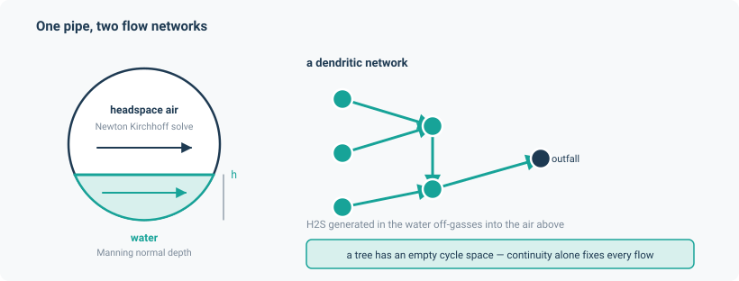

# Sewers

Gravity sewer networks, with the water, the air above it and the sulfide it carries coupled on one
network. Manholes are nodes and circular pipes are edges, draining as a tree to an outfall;
wastewater flows downhill under gravity, and the question the model answers is corrosion and
odour risk: how much H₂S is generated, and how much reaches the air where it attacks the crown
of the pipe.

Three physical subsystems share the network, each conserving its own quantity at every manhole —
water volume, headspace air, and BOD and sulfide mass — and each uses a different part of the
framework:

- **Water hydraulics** — partially full circular pipes under gravity. Under kinematic-wave
  routing, Manning's equation on a dendritic network: the cycle space is empty, so continuity
  alone fixes every discharge in closed form, with no potential solve at all. Under
  dynamic-wave routing, SWMM's momentum equation as a potential layer on head (see
  [Dynamic wave](#dynamic-wave)), which admits backwater, flat conduits and loops.
- **Headspace air** — the air above the water surface is its own flow network, a full
  `PotentialFlowLayer` driven by wall friction, the drag of the moving water surface, and
  buoyancy from the sewer-to-ambient temperature difference, vented through manhole leaks and
  optional fans.
- **Water quality** — BOD decay and Pomeroy–Parkhurst sulfide generation in the wastewater, with
  two-film Henry's-law transfer of H₂S into the headspace air, as two coupled transport layers.

**Units.** Water and headspace air flow m³/s, depth and head m, pressure Pa, concentrations
kg/m³ (with helpers to mg/L and ppm), sulfide transfer kg S/s.

```python
from noodl.apps.sewer import (
    SewerNetwork, Manhole, Pipe, Outfall, tree_steady,
    build_model, sewer_steady, initial_state,
    pipe_table, to_ppm, to_mg_per_litre,
)
```



Every type this application offers — what it does and how to call it — is listed in its [catalogue](../catalogue/sewer.md). It is set up and run like every other model; see [Using noodl](../usage.md).

## A worked example

```python
from noodl.apps.sewer import build_model, sewer_steady, pipe_table, tree_steady

model, state, drivers = build_model(tree_steady())
final = sewer_steady(model, state, drivers)
rows = pipe_table(model, final, drivers, path="pipes.csv")

# rows[0] is pipe "C1": q = 0.05 m3/s, h = 0.153007001 m
```

*(From `tests/apps/sewer/test_report.py`.)* `tree_steady()` is the committed 5-conduit, 6-node
fixture; its steady discharges are 0.05, 0.08, 0.03, 0.13 and 0.16 m³/s.

Start from a different state by naming it — here, sulfide already present in manhole
`J1` — and read the result by manhole and species:

```python
from noodl.apps.sewer import initial_state

wq = model.refs.water_quality                  # species ("bod", "sulfide"), kg/m3
start = initial_state(model, drivers=drivers, values={wq.concentration: {"J1": {"sulfide": 1e-3}}})
model.check(start, drivers).raise_for_errors(strict=True)
after = model.step(start, drivers, 60.0)
print(sorted(wq.concentration.named(after[wq.concentration])))
```

```text
['J1', 'J2', 'J3', 'J4', 'J5']
```

The sewer's `initial_state` takes the drivers as well (`drivers=`), because the storage it starts from
depends on the inflows. In the dictionaries the concentrations are
`"water_quality.x"` and `"air_quality.x"` (manhole order, species last); see
[Using noodl](../usage.md).

A model can also be read from a SWMM `.inp` file (see [File formats](../formats/swmm.md)):

```python
from noodl.apps.sewer import read_swmm_inp, build_model

net, inflows, pollutants = read_swmm_inp("tree_steady.inp")
model, state, drivers = build_model(net)
```

For a single step rather than a steady state:

```python
new = model.step(state, drivers, 60.0)
residuals = model.residuals(new, drivers)     # per-layer nodal balance
```

## Building a network

| Object | Fields |
|---|---|
| `Manhole(name, invert, ground=None, inflow=0.0, surface_area=None, surcharge_depth=0.0, initial_depth=0.0, storage=None)` | A junction. `surface_area` defaults to SWMM's `MIN_SURFAREA`, 1.167 m² — a 4 ft shaft. `surcharge_depth`, `initial_depth` and `storage` are dynamic-wave physics (see "Dynamic wave"). |
| `storage_unit(name, invert, max_depth, curve, *, surcharge_depth=0.0, initial_depth=0.0, inflow=0.0)` | A SWMM storage unit: a `Manhole` whose `storage` is the surface-area `curve` (`("functional", a, b, c)` for `A = a y^b + c`, `("tabular", depths, areas)`, or `("cylindrical", L, W)`, `("conical", L, W, Z)`, `("paraboloid", L, W, H)`, `("pyramidal", L, W, Z)`; m and m²) and whose ground is `invert + max_depth`. Dynamic wave only. |
| `Pipe(name, u, v, length, diameter, n, slope, inlet_offset=0.0, outlet_offset=0.0)` | A circular gravity conduit; offsets (m) are the invert heights above the end nodes' inverts. |
| `Outfall(name, invert, kind="free", stage=None, flap_gate=False, tide=None, series=None)` | The root of a tree. `kind` is `"free"`, `"normal"`, `"fixed"` (`stage`, m, required), `"tidal"` (`tide`, a SWMM TIDAL curve as `(hour, stage m)` pairs, required) or `"timeseries"` (its stage comes from the `outfall_stage` driver; `series` is the SWMM series' name, for messages); only dynamic-wave routing reads them. |
| `Orifice(name, u, v, orientation, shape, height, crest_height, discharge_coefficient, width=None, flap_gate=False)` | A SWMM orifice from `u` to `v`: `orientation` `"side"` or `"bottom"`, `shape` `"circular"` (`height` its diameter, m) or `"rectangular"` (`height`, `width`, m), its crest `crest_height` m above `u`'s invert, Cd (-). Dynamic wave only. |
| `Weir(name, u, v, kind, height, width, crest_height, discharge_coefficient, side_slopes=(0, 0), end_contractions=0, end_discharge_coefficient=0, can_surcharge=True, flap_gate=False)` | A SWMM weir: `kind` `"transverse"`, `"sideflow"` (opening `width` m long), `"v_notch"` (`width` the top width) or `"trapezoidal"` (`width` the bottom width, `side_slopes` horizontal per vertical); Cd in SWMM's SI units (m^0.5/s). Dynamic wave only. |
| `Outlet(name, u, v, crest_height, rating, head_difference=False, flap_gate=False)` | A SWMM outlet: `rating` `("functional", a, b)` for `q = a h^b` or `("tabular", heads, flows)` (m, m³/s); `h` the depth above the crest, or the head across it with `head_difference`. Dynamic wave only. |
| `SewerNetwork(manholes, pipes, outfalls, routing="kinematic_wave", notes={}, dynamic_wave=DynamicWaveOptions(), orifices=(), weirs=(), outlets=())` | The whole network. `routing` is `"steady"`, `"kinematic_wave"` or `"dynamic_wave"`; SWMM's `STEADY`/`KINWAVE`/`DYNWAVE` are accepted and normalised. |

`validate()` refuses, by name: duplicate node or pipe names; a pipe naming an unknown node;
non-positive slope, diameter, length or roughness; **a manhole with anything other than exactly
one outgoing pipe**; an outfall with an outgoing pipe; and a manhole whose component never
reaches an outfall — which also catches cycles. With `routing="dynamic_wave"` these tree
rules are replaced: loops and flat pipes are allowed, every connected component needs an
outfall, and each outfall ends exactly one link (a conduit or a regulator). Orifices, weirs
and outlets are refused by name for the other routings, and malformed ones (an unknown
node, a duplicate link name, a bad shape, a negative crest or coefficient, an unsorted
rating) for every routing.

That one-outgoing-pipe rule is the dendritic constraint, and it is what makes the closed-form
flow solve valid.

## `build_model`

```py
model, state, drivers = build_model(
    net,
    storage=False,          # implicit-Euler manhole storage sweep
    air=True,               # the headspace layer
    quality=True,           # the two quality layers
    species=("bod", "sulfide"),
    f_air=0.02, f_i=7.49e-4, c_s=1.0,
    leak_area=8e-4, leak_cd=0.6, fans=(),
    coupling="pingpong", scheme="implicit", dt_storage=None,
)
```

`air=False` gives the water-only model the SWMM parity rows use. `fans` names manholes carrying
a prescribed extraction (m³/s, positive out).

`build_model` dispatches on `net.routing`. A `"dynamic_wave"` network is built by
`build_dynamic_wave_model`, with `iterate_tol` (m), `iterate_flow_tol` (m³/s) and
`iterate_max` (passes) controlling the iteration; left out, they follow the file's
`HEAD_TOLERANCE` and `MAX_TRIALS` (see [Iteration and convergence](#iteration-and-convergence)).
For it, `air`, `quality`
and `storage` default to `False`; `quality=True` adds the water-quality layer of `species`
(see [Quality on the dynamic wave](#quality-on-the-dynamic-wave)); `air=True` builds the
headspace air on the solved conduits (see
[Headspace air on the dynamic wave](#headspace-air-on-the-dynamic-wave)) and takes `f_air`,
`f_i`, `c_s`, `leak_area`, `leak_cd` and `fans` as above; `storage=True`, a non-default
`coupling` or `dt_storage` (kinematic-wave options: the dynamic wave always iterates its passes
on its routing step) and a `geometry="analytic"` network (it always routes on SWMM's tabulated
circle) are refused, naming the option; `iterate_tol`, `iterate_flow_tol` and
`iterate_max` are refused for the other routings. Run it with `simulate_dynamic_wave` (see
[Dynamic wave](#dynamic-wave)), not `sewer_steady`. To tune the iteration itself
(`relaxation`, `acceleration`, `memory`), call
`build_dynamic_wave_model(net, ...)` from `noodl.apps.sewer` directly; it takes the same
dynamic-wave arguments as `build_model`.

`dt_storage` (optional) declares the interval the manhole storage sweep integrates over. When given,
a step at any other interval is refused by name. Omit it (the default) to follow the model's own
step interval via the `StepContext` the closure receives.

`initial_state(model, drivers=None)` builds the all-zero state, dispatching on each layer's
quantity. When `drivers` is given, it also evaluates the initial storage (by querying
`model.initial_capacities`), which a step with a changing capacity requires to be in the step-start
state. Drivers are required for initial_state whenever the model has a quality layer, because the
hydraulics closure writes those layers' capacity from the flows and the initial storage must be
evaluated from the drivers; this holds with or without `storage=True`.

`sewer_steady(model, state, drivers, *, reaction=None, dt=60.0, max_iter=500, tol=1e-12)` steps
repeatedly until every transport layer stops changing. You need it rather than `Model.steady`
whenever quality is on, because `Model.steady` never applies reactions.

`model._apply_closures(state, drivers)` resolves the hydraulics without stepping any layer,
which is the quickest way to inspect `sewer.q`, `sewer.h`, `sewer.v` and the rest.

## The physics

### Exact circular geometry

With the wetted half-angle $\theta = 2\arccos(1 - 2h/D)$:

$$
A = \frac{D^2(\theta - \sin\theta)}{8},\quad
P = \frac{D\theta}{2},\quad
R = \frac{A}{P} = \frac{D}{4}\left(1 - \frac{\sin\theta}{\theta}\right),\quad
T = D\sin\frac{\theta}{2}
$$

These exact relations are the default for networks built in code (`SewerNetwork(...,
geometry="analytic")`).

### SWMM's own circular geometry

SWMM 5 does not evaluate the circle. For a `CIRCULAR` conduit it interpolates 51-point tables
(`A/Afull`, `Y/Yfull` and the section factor `S/Sfull`, from `xsect.dat`) and near the invert
switches to closed forms solved by Newton iterations with their own starting guesses and stopping
rule (`xsect.c`). The tables differ from the true circle by up to ~5e-3 in depth, and by far more
in velocity near the invert. `geometry="tabulated"` (module `noodl.apps.sewer.xsect_tables`) reproduces
all of it, operation for operation, and is what `read_swmm_inp` uses by default, because a
network read from a SWMM file is read to reproduce SWMM (`read_swmm_inp(path,
geometry="analytic")` gives the exact circle).

At a kinematic-wave steady state SWMM gives a conduit carrying $q$ an inlet area
$a_1 = A(S = q/\beta)$ (inverse section-factor lookup) and an outlet area $a_2$ solving
$\beta\,S(a_2) = q$. It reports depth $\tfrac12(Y(a_1) + Y(a_2))$, volume
$\tfrac12(a_1 + a_2)L$, and velocity $q / A(\text{depth})$, which is zero at a depth of 0.01 ft
or less. $a_1 = a_2$ on the tables. Near the invert the two Newton solves differ slightly, and
both are carried. SWMM's units are reproduced too: it computes in feet with Manning's 1.486, but
converts CMS flows and volumes with 0.02832 m³/ft³ rather than $0.3048^3$. That is an effective
1.6e-4 on the Manning coefficient and 1.2e-4 on reported volumes. Everything is differentiable:
piecewise-linear tables, unrolled Newton loops, and one implicit-function root.

Scope: on the kinematic path `geometry="tabulated"` covers the steady case only, and is refused
by name with `storage=True`. Dynamic-wave routing always uses the tables and refuses
`geometry="analytic"` by name. The discharge limit is SWMM's `Qfull` rather than the analytic 0.938 D capacity.
The headspace, top width, hydraulic radius and mean depth (air side, sulfide) remain the exact
circle, evaluated at SWMM's depth. SWMM has no headspace to compare them with.

Numerical care worth noting: the `arccos` argument is clamped to the *exact* domain $[-1, 1]$,
not an epsilon-shrunk one — that was tried and rejected because it shifts the boundary value by
$O(\sqrt{\varepsilon})$. Every $0/0$ site is guarded on **both** branches of its `torch.where`,
so a masked-out branch cannot back-propagate `inf * 0 = nan`.

### Manning and normal depth

$Q = \frac{1}{n} A R^{2/3} \sqrt{S_0}$, with the SI constant 1.0. $Q$ is strictly increasing in
$h$ up to $h/D = 0.938$ and decreases above it, so the ascending branch is the entire invertible
domain. `normal_depth` inverts it with `solve_monotone`, batched over pipes and instances.

`q = 0` returns exactly `h = 0` with gradient 0 — a documented modelling choice, since the true
$dh/dq$ diverges there. A discharge above `capacity_flow` is **refused by name**: surcharge and
backwater are out of scope.

### The storage sweep

With `storage=True`, each manhole's water level is advanced by implicit Euler:

$$
A_s \frac{H^{n+1} - H^{n}}{\Delta t} + Q_{\text{out}}(H^{n+1}) = \sum Q_{\text{up}} + \text{lateral}
$$

solved with `solve_monotone` bracketed on $[0, 0.938D]$, valid because both left-hand terms are
strictly increasing in $H^{n+1}$. The sweep runs level-synchronously from leaves to outfall using
topological levels computed once; the only Python loop is over tree *levels* (depth 3 on the
committed fixture), never over individual pipes. Each level is one gather and one scatter.

When `storage=True` the normal-depth inversion is skipped entirely — the sweep has already solved
each manhole's own level, which *is* its outgoing pipe's entrance depth, bit-for-bit and with no
root-find.

### Dynamic wave

With `routing="dynamic_wave"` (SWMM's `DYNWAVE`) the network is a potential layer on **head**.
Where a conduit's flow follows from continuity alone, as on a dendritic kinematic-wave
network, nothing else is needed; where backwater, a flat conduit or a loop makes the flow depend
on the heads at both ends, the heads are the unknowns and the flows follow from the head
differences. The water side then has one `PotentialFlowLayer` named `"water"` (quantity `head`
in m, flow in m³/s) over the conduits, with the outfalls as its boundary, and a
`JunctionStorage` node source at every junction.

The rest of this section follows the physics in the order it enters the solve: the
[equations](#equations) and how they are [solved](#what-is-solved) (iteration, Anderson
acceleration and the flow tolerance it needs); the three places where SWMM's own iteration has
no fixed point and noodl takes a documented tie rule (the [crown hold band](#surcharge-slot-and-extran) of EXTRAN, the
[normal-flow slope switch](#normal-flow-slope-switch) and the [drop-end area switch](#drop-end-area-switch));
the [starting state](#starting-state-and-zero-fall); [surcharge](#surcharge-slot-and-extran), [flooding](#flooding),
[storage units](#storage-units), [orifices, weirs and outlets](#orifices-weirs-and-outlets) and
the [conduit options](#conduit-options); the [variable step and time-varying inflow](#variable-step-and-time-varying-inflow),
[tidal and time-series outfalls](#tidal-and-time-series-outfalls); [water quality](#quality-on-the-dynamic-wave) and
[headspace air](#headspace-air-on-the-dynamic-wave); and last the
[intentional differences from SWMM](#intentional-differences-from-swmm). What is not supported is
listed once, under [Limitations](#limitations).

#### Equations

SWMM 5.2.4's conduit and junction updates (`dwflow.c`, `dynwave.c`) are solved at their fixed
point rather than replayed trial by trial. For one barrel of conduit length $L$ (m) between
heads $h_1$ and $h_2$ (m), after a step $\Delta t$ (s):

$$
q = \frac{q_{\text{old}} + \Delta q_3 + \Delta q_4}{1 + \Delta q_1}
  + \frac{g\,\Delta t\,A_w}{L\,(1 + \Delta q_1)}\,(h_1 - h_2)
$$

where $q_{\text{old}}$ is the flow at the step start (m³/s), $\Delta q_1$ the friction and
$\Delta q_3$, $\Delta q_4$ the convective and area-change momentum terms, and $A_w$ the
weighted flow area (m²) that SWMM forms from the end and mid-conduit areas. The coefficients
are evaluated at the converged depths and flow. SWMM's two post-conditions are applied
afterwards: the normal-flow limit (`NORMAL_FLOW_LIMITED`, `SLOPE`/`FROUDE`/`BOTH`/`NO`), and the
dry-node clamps, which zero a flow that would draw from a junction with no water. At a junction
that is not an outfall, with surface area $A_s$ (m², the sum of the surface areas of the
conduits meeting there, plus a storage unit's own area, floored at `MIN_SURFAREA`) and depth
$y$ (m):

$$
A_s\,(y - y_{\text{old}}) = \tfrac12\,\Delta t\,(N_{\text{old}} + N)
$$

with $N$ the net inflow (m³/s: lateral inflow plus the conduit flows into the junction).
Outfalls are boundary heads: `FREE` takes the lesser of normal and critical depth in the
outfall conduit, `NORMAL` its normal depth, `FIXED` the stage with SWMM's stage logic, each
from the flow in that conduit. `TIDAL` and `TIMESERIES` outfalls use the same stage logic with
a stage that varies in time (see "Tidal and time-series outfalls").

#### What is solved

For frozen coefficients the conduit and junction equations are linear in the heads apart from
the min-clamps, so one pass is a single `PotentialFlowLayer` solve. The model then refreshes the
coefficients and repeats until the heads change by less than `iterate_tol` (m) and the flows
by less than `iterate_flow_tol` (m³/s), or `iterate_max` passes are used
(`Model(coupling="iterate")`, converging on the layer's own interior head; the defaults follow
the file, see [Iteration and convergence](#iteration-and-convergence)). The result is the head
and flow field at which a SWMM trial reproduces its own input.

The passes are Anderson-accelerated by default (`noodl.apps.sewer.build_dynamic_wave_model(net,
acceleration="anderson", memory=5)`; `Model`'s `iterate_acceleration`,
see [Layers and models](../concepts/layers.md)). Each pass's flows must then also reproduce the
flows it was fed to within `iterate_flow_tol` (m³/s): the head solve stops on its warm start once
every junction balance is within its `atol` (`solve_atol`), so near convergence the heads stand
still while the flows of a flat or nearly dry conduit still drift. Against plain relaxation judged on the heads alone the
mean passes per step fall from 34.8 to 14.1 (tree), 30.2 to 10.4 (backwater line) and 20.8 to 9.7
(loop) over the first 60 steps, and from 42.8 to 11.3 over the loop's first 120, whose worst step
drops from 327 passes to 22. The two iterations land on the same fixed point: with a tight head
solve (`atol=1e-12`) they agree to 2e-12 m; at the default `solve_atol` each lands within the head
solve's own resolution, `atol dt / (2 A_s)` (a few 1e-9 m). The mixing keeps to the fixed points
plain relaxation (and SWMM's relaxed trials) can reach: a flat, near-dry conduit's flow can have
a second, repelling fixed point, and a mixed step heading for it is replaced by the relaxed step.
`acceleration=None` is plain relaxation. The flows are judged either way, never the heads
alone, because on the normal-flow slope switch (below) the heads bound the flows' residual only
weakly, and a heads-only test was measured stopping 3e-5 m³/s short of the fixed point.

**SWMM's iteration artefacts are not modelled**: trial relaxation, the 0.001 cfs flow-reversal
rule and link bypassing. Each is a device for reaching the fixed point and none moves it.

#### Iteration and convergence

`HEAD_TOLERANCE` and `MAX_TRIALS` are read into `DynamicWaveOptions` and are the defaults of
the iteration (`noodl.apps.sewer.dynwave.iterate_tolerances`); an explicit `iterate_tol`,
`iterate_flow_tol` or `iterate_max` overrides each:

| control | default | SWMM |
|---|---|---|
| `iterate_tol` (m) | `HEAD_TOLERANCE` (the file's length unit), else 0.005 ft = 0.001524 m | the same test: every node's depth change between trials (`dynwave.c::findNodeDepths`) |
| `iterate_flow_tol` (m³/s) | $2 A_{\min} \epsilon_H / \Delta t$ ($\epsilon_H$ = `iterate_tol`), at least 1e-10 | none: SWMM judges the heads alone |
| `iterate_max` (passes) | `MAX_TRIALS`, else 8 (at least 2) | the same limit |

The flow tolerance is the flow residual that matches the head tolerance: a flow error $dQ$
moves a junction's next depth by $\Delta t\, dQ / (2 A_s)$ (the trapezoid), so at the
surface-area floor $A_{\min}$ (`MIN_SURFAREA`, 12.566 ft² by default) and the routing step
$\Delta t$ it is a move of exactly `iterate_tol`, and less at every larger junction. At SWMM's
defaults on a 5 s step that is 7.1e-4 m³/s.

A step that uses up the file's trials is **accepted**, as SWMM accepts it (it counts it as "not
converging", `NonConvergeCount`): the step is taken with its last pass, its diagnostics say
`converged` False, and `simulate_dynamic_wave` returns `out["converged"]` per step, so
`(~out["converged"]).sum()` is SWMM's count. With an explicit `iterate_max` such a step is
refused by name, as before, and a step that has to be differentiated is always refused when it
does not converge (there is no fixed point to differentiate).

Measured at SWMM's defaults (the fixtures with `HEAD_TOLERANCE` and `MAX_TRIALS` removed, 30
min), against SWMM 5.2.4's own 2.02 trials per step on the tree:

| network | passes per step | steps at the limit | worst depth against the tight fixed point (m) | SWMM at its defaults, same measure (m) |
|---|---|---|---|---|
| tree | 2.06 | 1 / 360 | 1.6e-3 | 2.3e-3 |
| backwater | 2.22 | 1 / 360 | 6.9e-3 | 1.3e-2 |
| loop | 2.01 | 0 / 360 | 7.0e-4 | 3.6e-3 |
| structures | 2.39 | 0 / 360 | 4.4e-4 | 5.9e-3 |
| storage | 2.06 | 1 / 360 | 1.0e-3 | 2.3e-3 |

So noodl at SWMM's tolerances is at least as close to the converged answer as SWMM is, in about
SWMM's number of trials. A judgement on the flows at 1e-4 m³/s instead takes 2.54 passes on the
tree for a 7.8e-5 m answer; the parity tests pass their own tight tolerances (1e-13 m, 2000
passes) and the fixtures set `HEAD_TOLERANCE` 1e-12 and `MAX_TRIALS` 500.

**Speed.** One pass costs a nearly fixed few thousand small tensor operations, whatever the
network's size: 10-15 ms on the 6-node tree, from 37 ms, and 38 ms on a 2,047-conduit tree,
from 55 ms (`benchmarks/sewer_dynwave_speed.py`, which also times SWMM). With SWMM's own
tolerances the tree's 30 minutes take 11.5 s (123 s before), about 850 times SWMM; the
2,047-conduit tree is about 40 times SWMM. Most of it is the conduit update (`dynwave_terms.conduit_terms`), SWMM's
normal and critical depths, and the head solve, whose Newton Jacobian is the elements' own
analytic `dflow` on the primal passes (`PotentialFlowLayer(analytic_primal=True)`; the implicit
adjoint still differentiates the converged pass). A batch of B scenarios (`simulate_dynamic_wave`
with a `(B, n)` inflow) costs about the same per pass, so an ensemble amortises it.

#### Units

SWMM computes in feet with $g = 32.2$ ft/s² and Manning's 1.486, and the conduit coefficients
here are evaluated exactly that way (reusing `xsect_tables.LCF`, `QCF`, `PHI`). Outputs are
converted with SWMM's own factors: head in m is ft × `LCF`, flow in m³/s is cfs × `QCF`,
conveyance in m²/s is ft²/s × `QCF/LCF`, and an area in m² is ft² × `QCF/LCF`, which is the
area `kinwave_steady` reports and makes $A_s\,\Delta y = \tfrac12\Delta t\,N$ exact in m and
m³/s.

#### Bed stiffening and lagged pieces

SWMM clamps a junction depth at 0 after the update. `JunctionStorage` stands in for that with a
stiff bed term, $K_{\text{bed}} = 10^{6}$ times the storage slope applied to
$\min(H - z_{\text{bed}}, 0)$, built on `MIN_SURFAREA` rather than on the pass's $A_s$. The
slope of a junction's balance is therefore positive everywhere, so each junction is grounded
by itself and the Jacobian stays symmetric positive definite. The default Newton tolerance
`solve_atol` (m³/s) is scaled per model to the round-off floor of that term (about
2.5e-9 m³/s, or about 5e-9 m of head, on the committed fixtures; it grows with invert
elevation).

Some quantities are taken from the previous pass, as SWMM takes them from the previous trial,
and are consistent at the fixed point: the flow class and the weighting $f_{\text{asnh}}$, the
surface areas $A_s$, the normal-flow-limit flag (its Froude test uses the momentum flow at the
fed heads; its slope test is applied within the pass where it can be, see the next section),
the normal flow, the dry-node flags, the outfall heads (the surface areas' jump at a drop
end is applied within the pass where it can have no fixed point, see "Drop-end area
switch"), and the head at any
conduit end SWMM pins (the head is raised to the invert plus offset when it lies below it, and
set to critical depth in `UP_CRITICAL`/`DN_CRITICAL`). A conduit with a pinned end has no head
dependence there: its conveyance is zero and the pinned head enters the constant term.

#### Normal-flow slope switch

SWMM limits a conduit's flow to the normal flow $q_{\text{norm}}$ at its upstream depth when its
slope test $y_1 < y_2$ passes (`dwflow.c:637-686`; always on for a conduit at an outfall, and
under `NORMAL_FLOW_LIMITED SLOPE` or `BOTH`). With both end depths inside their clamps that
test is $h_1 - h_2 < z_1 - z_2$ (the conduit-end inverts), a switch on the conduit's own head
difference, so `DynamicWaveConduit` applies it within the head solve instead of from the
previous pass:

$$
q = \min\!\big(q_{\text{lin}},\ \max(q_{\text{norm}},\ q_{\text{last}} + S\,(h_1 - h_2 - z_1 + z_2))\big)
$$

with $q_{\text{lin}}$ the momentum flow above, $q_{\text{last}}$ the previous pass's flow and
$S$ (m²/s) a wall slope. At a fixed point ($q = q_{\text{last}}$) this is SWMM's unlimited flow
above the switch and its limited flow below it, so every SWMM fixed point is unchanged. It has
one more kind of fixed point: on the switching surface $y_1 = y_2$, with the flow between
$q_{\text{norm}}$ and $q_{\text{lin}}$. That is the tie rule for the case where SWMM has no
fixed point, which a draining network reaches at its outfall conduit. A `FREE` or `NORMAL`
outfall's depth is set from its conduit's flow, and the limited flow is Manning's normal flow
at the upstream depth $y_1$, at which the outfall's normal depth is $y_1$ again, up to the
interpolation mismatch of SWMM's tables (about 1e-5 m). Once the junction upstream has fallen
to the outfall's depth, the limited side is consistent only where that mismatch happens to
put the outfall above the junction, and the unlimited side's larger flow raises the outfall
above it. SWMM's trials then alternate around the surface: on the tree fixture with every
inflow ramped down, SWMM 5.2.4 at `HEAD_TOLERANCE 1e-12` m and 500 trials fails to converge on
82 of the 108 steps after the junction meets the outfall depth, its last trial within about
6e-4 m of the surface on either side. A flag lagged by one pass chattered there until the pass
budget ran out. noodl converges on every step: on SWMM's fixed point where one exists (it
found the limited ones the lagged flag missed), and exactly on the surface where none does.
The cost against SWMM is confined to those steps, and it is bounded by SWMM's own oscillation,
since SWMM has no converged answer there; from SWMM's first such step on its history is that
of an unconverged trial, so later steps differ by that much too (asserted to 1e-3 m and
5e-4 m³/s in `test_ramp_down_matches_swmm_until_swmm_stops_converging`; before that step the
targets hold, 7e-10 m).

The wall slope does not move a fixed point; it shapes the passes. Where the outfall depth
follows the conduit's flow, $S = 1/(c + 1/S_{\max})$ with $c$ the outfall depth's rise per
unit flow, so the head solve sees the switching surface move with the flow as it does at the
fixed point. $S_{\max}$ is the smaller end junction's grounding (storage slope $2A_s/\Delta t$
plus its conduits' conveyance; `K_SWITCH` = 1). A steeper wall would turn the flow into an
S-curve in the head that the damped Newton head solve cycles on. The Froude test
($\mathrm{Fr} \ge 1$ on the momentum flow) and a slope test at a clamped end depth stay
lagged flags.

#### Drop-end area switch

A conduit end with an offset gives its junction no surface area while that end is
`DN_CRITICAL` (downstream, end depth below $\min(y_N, y_C)$ on forward flow) or `UP_CRITICAL`
(upstream, on reverse flow), and none while the end is dry below a wet other end. Above that
lower threshold the end gives the junction a quarter of the conduit, scaled downstream by
$f_{\text{asnh}}$, which falls from 1 to 0 up to $\max(y_N, y_C)$ and jumps back to 1 there
(`dwflow.c:357-411, 472-499`). The lower threshold is $\max(\mathrm{FUDGE}, \min(y_N, y_C))$
where the flow leaves the conduit at that end, and FUDGE elsewhere. So the junction's area
jumps up with its own depth at both thresholds. While the junction **fills**, its storage
equation $A_s (H - H_{\text{start}}) = \tfrac12 \Delta t (N_{\text{start}} + N)$ can then
land above the threshold with the lower area and below it with the upper one: there is no
fixed point. SWMM 5.2.4 does not converge on such steps (its trials cycle around the
threshold), and an area lagged by one pass chattered until the pass budget ran out, or until
the head solve failed when the class also moved the other end's area. While the junction
drains the jump runs the other way, a solution always exists, and the lagged area settles as
SWMM's does.

`DynamicWaveHydraulics` finds, for each junction, the threshold of its attached drop ends
nearest its head, and where it lies above the step-start head gives `JunctionStorage` the
storage lines with the area just below ($A_{\text{lo}}$) and just above ($A_{\text{hi}}$) it.
The junction then withdraws, within the head solve,

$$
w = \max\!\big(w_{\text{lo}}(H),\ \min(w_{\text{hi}}(H),\ N_{\text{last}} + S\,(H - H^*))\big)
$$

with $N_{\text{last}}$ the previous pass's net inflow and $S$ a wall slope (`K_SWITCH` times
the junction's grounding above the threshold). At a fixed point ($w = N = N_{\text{last}}$)
this is SWMM's storage with the lower area below $H^*$ and with the upper area above it, so
every SWMM fixed point is unchanged; where neither side holds, the junction sits exactly on
the threshold, $H = H^*$, with its withdrawal inside the jump. That is the tie rule. A
junction held there (its fed net inflow inside the jump, at the fraction $\theta$ of it) has
the threshold's conduit end classified as SWMM classifies it at the threshold (SWMM's tests
are strict, so the upper side: not critical, wet, $f_{\text{asnh}} = 1$ at the upper
threshold), and, at the lower threshold, the conduit's other end gets the sliding area
$(2 - \theta)$ quarters of the conduit: half (the critical side's) at $\theta = 0$, a quarter
(the upper side's) at $\theta = 1$. Holding only the junction's own area was not enough: on
`options_dynwave.inp` with a 0.03 m outlet offset on C3, C3's class also moves J3's area,
J3's head moves C3's flow and with it the threshold, and the passes cycled.

On three variants of `options_dynwave.inp` (a 0.03 m or 0.1 m outlet offset on C3, or C6
without its flap gate) every step converges, with Anderson and with plain relaxation. In
noodl's own runs the rule holds a junction only on the steps where SWMM's run first fails
(0.03 m: 60 and 62; 0.1 m: 107; gate off: 106 and 129), nowhere else over the 359 steps.
SWMM also fails on step 167 of the 0.03 m variant; that step lies in SWMM's own history,
which differs from noodl's after step 60. Started from SWMM's state before it, noodl holds
J5 on its threshold there too (see "Dynamic wave against SWMM").

#### Starting state and zero fall

The start follows SWMM's `flowrout.c`. A cold, dry network: junction depth 0, each outfall at its
outfall depth for zero flow (the stage for `FIXED`, and its stage at t = 0 for `TIDAL` and
`TIMESERIES`), each conduit's depth the mean of its two
clamped end depths, and a previous net inflow of 0 at the first step. Initial conditions change
that exactly as SWMM does (`initNodeDepths`, `initLinkDepths`, `initNodes`):

- A conduit with an `InitFlow` (`Pipe.initial_flow`, m³/s, a total over its barrels, positive
  from the pipe's first node to its second) starts at the normal depth of one barrel's flow,
  capped at the depth of SWMM's `qMax`, and keeps that flow as its previous flow. The reader
  flips the sign of the `InitFlow` of a conduit it reverses, as SWMM does.
- A junction with an `InitDepth` (`Manhole.initial_depth`, m) starts there. One without it
  starts at the mean, over its attached conduits, of each conduit's initial depth plus that
  conduit's first-end offset (a conduit without `InitFlow` counts as depth 0 in the mean).
  An `InitDepth` above the full depth plus `SurDepth` is refused by name, as SWMM's own check.
- The outfalls start at the depth SWMM gives for their conduit's initial flow, a conduit
  without `InitFlow` at the mean of its end-node depths above its offsets, and each junction's
  previous net inflow is that of the initial flows through it (minus an outflowing `InitFlow`),
  so the first step's trapezoid sees them.

SWMM orients a conduit with exactly
zero fall by round-off under `DYNWAVE`, so noodl can legitimately differ on an exactly flat
conduit; the backwater fixture avoids an exact tie for that reason.

#### Scope

Circular conduits, SWMM's tabulated geometry; the fixed routing step or
SWMM's variable step (`VARIABLE_STEP > 0`, below); a cold start or SWMM's `InitDepth` and
`InitFlow` (above); constant or
driver-supplied lateral inflows; `FREE`, `NORMAL`, `FIXED`, `TIDAL` and `TIMESERIES` outfalls,
with flap gates;
parallel barrels, `MaxFlow`, conduit flap gates and conduit lengthening (below); storage
units with `FUNCTIONAL`, `TABULAR` and the closed-shape area curves (below); orifices
(side and bottom, circular and rectangular), transverse, sideflow, V-notch and trapezoidal
weirs, and outlets with a functional or tabular rating, with their flap gates (below);
`INERTIAL_DAMPING` `NONE`/`PARTIAL`/`FULL` and every `NORMAL_FLOW_LIMITED` option.
#### Surcharge: SLOT and EXTRAN

`SURCHARGE_METHOD SLOT` is SWMM's Preissmann slot: above `0.985257 y_full` the top width is the
Sjoberg slot width `0.5423 w_max exp(-(y/y_full)^2.4)` (`0.01 w_max` above `1.78 y_full`), the
area above the crown is `a_full + (y - y_full) w_slot`, the friction radius stays `r_full`, a
full conduit takes no inertial terms, and the reported link depth stays `min(y_mid, y_full)`
while the stored volume may exceed the full volume. The junction equation is unchanged (SWMM
never takes its node-surcharge branch under SLOT; the junction surface-area floor governs a
pressurised junction).

`SURCHARGE_METHOD EXTRAN` (the default) caps each conduit's end depths at its crown while the
end heads keep driving a full conduit, which takes no inertial terms. A junction whose depth
exceeds its crown -- the highest `offset + y_full` over the conduit ends it carries -- is
surcharged: SWMM's update `y_new = y_last + corr dQ/denom` (`dynwave.c:716-741`) is converged
exactly when the junction's net inflow `dQ` is zero, so a surcharged junction stores nothing
and holds instantaneous continuity (`corr` and SWMM's `exp(-15 f)` blend only shape SWMM's
iteration). The surcharge flag is evaluated from the previous pass's depth, as SWMM evaluates
it from its previous trial, and it drops when the solution falls below the crown. Where SWMM
has no fixed point -- the storage equation would end above the crown while at the crown the
junction already loses water, so SWMM's trials alternate between its two branches and do not
converge -- noodl holds the junction at its crown (within a band below a millimetre) and
releases the water the balance needs; every step then converges. `sewer.surcharged` reports
the junctions above their crowns (SWMM's test): a junction held at its crown by that rule
reports 1 without holding zero net inflow. A surcharged junction's head is resolved to
`atol / sum(k)` with `sum(k)` its conduits' conveyance (~0.01 m2/s for a 0.3 m pipe), so the
default head-solve tolerance (`solve_atol`, a few 1e-9 m3/s) leaves it a few 1e-7 m from the
fixed point; pass `atol=1e-12` to `simulate_dynamic_wave` for tighter heads where no junction
sits on its bed.

#### Flooding

Flooding follows SWMM without ponding (`ALLOW_PONDING NO`, `dynwave.c:743-795`). A junction's
full depth is its `MaxDepth`, raised to the top of every conduit end it carries (so a
`MaxDepth` of 0 means the crown, `link.c:440-463`), and it floods above
`y_max = full depth + SurDepth` (`Manhole.surcharge_depth`). A flooded junction is held at
`y_max`, and the water that cannot enter it leaves the system: `sewer.overflow` (m³/s per
junction, `record=("sewer.overflow",)` in `simulate_dynamic_wave`) is SWMM's flooding loss,
the step's trapezoidal net inflow `0.5 (N_start + N)`, set to 0 below SWMM's 1e-4 cfs. It does
not return to the network and is not part of the net inflow carried to the next step, as in
SWMM. In the head solve every junction's withdrawal is capped by a steep "wall" at `y_max`
offset by the previous pass's excess of net inflow over what the junction would otherwise
take there; at the fixed point that offset is the solved excess, so a flooded junction sits
exactly at `y_max` (not at a penalty's offset above it), and the excess falling to zero
releases it on the next pass, without a flag to chatter.

#### Storage units

A storage unit (`[STORAGE]`, `storage_unit`, `Manhole.storage`) follows SWMM's storage
node (`node.c`, `dynwave.c`). A unit is a junction whose surface area adds its curve's area
at the previous pass's depth (`node_getSurfArea`) to the attached conduit ends' (SWMM does
not zero a conduit's end area at a storage node, only a regulator's), so it enters the same
trapezoidal equation. Its area curve is `FUNCTIONAL` `A = a y^b + c`, `TABULAR` (linear
between the curve's points, linear from zero below the first, the last segment's slope,
floored at 0, beyond the last; `table_lookupEx`) or one of SWMM's closed shapes (cylinder,
cone frustum, paraboloid, pyramid frustum, each a quadratic in depth). Its volume, reported as
`"sewer.storage_volume"` (m³ per junction, 0 at a plain junction; `record=` in
`simulate_dynamic_wave`), is SWMM's `storage_getVolume`: the integral of the area (the
end-area method for `TABULAR`, as `table_getStorageVolume`), held at the full volume at and
above the full depth, so `SurDepth` stores nothing. SWMM's storage rules differ from a
junction's in three places:

- its full depth is extended to the attached conduit crowns only when it has a `SurDepth`
  (`link.c:450-458`), so a unit with no `SurDepth` floods at its own `MaxDepth`, below its
  crown if that is lower;
- under EXTRAN it surcharges only with a `SurDepth`, and then above its full depth rather
  than its crown (`dynwave.c:683-687`); the surcharged form, the hold band and the flood
  wall are those of a junction with the full depth as its crown;
- it keeps its own `InitDepth`, 0 included, instead of the average of its conduits
  (`flowrout.c:375`).

Evaporation (`Fevap`) and exfiltration are refused by name, so a unit loses no water but
through its links and its overflow.

#### Orifices, weirs and outlets

Orifices, weirs and outlets (`[ORIFICES]`, `[WEIRS]`, `[OUTLETS]`; `Orifice`, `Weir`,
`Outlet`) are flow regulators between two nodes, each an edge of its own kind (`"orifice"`,
`"weir"`, `"outlet"`) in the `"water"` layer, whose flows follow the pipes' in `"water.q"`
(`model.link_names`). Their flow is SWMM's `link_getInflow` (`link.c`, transcribed in
`noodl.apps.sewer.structures`, in feet as SWMM computes it): the orifice equation with its
weir regime below the opening's critical height and Villemonte's submergence factor there,
the four weir formulas with end contractions, Villemonte's factor and, above the opening,
the equivalent orifice (`CanSurcharge`) or a head capped at the opening, the outlet's rating
on the depth above the crest (`/DEPTH`) or the head across it (`/HEAD`), each closed (no
flow) below its crest, with no water upstream, or against a flap gate; gated orifices and
weirs take SWMM's ARMCO head loss. A regulator never reverses: flow from its second node to
its first takes the first node's crest, as in SWMM. Within a pass a regulator is the
element `StructureLink`, ``q = c0 + g (dp - dp_fed)``: ``c0`` is SWMM's flow at the previous
pass's heads, ``dp_fed`` that pass's head difference, ``g >= 0`` SWMM's `dqdh` (an outlet,
which has none, a central difference in its upstream head). At the fixed point ``dp =
dp_fed``, so the flow is SWMM's own whatever ``g``, which only makes each pass a Newton-like
step. SWMM's under-relaxation of these flows is iteration only and is not modelled.
A regulator also enters the junctions as SWMM's does:

- an orifice gives each end half its equivalent surface area (`dynwave.c:503-524`; a side
  orifice ``W(depth) L``, a bottom one its opening's area, ``L`` an equivalent length of at
  least 200 ft), none at its downstream end while DN_CRITICAL (or upstream, UP_CRITICAL) and
  none at a storage unit; weirs and outlets give none;
- its two ends raise both nodes' crowns (node 1 by the crest plus the opening height, node 2
  by the crest height as given plus the opening height; an outlet's opening is SWMM's DUMMY
  height of 1e-6 ft), and it extends its first node's full depth to that crown (a bottom
  orifice does not), as `link_validate` does; a crest below the downstream invert is raised
  to it at the first node only;
- an outfall at the end of a regulator takes normal and critical depth 0, then its `FREE`,
  `NORMAL` or `FIXED` rule with the regulator's crest height as its offset;
- a regulator starts dry and counts, with depth 0, in its nodes' initial average depth.

Roadway weirs, weir coefficient curves, pumps and dividers are refused by name, and so are
control rules (a regulator is always fully open).

#### Conduit options

Each of these is a SWMM `[CONDUITS]`, `[XSECTIONS]`, `[LOSSES]` or `[OUTFALLS]` entry
and a `Pipe` or `Outfall` field:

- **Barrels** (`Pipe.barrels`, `[XSECTIONS]` 7th field, 1 to 127). A conduit's `length`,
  `diameter`, `n` and slope are one barrel's. Its momentum update is one barrel's, and its
  flow, conveyance, surface areas and volume are totals (`n` times a barrel's, `dwflow.c:243,
  292`; `dynwave.c:575`), so `n` barrels at equal heads carry exactly `n` times one barrel's
  flow. The reported velocity is one barrel's.
- **`MaxFlow`** (`Pipe.max_flow`, m³/s, a limit on each barrel, `dwflow.c:270-273`) clamps the
  flow after the normal-flow limit.
- **Flap gates** (`[LOSSES]` flap gate YES for a conduit, `Gated` for an outfall,
  `link_setFlapGate`): flow against a conduit gate's direction is zeroed, and so is flow
  that would enter the conduit from a gated outfall. A conduit the reader reversed (adverse)
  keeps the direction of its file's From to To, `Pipe.flap_gate_reversed`.
- **Lengthening** (`LENGTHENING_STEP`, `DynamicWaveOptions.lengthening_step`, s):
  a conduit shorter than `(sqrt(g y_full) + v_full) t` is lengthened by the factor
  `lf = (sqrt(g y_full) + v_full) t / L`, `t` the smaller of `LENGTHENING_STEP` and the file's
  routing step, to `modLength = lf L` in the momentum terms and the surface areas, with its
  roughness divided by `sqrt(lf)` (the friction coefficient by `lf`), so its normal flow is
  unchanged and its volume keeps the true length. The variable step's Courant limit is scaled
  by `modLength / L`.

These limits apply in SWMM's order (`dwflow.c:255-281`): the normal-flow limit, `MaxFlow`,
the flap gate, then the dry-node caps (at `FUDGE` times the barrels). Each is a clamp of
the element's flow against a constant, so the flow stays continuous and non-decreasing in the
head difference, as the head solve's Newton step needs. A set `InitDepth`, `InitFlow`,
`MaxFlow`, flap gate or barrel count is refused by name under STEADY or KINWAVE routing.

The reader refuses by name, with the line number, `ALLOW_PONDING YES`, loss coefficients
and seepage in `[LOSSES]`, storage evaporation and exfiltration, roadway weirs, weir coefficient curves and regulators with `LINK_OFFSETS
ELEVATION` (see [SWMM `.inp`](../formats/swmm.md)).
`build_model` with `storage=True` is refused by name; `quality=True` builds
the water-quality layer on the solved flows (see
[Quality on the dynamic wave](#quality-on-the-dynamic-wave)) and `air=True` the headspace air
(see [Headspace air on the dynamic wave](#headspace-air-on-the-dynamic-wave)). Ponding
(`ALLOW_PONDING YES`) is refused; see [Limitations](#limitations).

```python
from noodl.apps.sewer import read_swmm_inp, build_model, simulate_dynamic_wave

net, _, _ = read_swmm_inp("tree_dynwave.inp")
model, state, drivers = build_model(net)
state, hist = simulate_dynamic_wave(model, state, drivers, steps=24)    # 24 x 5 s
print([round(float(q), 4) for q in hist["water.q"][-1]])                # m3/s, C1..C5
```

```text
[0.0184, 0.031, 0.0032, 0.0092, 0.0004]
```

`hist` holds `"water.phi"` (head at every node, m) and `"water.q"` (flow in every link,
m³/s: the conduits, then any orifices, weirs and outlets, as `model.link_names`), stacked
over steps, with `"t"` (s, the end time of each step) and `"dt"` (s, each
step's length). `simulate_dynamic_wave` also takes an `inflow=` override (`(n,)`
constant, `(B, n)` a batch, `(steps, B, n)` a series, or a function `inflow(t)` of the
start time `t` in s) and `record=` for other state keys and for `"sewer.overflow"` (m³/s
per junction).

#### Variable step and time-varying inflow

Give `duration=` (s) instead of `steps=` to run a stretch of simulated time. With
`VARIABLE_STEP > 0` (a `DynamicWaveOptions.variable_step`, the Courant factor, 0 to 2) every
step is chosen as SWMM does (`dynwave_getRoutingStep`): the first step is `MINIMUM_STEP`
(`minimum_step`, 0.5 s by default, capped at the routing step and floored at 1 ms), and
each later one is the smallest of

- the routing step;
- each conduit's Courant step, `V / |q| * Fr / (1 + Fr) * VARIABLE_STEP` with `V` the
  conduit's volume, `q` its flow and `Fr` its Froude number (a dry, still or full closed
  conduit, `Fr <= 0.01`, does not limit it);
- each junction's depth-change step, the time to rise a quarter of its crown depth at the
  rate it rose over the last step (a dry junction, one at or above its crown, and a quasi-steady
  one do not limit it);

floored at the minimum step and truncated to a millisecond. The reader takes an absent
`VARIABLE_STEP` as SWMM's 0.75 and lowers `ROUTING_STEP` to `WET_STEP` (default 300 s) when
larger, as SWMM does; `DynamicWaveOptions()` built in code defaults to the fixed step (0). The last step is cut to the time
that remains (at least 1 ms), so the run ends at `duration`; this clipping applies to a fixed
step too. One call is one run: under a variable step a second call restarts with the minimum step and
with `t` from 0, as a new SWMM run does (continuing needs the previous step's state, which
the call does not carry). A variable step needs a single network (no batched `inflow`), and `dt=` is refused
with it, since the step is then chosen by the options.

An inflow function `inflow(t)` returns the `(n,)` lateral inflow of the step that starts at
`t` s. SWMM reads a time series at the start of the step (its own clock is 1 ms ahead,
`swmm5.c`'s `getDateTime`: a function that stands for a SWMM `[TIMESERIES]` should add
0.001 s), and the inflow enters the step's trapezoid with the end state, as a constant
inflow does. A function (or an `(steps, B, n)` series) in `simulate_dynamic_wave` is how
time variation enters: the reader still refuses a `[TIMESERIES]` other than a `TIMESERIES`
outfall's, whose stage is a driver (below). The step sequence and every
state of the variable-step tree, with and without a ramping inflow, match SWMM 5.2.4 to the
millisecond and to the targets of the other dynamic-wave comparisons
(`tests/verification/test_sewer_dynwave_parity.py`). Because the step depends on the state
through switches, a variable-step run is not differentiable through its step sizes.

#### Tidal and time-series outfalls

A `TIDAL` outfall (`Outfall(kind="tidal", tide=...)`, the `.inp`'s `[CURVES]` TIDAL curve of
`(hour of day, stage elevation)` pairs) and a `TIMESERIES` outfall are `FIXED` outfalls whose
stage changes in time: noodl applies the same stage rule as for `FIXED` (the stage above the
conduit's critical-depth elevation sets the outfall depth, otherwise the critical or normal
depth) to the stage of the step's end, because SWMM sets the outfall depth with its routing
clock already advanced (`routing.c:301-302`, `node.c:1445-1456`). That is later than
the step start at which a lateral inflow is read. A tidal stage is `tidal_stage(tide, t)`: the
curve is read at its first hour plus the elapsed hours of the run (the start time of day is
not added), repeats every 24 h of elapsed time, holds its first stage below and its last
stage above the curve, and interpolates linearly (`table_lookup`).

A `TIMESERIES` outfall takes its stage elevation (m, relative to datum, not to the invert)
from a driver, as time variation belongs in the drivers. Give `outfall_stage={"Outfall":
stage}` to `build_model` (it sets the initial heads at t = 0 and becomes the model's default)
or to `simulate_dynamic_wave`: `stage` is a number, or a function of the elapsed time `t` in s
that is called once per step with the step's END time (no 1 ms offset, unlike the inflow
function). The two share one code path: `simulate_dynamic_wave` fills the per-outfall driver
`"outfall_stage"` (m) each step, from the tide curves and the functions, and the closure
reads it for every `TIDAL` and `TIMESERIES` outfall; a user stepping `Model.step` directly
supplies that driver. Both work under the fixed and the variable step. A `.inp` with a
`TIMESERIES` outfall is read (its `[TIMESERIES]` section may hold only the series that
outfalls name, and is not read: the driver is required, and `build_model` refuses a network
without one by name). `tests/verification/test_sewer_dynwave_parity.py` runs the tide fixture
`tidal_dynwave.inp` (a tide that backs the outfall conduit up to 0.38 m of its 0.45 m and
lets it fall) against SWMM 5.2.4 at every step for the `TIDAL` outfall and for the same stage
as a `TIMESERIES` outfall, and the variable-step tree with the tide, with SWMM converging on
every step: the worst depth difference is 8.4e-10 m.

#### Quality on the dynamic wave

`build_model(net, quality=True, species=...)` on a dynamic-wave network adds the transport
layer `"water_quality"` (kg/m³, one row per junction, the outfalls its boundary) on the
solved flows. Every edge kind of the `"water"` layer (conduits, orifices, weirs, outlets) is
one of its flow kinds, so it reads `"water.q"` and is upwind by the sign of each flow: a
conduit carrying its water against its own orientation (the loop's adverse conduit) carries
the tracer from its `v` end. An orifice, weir or outlet carries water between junctions but
holds none, as in SWMM, which gives a non-conduit link its upstream node's quality
(`qualrout.c:282-288`). The head iteration judges the layer too (`iterate_tol` 1e-12 kg/m³);
its concentrations follow the flows of each pass, which costs 1-5 % more passes.

Each species `s` enters with the lateral inflow at the concentration of the driver
`"<s>_in"` (kg/m³, one per node). `"bod"` decays and `"sulfide"` is generated
(Pomeroy–Parkhurst, see [Quality](#quality)); a species of any other name is a conservative
tracer. Sulfide needs `"bod"`, and it needs a single outgoing conduit at every junction,
whose hydraulic radius `sewer.R_h`, speed `sewer.v` and mean depth `sewer.d_m` (exact circle
at the link depth, one barrel) it reads. A loop, an adverse conduit or a junction drained
only by a regulator therefore refuses sulfide, naming the junctions; BOD and tracers need no
conduit and build on any network. In a conduit flowing full (`d_m = 0`, no free surface)
sulfide is still generated, without the loss term, and the loss term reads the speed $|v|$.

**Control volumes.** Each junction's capacity is the water its transport control volume
holds, carried as `"sewer.quality_volume"` (m³). It starts at half the summed wetted volume
of the attached conduits (`sewer.V_wet`, totals over barrels) plus a storage unit's own
volume, floored at 1e-9 m³; half of an outfall conduit belongs to no junction. From there it
follows the junction's continuity on the flows the transport sees,

$$
V_{\text{end}} = \max\big(V_{\text{start}} + \Delta t\,(N - Q_{\text{overflow}}),\ 10^{-9}\ \text{m}^3\big),
$$

with $N$ the junction's net inflow (its lateral inflow and every link's flow) and
$Q_{\text{overflow}}$ SWMM's flooding loss. The transport step's amount form,
$V_{\text{end}} x_{\text{end}} - V_{\text{start}} x_{\text{start}} = \Delta t\,F(x_{\text{end}})$,
then balances water as exactly as it balances mass, so water that starts and enters at one
concentration keeps it while the network fills and drains. Half-volumes alone do not: a
conduit filling from its upstream end gives its surface area, and so its water, to that
junction (`dwflow.c:357-411`), while the halves split it, and on the tree's filling a uniform
inflow concentration of 1 came out anywhere between 0 and 5. A flooded junction's overflow
leaves at the junction's concentration (`OverflowLoss`, applied before the transport step,
with the same water taken out of the control volume).

**Against SWMM's scheme.** A conduit's concentration is its upwind junction's. SWMM's
reactors are the conduits: each mixes its upstream node's concentration over its own volume,
with the inflow raised by the volume change so that the conduit's water balances
(`qualrout.c:315-341`). Its junctions hold no volume and mix the upstream links'
start-of-step concentrations (`qualrout.c:210`, a lag of one step each). At steady flow
both give every conduit the flow-weighted mixture of what enters upstream. In transit the
two differ by their residence times, by design: the tracer arrives shifted by the
difference of the chains' mean delays, $T_{\text{noodl}} - T_{\text{SWMM}}$ (on the tree
noodl's is the shorter: a junction's control volume holds roughly the upstream part of its
conduits, where SWMM's reactor is the whole conduit; see
[Dynamic wave against SWMM](#dynamic-wave-against-swmm)).

#### Intentional differences from SWMM

Everywhere else the dynamic wave reproduces SWMM's fixed point (the parity numbers are under
[Dynamic wave against SWMM](#dynamic-wave-against-swmm)). These differences are deliberate, and
each is confined to the cases named.

- **Tie rules where SWMM has no fixed point.** SWMM's trials alternate between two branches
  on these steps, so SWMM does not converge (it reports it) and has no answer to compare with.
  noodl converges on every step, and its answer lies on the switch between the branches:
    - the EXTRAN crown hold band: a junction whose storage equation would end above its crown
      while it loses water at the crown is held within a millimetre of the crown
      ([Surcharge](#surcharge-slot-and-extran));
    - the normal-flow slope switch: a draining outfall conduit sits on $y_1 = y_2$
      ([Normal-flow slope switch](#normal-flow-slope-switch)). Cost: 1e-5 m of SWMM's
      table mismatch at the switch, and steps after SWMM's first unconverged one differ by
      SWMM's own oscillation (about 6e-4 m on the tree);
    - the drop-end area switch: a junction filling through a drop end's area threshold is held on
      the threshold ([Drop-end area switch](#drop-end-area-switch)), with histories then
      differing by SWMM's oscillation (3e-4 m on the options fixture).

  At a gradient the tie rule is what is differentiated: the sensitivity of the constrained
  solution, where SWMM has no fixed point.
- **A surcharged junction drained only by outlets.** SWMM's surcharged update divides by
  the attached links' `dqdh`, which an outlet leaves 0, so above 1.25 crowns SWMM freezes the
  junction's depth and loses the inflow it cannot pass. noodl keeps instantaneous continuity: the
  outlet passes what arrives. Such a junction has no SWMM reference; drain an outlet from a
  storage unit, as SWMM's own examples do.
- **Water-quality transients.** noodl's reactors are the junctions' control volumes and SWMM's
  the conduits, so in transit the tracer arrives shifted by the difference of the mean delays;
  steady concentrations agree (see [Quality on the dynamic wave](#quality-on-the-dynamic-wave)).
- **Iteration artefacts.** Trial relaxation, link bypassing and the 0.001 cfs reversal rule are
  not modelled; `HEAD_TOLERANCE` and `MAX_TRIALS` are the iteration's defaults, with a flow
  tolerance SWMM does not have (see [Iteration and convergence](#iteration-and-convergence)).
  SWMM at its default tolerance is off its own fixed point by centimetres on a backwater.
- **Refused where SWMM accepts.** A `FUNCTIONAL` storage exponent below 0 (infinite area at zero
  depth), a negative storage `MaxDepth`, `InitDepth` or `SurDepth`, a nonzero pollutant
  `Cinit`, and the sections listed under [Limitations](#limitations).
- **One call is one run under a variable step.** A second call to `simulate_dynamic_wave`
  restarts the variable step as a new SWMM run does.

### Headspace air

`Headspace` is an `Element` with $\Delta p = R(h)\,\lvert Q \rvert Q$ and

$$
R(h) = \frac{f_{\text{air}} L \rho}{2 D_h A_{\text{air}}^2}
$$

inverted in closed form with a laminar blend near zero. The air-side wetted perimeter is
$P_{\text{air}} = \pi D - P(h) + T(h)$ — the dry wall plus the water surface acting as a moving
wall — and $D_h = 4A_{\text{air}}/P_{\text{air}}$.

`Drag` is a `Drive`: $D = \tfrac{1}{2} f_i \rho U_s \lvert U_s \rvert T L / A_{\text{air}}$ with
$U_s = c_s V_w$. The full branch law is $\Delta p = R\lvert Q\rvert Q - D - B$, where $B$ is the
**same `Stack` buoyancy drive the building application uses** — reused unchanged.

The drag sign convention is documented and was verified rather than assumed: the drive returns
$+D$ so that with both ends at ambient the air moves from the upstream manhole toward the
downstream one, the direction the wastewater drags it. The opposite sign was tried and caught by
the measurement.

#### Headspace air on the dynamic wave

`build_model(net, air=True)` on a `"dynamic_wave"` network reuses the kinematic path's air layer
unchanged (`Headspace`, `Drag`, `Stack`, the leaks and fans, built by the same `air_layer`) and
feeds it from the solved conduits. Each conduit's air geometry is read at its **link depth**
$y = \min(y_{\text{mid}}, y_{\text{full}})$ (SWMM's `Link.newDepth`, one barrel's) on the exact
circle (`air_geometry`), whatever `net.geometry` is: the tabulated section is the water side's,
and the air has no SWMM reference, as with the kinematic path at `geometry="tabulated"`.
With $n_b$ barrels the closure writes `sewer.A_air` (m², total, $n_b A_{\text{air}}$),
`sewer.D_h` (m, one barrel's), `sewer.T` (m, total free-surface width, so $T/A_{\text{air}}$,
which the drag reads, is one barrel's) and `sewer.V_air` (m³, total): $n_b$ parallel headspaces
have $1/n_b^2$ of one barrel's resistance. These four keys, with `sewer.R_h`, `sewer.d_m`,
`sewer.q`, `sewer.h`, `sewer.v` and `sewer.V_wet`, are the columns of `pipe_table` for every
dynamic-wave model, with or without the air.

A conduit flowing full has no headspace ($A_{\text{air}} = 0$, infinite resistance). The air
side reads the depth capped at 0.999 D, which leaves a finite area of about $6\times10^{-5}D^2$
and a resistance so large that the conduit is nearly closed, with finite derivatives on both
ends of the circle; a surcharged tree keeps solving. It is not closed: the interfacial drag does
not depend on the headspace's area, and still moves a small, nonzero flow of air through a capped
full conduit.

The closure also writes `rho_air_nodes` (from `T_head` and `T_amb`) and `air_quality.capacity`
(m³, per junction): the headspace volume of the junction's outgoing conduit plus the air of its
shaft above the water, $A_s(y_{\text{full}} - y_j)$ for a junction ($A_s$ the manhole's
`surface_area`, else 1.167 m²; $y_j$ the junction's depth) and the storage curve's volume
between the water and the full depth for a storage unit. As on the kinematic path the shaft term
needs `ground` on every manhole. With quality and sulfide the `air_quality` layer of H₂S and
`H2STransfer` are built and judged by the iteration beside the water quality (the air layer is
not built without sulfide, its only species).

The air side assumes every junction has exactly one outgoing conduit (its capacity, leak and
sulfide transfer are that conduit's). A loop, a junction with several outgoing conduits or none
(an adverse conduit, or one drained only by a regulator) and an outfall that is a conduit's
upstream end are refused by name with `air=True`.

### Quality

| Quantity | Form |
|---|---|
| Henry's constant | $H(T) = 1/(H_{cp}(T) R T)$, $H_{cp}(T) = H_{cp}(298.15)\exp\!\big(2100(1/T - 1/298.15)\big)$ |
| Free sulfide fraction | $f = 1/(1 + 10^{\,\mathrm{pH} - \mathrm{p}K_a})$ |
| Transfer coefficient | $K_L a = a(1 + b\,\mathrm{Fr}^2)(S_0 V)^{3/8} / d_m$ per hour |
| Two-film flux | $K_L a \, V \, \big(f C_S - C_G (M_S/M_{\mathrm{H_2S}}) / H\big)$ kg S/s |
| Sulfide generation | $d[S]/dt = M' \mathrm{EBOD} / R_h - m [S] (S_0 V)^{3/8} / d_m$ |
| BOD decay | $d[\mathrm{BOD}]/dt = -k_{\mathrm{BOD}} \cdot 1.07^{\,T-20} [\mathrm{BOD}]$ |

The gas concentration is converted to sulfur-equivalent before the Henry partition is applied, so
the flux is symmetric between the two source terms in moles of S.

`LateralLoads` must be registered **before** `H2STransfer` in the closure list, so that
`H2STransfer` adds its transfer term rather than overwriting the lateral load.

The model is built with `reaction_order="before_transport"`: each step applies sulfide generation
and BOD decay to the step-start state, then transports it, and returns the post-transport
concentration, as SWMM does. `H2STransfer` reads the step-start state either way.

## Verification

Against SWMM 5.2.4 through `pyswmm`, with `geometry="tabulated"`, on three kinematic-wave networks
of circular conduits:

- `tree_kinwave.inp`, the hand-built 5-conduit tree.
- `example1_kinwave.inp`, the 13-conduit network of EPA SWMM's published *Example 1*. It is
  converted to metres, and its runoff is replaced by rational-method constant inflows, because
  runoff and CFS units are outside this reader.
- `tree_kinwave_large.inp`, a synthetic 32-conduit tree with fills from 8e-5 to 0.81 of `Qfull`.

`tests/data/sewer/make_kinwave_fixtures.py` regenerates the last two. The engine identity is
pinned: `engine_version == "5.2.4"` and `flow_routing_error == 0.0`.

| Check | Tolerance | Measured worst (5 / 13 / 32 conduits) | Exact circle, for comparison |
|---|---|---|---|
| Pipe flows | rel 1e-9 | 1.4e-14 / 3.1e-15 / 6.2e-14 | the same |
| Depths (live, float64) | rel 1e-10 | 7.5e-15 / 1.2e-15 / 1.7e-14 | 5.5e-4 / 1.8e-3 / 5.2e-3 |
| Volumes (live, float64) | rel 1e-10 | 8.6e-15 / 1.8e-15 / 2.3e-14 | 6.5e-4 / 1.7e-3 / 4.8e-3 |
| Velocities (binary output, float32) | rel 1e-7 | 3.7e-8 / 5.8e-8 / 5.3e-8 | 6.3e-4 / 2.5e-3 / 1.8e-1 |
| Tracer, tank-in-series closed form | rel 1e-9 | 4.5e-15 | 7.8e-6 |
| Tracer, the model's quality layer, steady | rel 1e-9 | 6.3e-13 | 3.5e-3 at dt = 60 s if sampled after the reaction |
| Tracer, time-varying load, every 5 s step, head conduit | rel 1e-9 | 1.1e-14 | |
| Tracer, same run, downstream conduits (SWMM's junction lag, see below) | not asserted | 1.1e-2 / 1.7e-2 of peak at 5 s | 2.2e-3 / 3.5e-3 at 1 s |

The tolerances are not fitted to these numbers. Depth and volume are read live, as float64, and
both sides run the same float64 operations. 1e-10 is three decades above a rounding bound of
about 1e-13. Velocity has no live accessor under KINWAVE. The binary output stores it as float32,
whose half-ulp is 5.96e-8.

The quality layer uses SWMM's scheme and reports where SWMM reports. Both codes split a step
into an explicit first-order decay $c \to c(1 - k\Delta t)$ followed by an implicit upwind mixing
over the conduit volume (SWMM `qualrout.c`: `getReactedQual`, then `getMixedQual`), and both
return the concentration after the mixing: `build_model` sets
`Model(reaction_order="before_transport")`. The fixed point satisfies
$c(q + kV) = \sum q_u c_u + \text{load}$ at any $\Delta t$, which is SWMM's own. Sampled after the
reaction instead (the framework's default order), the fixed point would be $(1 - k\Delta t)$
times SWMM's, 3.47e-3 at 60 s.

The transient check drives the model with the inflow concentration SWMM applied at each step
(its `J1` node quality) and compares every routing step. A conduit fed only by a lateral inflow
takes exactly SWMM's step. A conduit fed by upstream conduits does not: SWMM mixes a junction's
inflow from the upstream links' start-of-step concentrations (`findLinkMassFlow` reads
`Link.oldQual`), a one-step lag per junction, where the model solves the whole tree implicitly.
That difference is first order in $\Delta t$. The test asserts that SWMM equals exactly this
lagged recursion on the model's own volumes and flows (5e-15), so the lag is the whole
difference. Transient hydraulics are not compared: the model's water side is quasi-steady (or
manhole storage), not a kinematic wave. SWMM also mixes over the step-start volume,
$(cV_1 + c_{in} q_{in}\Delta t)/(V_1 + q_{in}\Delta t)$, where the model's amount form divides by
$V_2 + q_{out}\Delta t$; the two agree when $V_2 - V_1 = (q_{in} - q_{out})\Delta t$.

### Dynamic wave against SWMM

`tests/verification/test_sewer_dynwave_parity.py` runs live SWMM 5.2.4 through `pyswmm` with a
fixed 5 s routing step for 30 min and compares every step's node depths and link flows
(files `tests/data/sewer/{tree,backwater,loop}_dynwave.inp`):

- a 5-conduit tree, filling from dry;
- a backwater line, with a drop at J2, a flat conduit C2 and a `FIXED` outfall stage above the outfall invert;
- a loop with an adverse conduit.

SWMM is run with `HEAD_TOLERANCE` 1e-12 m and `MAX_TRIALS` 500; noodl with `iterate_tol` 1e-13 m
and `iterate_max` 2000. Each test asserts that SWMM's report says 0 % of steps not converging.
The two sides compare the same fixed point only if SWMM has reached it, and SWMM's trials are
relaxed, so a loose `HEAD_TOLERANCE` stops it short (second table). Tightening it to 1e-12 m
brought the differences below the targets without changing either code's equations.

| Check | Target | Measured worst (tree / backwater / loop) |
|---|---|---|
| Node depths, every 5 s step | abs 1e-7 m | 1.2e-9 / 4.5e-9 / 3.4e-9 m |
| Link flows, every 5 s step | rel 1e-6 + abs 1e-9 m³/s | within the target at every step |

The options are compared together on `options_dynwave.inp`: J1 starts at 0.25 m (`InitDepth`)
and C3 at 0.03 m³/s (`InitFlow`); C1 is limited to 0.012 m³/s (`MaxFlow`) and has a 0.05 m
outlet offset; C3 has two barrels; C4 has a flap gate that closes on the water backing up from
J4; C6 is adverse in the file (it is reversed, with its `InitFlow` negated, and the offsets
swap), has 0.003 m³/s of `InitFlow` and a flap gate that, being reversed, passes only the
file's J5-to-J3 direction, so the downhill flow is closed; the `FIXED` outfall (stage 9.3 m,
above J4's invert and C5's crown) is gated, so C5 carries nothing until J4 rises over the
stage; C2 is 10 m long and `LENGTHENING_STEP 5` lengthens it. The fixture is therefore not
free-surface throughout. SWMM converges on every step, and noodl meets the targets above:
worst depth 6.4e-9 m over the 359 steps. Under `VARIABLE_STEP 0.75` the same fixture's 304
steps match SWMM's step sequence to the millisecond (the Courant step reads one barrel's flow
and volume and the lengthened conduit's `modLength / length`) and its states to the same
targets.

Three variants of that fixture take a junction through a drop end's area threshold while it
fills (see "Drop-end area switch"): a 0.03 m or 0.1 m outlet offset on C3 (J4 fills behind
the closed outfall gate) and C6 without its flap gate (J5 fills). SWMM fails to converge on
steps 60, 62 and 167, on step 107, and on steps 106 and 129 respectively, found by cutting
the run after each step (SWMM floors a run's duration, so each cut run ends at 5n + 1 to
3 s). noodl converges on every step. Its own run meets the targets on every step before
SWMM's first failure; after it the two histories differ by what each did on that step
(SWMM's last trial against noodl's held solution), up to 3e-4 m stored behind the gate. Each
step is therefore also run from SWMM's own state before it: on every step SWMM converged
from a converged start the targets hold (worst 2.0e-9 m), and on SWMM's failing steps and
the steps after them noodl is within SWMM's own oscillation (at most 3.1e-4 m and
2.5e-5 m³/s; bounded at 1e-3 m and 5e-5 m³/s). The fixture itself keeps C1's offset, where
nothing fills through a threshold.

Surcharge is compared on the same tree at higher inflows. `tree_slot_dynwave.inp` (2.5x,
`SURCHARGE_METHOD SLOT`) pressurises C4 from step 95. `tree_extran_dynwave.inp` (3x,
`SURCHARGE_METHOD EXTRAN`) surcharges J2, J4 and J3 above their crowns at steps 21, 139 and
270; there noodl's head solve runs at `atol=1e-12` m3/s, because a surcharged junction has no
storage to damp a balance residual. SWMM converges on every step of both runs. Every step meets
the targets above: the worst depth difference is 8.3e-10 m (SLOT) and 1.6e-10 m (EXTRAN).
SWMM's EXTRAN iteration has no fixed point when a junction would fall back through its crown
while the storage equation keeps it above (see "Dynamic wave"). Such steps have no SWMM
reference, and none occurs in this fixture.

Flooding is compared on depths, flows and `sewer.overflow` against pyswmm's `Node.flooding`
(SWMM's overflow rate of the step), at the same targets (the overflow at the flow target):

- `flooding_dynwave.inp` (EXTRAN, 3x): J2, with `SurDepth` 1.7 m, floods at 2.0 m on steps
  21-27 and is then released; J3 floods from step 270.
- `flooding_slot_dynwave.inp` (the same junctions under SLOT): J3 floods from step 307.

SWMM converges on every step of both, and the worst differences are 1.2e-10 m and
1.4e-11 m³/s of overflow.

`flooding_outfall_dynwave.inp` floods J4, whose only outflow conduit C5 ends at the free
outfall, from step 236. There SWMM's answer is not converged for one quantity, although
SWMM reports 0 % of steps not converging:

- SWMM's stopping rule tests only non-outfall depths. J4 is clamped at `y_max`, so once J4
  is clamped on two trials in a row nothing tested depends on C5's flow.
- SWMM therefore stops while C5's relaxed flow is still 3.2e-5 m³/s from its fixed point.
  A reproduction of SWMM's trials at that step lands on SWMM's value to 1e-10 m³/s and
  converges to noodl's.
- That error decays over the next 22 steps.

The test therefore leaves out C5's flow, the outfall depth and J4's overflow on steps
236-258, where they are held only to the onset error's scale. Every other quantity on every
step meets the targets.

Storage units are compared on depths, flows, overflow and each unit's volume (against
pyswmm's `Node.volume`, at the depth target times the unit's area):

- `storage_dynwave.inp`: the tree with J5 `CONICAL`, J3 `FUNCTIONAL` and J4 `TABULAR`,
  filling from dry below every crown;
- `storage_extran_dynwave.inp` (EXTRAN, 3x): J3 (`MaxDepth` 0.4 m below its 0.45 m crown, no
  `SurDepth`) floods at 0.4 m, its full depth not extended; J4 (`MaxDepth` 0.3 m, `SurDepth`
  1.0 m) has its full depth extended to its 0.45 m crown and surcharges above it, its volume
  held at the full volume;
- the same under SLOT;
- the same under EXTRAN with J4's `MaxDepth` 0.55 m, above its crown: its full depth stays
  0.55 m and it surcharges only above that (to 0.84 m), where SWMM's surcharged update still
  uses the crown for its blend and its floor.

SWMM converges on every step of all four, and every step meets the targets (worst depth
7.6e-10 m). Without the storage area the first fixture misses by 1.2e-2 m within 40 steps,
and with the conduit end areas zeroed at the storage units by 0.17 m.

Regulators are compared on every node depth and every link flow, conduits and regulators
(`structures_dynwave.inp`): a side orifice that opens from dry and passes from its weir
regime to its orifice regime, a transverse weir with two end contractions, a V-notch weir,
and an outlet with a `RATING` curve from a storage unit into an outfall. A second variant
fixes the outfall stage between the junction's invert and the transverse weir's crest: the
outfall's backflow first overshoots the crest and the weir flows in reverse into its dry
upstream junction, then closes, and later runs submerged (Villemonte) for over 200 steps. SWMM converges on every step of
both, and every step meets the targets (worst depth 2.9e-9 m and 3.4e-9 m over 359 steps).
With the downstream stage above the crest from the start, water flows back over that weir
and its flow passes through zero under full submergence, where the flow's slope in the
heads is infinite: SWMM does not converge on 3 of those steps (0.84 %), so that variant is
not compared.
A third variant raises the orifice's downstream junction so that it fills through the
orifice's crest while the orifice flows: the orifice's end area there jumps from 0
(DN_CRITICAL) to half its equivalent area (~9 m²), a threshold like a drop end's. SWMM
converges on every step, and noodl converges without an in-pass switch for it and meets
the targets (worst depth 4.8e-9 m).

What is implemented but has no live SWMM comparison yet is listed under [Limitations](#limitations).

Water quality is compared with a conservative tracer (a `[POLLUTANTS]` entry without
decay, written into copies of the fixtures; noodl takes the tracer as a driver):

- the tree, J1's lateral inflow carrying none for an hour while the hydraulics settle, then
  ramping to 100 mg/L over 10 min and holding it to 3 h; noodl is driven step by step with
  SWMM's own J1 concentration (J1 has only its lateral inflow, so that is the inflow
  concentration SWMM applied over the step);
- the loop, 100 mg/L entering at J1 and 40 mg/L at J3 from the start, for 3.5 h (its
  hydraulics settle slowly: at 2 h both codes are still 1e-6 from steady state). J3's water
  reaches J4 through the reversed conduit Cd.

SWMM converges on every step of both. In transit the codes differ by design (see
[Quality on the dynamic wave](#quality-on-the-dynamic-wave)), so the transit checks test
SWMM against its own scheme and the difference against what the two schemes predict. At
steady flow both are linear chains with the same gain $g$, so the area between a conduit's
concentration and its final value is $g\,u\,T$, $T$ the chain's mean delay: SWMM's
$\sum V_{\text{conduit}}/q$ plus one step per junction passed, noodl's
$\sum V_j/q_{\text{out}}$. For step responses rising monotonically to $g$, the pointwise
difference is at most $\max|\Delta u|\,g\,(T_{\text{noodl}} + T_{\text{SWMM}})/\Delta t$.

| Check | Target | Measured worst |
|---|---|---|
| Tracer at steady state, every conduit (tree / loop) | rel 1e-8 | 4.2e-11 / 2.5e-10 |
| SWMM's tree concentrations against `qualrout.c` ported on SWMM's own flows and volumes, every step | abs 1e-12 of the plateau | 4.7e-16 kg/m³ |
| Area between SWMM's and noodl's concentration in transit (C1 / C3 / C5) against $g\,u\,(T_{\text{noodl}} - T_{\text{SWMM}})$ | rel 1e-6 | 1.5e-11 / 5.7e-11 / 2.6e-10 |
| Pointwise difference in transit (C1 / C3 / C5), of each conduit's plateau | the bound above: 57 % / 49 % / 61 % | 25 % / 18 % / 9 % |

The mean delays to C1 / C3 / C5 are $T_{\text{SWMM}}$ = 259 / 456 / 628 s and
$T_{\text{noodl}}$ = 82 / 306 / 542 s. The quality runs are slow tests (the loop's takes
about 11 min).

The same networks with SWMM at its **default** tolerance (`HEAD_TOLERANCE` 0.0015 m,
`MAX_TRIALS` 8), against noodl's converged answer:

| SWMM at default tolerance | Worst depth difference (m) | Worst flow difference (% of the network's maximum flow) |
|---|---|---|
| tree | 2.3e-3 | 0.8 |
| backwater | 1.3e-2 | 7.4 |
| loop | 3.6e-3 | 3.6 |

SWMM reports 0 % of steps not converging at those defaults too. Its stopping rule bounds the
change between relaxed trials, not the distance to the fixed point, so a result that SWMM
calls converged can sit centimetres away from the equations' solution on a backwater.

Non-SWMM checks, for the physics SWMM does not model:

| Check | Result |
|---|---|
| Pescod & Price Tests 7–9, air-to-water velocity ratio in a 300 mm UPVC pipe, 15 m, open at both ends (20–40 % band) | 24.14 %, 25.00 %, 25.15 % against measured 35 %, 25 %, 27.5 % (Test 8 calibrates `f_i`); each inside the band and equal to the closed form to round-off (asserted at rel 1e-6) |
| Pescod & Price Tyneside ventilation band (105–315 m³/h) | bracketed; open-both-ends gives 1253.78 m³/h, a 17.27% velocity ratio, inside their 5–30% envelope |
| Fan draws exactly through the leaks | balance 1.234e-14, nodal residual 6.3e-15, power residual 8.1e-13 |
| Transfer-dominated state reaches Henry equilibrium | rel 1e-10, **measured 1.4e-16** |
| Air-layer nodal residual, and Tellegen power balance | 4.518e-13 m3/s, 6.141e-12 W |
| Cross-phase sulfide conservation | rtol 1e-12 |
| Adjoint gradients vs Richardson-extrapolated central differences | rel 1e-6, holds |
| Storage sweep vs the closed-form steady state | **5.7e-15** on flows, **4.4e-15** on depths |

## Coefficient provenance

Each coefficient is labelled, and three of them are not verified. This matters if you intend to
publish numbers from this application.

| Coefficient | Default | Status |
|---|---|---|
| `f_air`, headspace wall friction | 0.02 | **Unverified.** Stated to lie in the reported 0.015–0.045 range for sewer crowns; the source is paywalled and was not independently checked. |
| `f_i`, interfacial drag | 7.49e-4 | **Calibrated** against one Pescod & Price test (Test 8), cross-checked against Tests 7 and 9 at 24.14% and 25.15% against measured 35% and 27.5% — inside a fairly wide 20–40% acceptance band. |
| Henry's constant, van't Hoff slope | 1.0e-3 mol/m³/Pa, 2100 K | **Verified** (Sander 2023). |
| p$K_a$ | 7.0 | Verified value; its temperature dependence is approximated as constant. |
| $K_L a$ constants $a$, $b$ | 0.86, 0.20 | Correlation form corroborated, **constants unverified** (paywalled). |
| Pomeroy–Parkhurst $M'$, $m$ | 0.32e-3 m/h, 0.64 | **Vendor defaults, unverified** against Pomeroy and Parkhurst 1977. |
| $k_{\mathrm{BOD}}$ | 0.2/day | Generic (Metcalf & Eddy). |

## Limitations

- **Kinematic-wave and steady routing have no surcharge or backwater.** A network that would
  surcharge or need backwater is refused by name there; use `routing="dynamic_wave"` for
  backwater.
- **Kinematic-wave and steady routing: dendritic networks only**, one outgoing pipe per
  manhole, no loops. Dynamic-wave routing allows loops and flat or adverse conduits.
- **Dynamic wave, not supported.** Each is refused by name, with the line number when it comes
  from a file (see [SWMM `.inp`](../formats/swmm.md)), unless it says otherwise:
    - pumps (`[PUMPS]`), flow dividers (`[DIVIDERS]`), control rules (`[CONTROLS]`: a regulator
      is always fully open), culvert inlet control (a conduit's culvert code), roadway weirs and
      weir coefficient curves;
    - ponding (`ALLOW_PONDING YES`): flooded water is lost, as in SWMM without ponding. A junction
      with no ground (`MaxDepth` 0) and no `SurDepth` floods as soon as it fills to its crown;
    - runoff, groundwater and LID (`[SUBCATCHMENTS]`, `[RAINGAGES]`, `[LID_USAGE]`), dry-weather
      flow (`[DWF]`), time-series inflows (supply them as drivers) and `[TIMESERIES]` data
      (a `TIMESERIES` outfall's stage is a driver);
    - the `[LOSSES]` entry, exit and average coefficients and seepage (the flap gate is read),
      storage evaporation (`Fevap`) and exfiltration, and a nonzero pollutant `Cinit`;
    - non-circular conduit shapes, flow units other than CMS, and regulators with
      `LINK_OFFSETS ELEVATION`;
    - headspace air on networks that are not dendritic: loops, junctions with several outgoing
      conduits or none, a junction drained only by a regulator (orifice, weir or outlet), a cycle
      that reaches no outfall (refused by network validation), and an outfall at a conduit's
      upstream end are refused with `air=True` (see [Headspace air on the dynamic wave](#headspace-air-on-the-dynamic-wave));
    - a variable step on a batched network, and `dt=` with a variable step (the step is the
      options'); a variable-step run is not differentiable through its step sizes.
- **Dynamic wave, implemented but not compared with SWMM live.** Each is transcribed from
  SWMM's source and checked against its closed forms or in unit tests, with no live reference
  run yet: a surcharged weir (above its opening, `CanSurcharge` YES or NO), bottom orifices,
  regulator flap gates and the ARMCO head loss, sideflow and trapezoidal weirs, functional and
  `/HEAD` outlets, and an orifice ending at a storage unit; the cylindrical, paraboloid and
  pyramidal storage shapes and a `TABULAR` curve beyond its last point; a storage unit falling
  back through its full depth under EXTRAN; a tide with a nonzero `START_TIME` or beyond 24 h of
  elapsed time, and batched `TIDAL` or `TIMESERIES` outfalls (a batched stage only via the
  driver); and a fully submerged weir whose flow reverses through zero, where SWMM itself
  fails to converge on a few steps.
- **Dynamic wave, where SWMM has no fixed point** (the three tie rules above): the EXTRAN
  crown hold, the normal-flow slope switch and the drop-end area switch. The Froude test of the
  normal-flow limit stays a lagged flag. The area switch picks one threshold per junction (the
  nearest to its head), so two drop ends of one junction switching in the same step are not
  covered. At a step that lands on the slope switch the gradient is the tie rule's, the
  sensitivity of a solution constrained to $y_1 = y_2$; it does not depend on the wall slope $S$,
  which only shapes the passes (on the tree's drain-down the gradient is the same to 11 digits
  for $S$ scaled by 0.2 and 5, and matches central differences to 2e-8 relative).
- **Dynamic wave, resolution.** The default head solve (`solve_atol`) leaves a surcharged
  junction up to about 2.5e-7 m from the fixed point (pass `atol=1e-12` for tight heads where no
  junction sits on its bed). Plain relaxation (`acceleration=None`) does not converge on some
  steps where the default Anderson iteration does (the flooding tree's EXTRAN ramp-down at
  t = 175 s), and `iterate_flow_tol` is required either way.
- **Dynamic-wave quality: junction reactors, not SWMM's conduit reactors.** Steady
  concentrations agree with SWMM; in transit the tracer arrives shifted by the difference of
  the residence times (on the tree's ramp up to 25 % of the plateau at the head conduit,
  9 % at the outfall conduit). The transport control volume follows the junction's
  continuity, not its geometry, so it drifts from the half-volumes it starts at (at the
  tree's steady state J1 holds 2.0 m³ against C1's 6.5 m³). A junction drained dry keeps the
  1e-9 m³ floor, where the water balance is no longer exact. Sulfide needs a single
  outgoing conduit at every junction (refused by name on loops, adverse conduits and
  junctions drained by a regulator); BOD and tracers do not. Water starts clean: a nonzero
  SWMM `Cinit` is refused by name. Headspace air and the H₂S transfer are built on dendritic
  networks only (see [Headspace air on the dynamic wave](#headspace-air-on-the-dynamic-wave)).
- **No gas-phase sulfide sink.** H₂S leaves the headspace by ventilation, at the outfall, and
  by re-absorption into the water (the two-film flux is signed); no wall uptake or gas-phase
  oxidation is modelled.
- **Headspace drag uses the absolute water-surface velocity.** `Drag` drives the air with
  $U_s$ rather than the relative velocity $U_s - U_{\text{air}}$, which would need the air
  layer's own solved state. The drag is overestimated where the headspace air already moves
  with the water.
- **Headspace buoyancy ignores conduit offsets.** The stack term takes a conduit's crown
  elevation as the mean of its end nodes' inverts plus its diameter, as the kinematic path does;
  a dynamic-wave conduit raised on an inlet or outlet offset has its crown that much higher than
  the stack term sees.
- **`f_i` is not differentiable.** It is a `Drive` attribute, and the differentiable solve
  refuses `requires_grad=True` on it; you cannot fit it by gradient descent.
- **Without a ground elevation, manhole shafts add no headspace volume**, so the air-quality
  capacity is the conduit headspace alone. `model.notes` says when this applies.

## Install

Nothing beyond the base dependencies. `pyswmm` is needed only to reproduce the SWMM parity tests:

```bash
pip install "noodl-physics[dev]"
```
