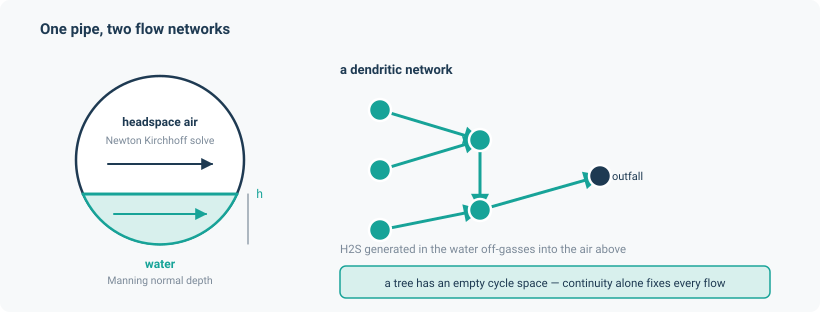

# Sewers

Gravity sewer networks, with the water, the air above it and the sulfide it carries coupled on one
network. Manholes are nodes and circular pipes are edges, draining as a tree to an outfall;
wastewater flows downhill under gravity, and the question the model answers is corrosion and
odour risk: how much H₂S is generated, and how much reaches the air where it attacks the crown
of the pipe.

This application is a batched, differentiable equivalent of **EPA SWMM 5.2** for the part of
SWMM that routes flow through a conduit network, with a headspace-air and sulfide model that SWMM
does not have. A SWMM `.inp` file can be read directly ([SWMM `.inp`](swmm.md)).

**Maturity: verified on a stated subset.** Flows, depths, volumes, velocities and overflows are
compared with live SWMM 5.2.4 runs at every routing step, to 1e-6 or better in the quantities
compared (depths 1e-7 m, flows 1e-6 relative), fixture by fixture. There are exceptions: where
SWMM's own iteration does not converge (the ramp-down fixtures) noodl is held only to SWMM's
oscillation, up to 5.7e-4 m, and the tracer in downstream conduits is not asserted because of
SWMM's one-step junction lag
([Verification: sewers](../../reference/verification/sewer.md)). The comparison is a stated set
of fixtures and file-defined options, not the whole SWMM input language: a run of 1,646 public
SWMM files runs 107 of them and refuses the rest by name. The headspace-air and sulfide model is
checked against closed forms and against one laboratory data set, and three of its coefficients
are not independently verified ([Limitations](limitations.md#coefficient-provenance)).

## Supported and not supported

Supported:

- Kinematic-wave and steady routing on dendritic networks of circular conduits, with SWMM's
  tabulated circular geometry (`geometry="tabulated"`) or the exact circle.
- Dynamic-wave routing, compared with live SWMM: loops, flat and adverse conduits, backwater,
  surcharge (`SLOT`, `EXTRAN`), flooding and ponding, storage units, orifices, weirs, outlets,
  pumps and control rules, cross-section shapes, transects, culverts, force mains, tidal and
  time-series outfalls, and the fixed or variable routing step. Some parts of these are
  implemented from SWMM's source but not yet compared with a live run (a surcharged weir, bottom
  orifices, flap gates, functional outlets, some storage shapes, tides beyond 24 h); they are
  listed under [Limitations](limitations.md).
- Lateral inflows, dry-weather flow, subcatchment runoff and RDII read from a SWMM file.
- Water quality (BOD decay, Pomeroy–Parkhurst sulfide generation) and headspace air with
  two-film H₂S transfer.
- Gradients of outputs with respect to network, inflow and runoff parameters. Some quantities
  carry no gradient: the step sizes of a variable-step run, the evaporation and infiltration
  state of the climate, and the rainfall and dates of RDII.

Not supported (each is refused by name, with the line number when it comes from a file; the
full list is on [Limitations](limitations.md)):

- Groundwater, LID, snowmelt, pollutant buildup and washoff, rain `FILE` gages, and the
  `[FILES]` hot-start and interface files.
- Loops and surcharge under steady and kinematic-wave routing.
- Headspace air on networks that are not dendritic.
- Ponding together with water quality or headspace air.

**Units.** Water and headspace air flow m³/s, depth and head m, pressure Pa, concentrations
kg/m³ (with helpers to mg/L and ppm), sulfide transfer kg S/s.



## A worked example

```python
from noodl.apps.sewer import build_model, sewer_steady, pipe_table, tree_steady

model, state, drivers = build_model(tree_steady())
final = sewer_steady(model, state, drivers)
rows = pipe_table(model, final, drivers, path="pipes.csv")

# rows[0] is pipe "C1": q = 0.05 m3/s, h = 0.153007001 m
```

`tree_steady()` is a 5-conduit, 6-node example network; its steady discharges are 0.05, 0.08,
0.03, 0.13 and 0.16 m³/s.

Start from a different state by naming it, here with sulfide already present in manhole `J1`,
and read the result by manhole and species:

```python
from noodl.apps.sewer import initial_state

wq = model.refs.water_quality                  # species ("bod", "sulfide"), kg/m3
start = initial_state(model, drivers=drivers, values={wq.concentration: {"J1": {"sulfide": 1e-3}}})
model.check(start, drivers).raise_for_errors(strict=True)
after = model.step(start, drivers, 60.0)
print(sorted(wq.concentration.named(after[wq.concentration])))
```

```text
['J1', 'J2', 'J3', 'J4', 'J5']
```

The sewer's `initial_state` takes the drivers as well (`drivers=`), because the storage it starts from
depends on the inflows. The model is set up and run like every other model; see
[The workflow](../../guide/workflow.md). Every type this application offers is listed in its
[catalogue](../../reference/catalogue/sewer.md), and the whole API in the
[API reference](../../reference/api/index.md).

## In this section

Guides:

- [Kinematic-wave and steady runs](kinematic-wave.md): build a network in code, `build_model`,
  steady state, a step, reading a file.
- [Dynamic-wave runs](dynamic-wave.md): `simulate_dynamic_wave`, units, scope, step control,
  outfalls and conduit options.
- [Dynamic-wave structures and cross sections](dynamic-wave-structures.md): storage units,
  losses, orifices, weirs, outlets, pumps, control rules, shapes, transects and culverts.
- [Lateral inflows, runoff and RDII from a SWMM file](swmm-hydrology.md).
- [Headspace air and sulfide](headspace-sulfide.md): water quality and air on the dynamic wave.

Explanation and reference:

- [Physics: geometry, Manning, air and quality](physics.md), and the
  [dynamic-wave physics](physics-dynamic-wave.md): the equations, the solve and where noodl
  differs from SWMM on purpose.
- [SWMM `.inp`](swmm.md): how a file is read, section by section, and what is refused.
- [Limitations](limitations.md), including the coefficient provenance.
- [Verification: sewers](../../reference/verification/sewer.md): the evidence.
