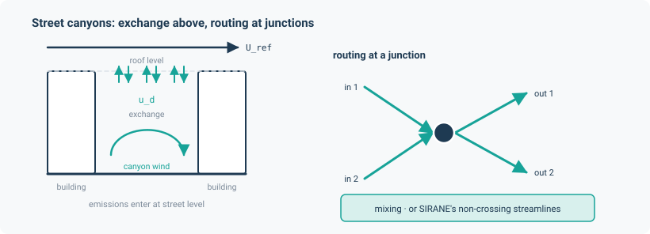

# Street air quality

Urban air quality on a street network. Road segments flanked by buildings are "canyons", and each canyon is a node holding a well-mixed pollutant concentration (kg/m³); the atmosphere above roof level is the boundary node. Edges carry air between streets at junctions, and exchange it with the atmosphere at junctions and through the canyon roof. Pollutant mass is conserved in every canyon: it builds up from traffic emissions (kg/s), is ventilated into the atmosphere, and is carried from street to street by the wind-driven flow along them.

The application reproduces the physics of two street-network models: **MUNICH** (Kim et al. 2018, 2022) and **SIRANE** (Soulhac et al. 2011), each available as a preset (`preset="munich"`, `preset="sirane"`) and mixable option by option. It adds an unsteady above-roof puff model after SIRANERISK (Soulhac et al. 2016). There is no potential variable anywhere: the along-canyon velocity is a closed-form function of the wind aloft and the canyon geometry, so a closure computes every flow and writes it, and the transport layer advects on what it wrote.



## Maturity: partial

The street application is **partial**: street concentrations are verified against MUNICH, and against SIRANE everything up to the street concentration is.

- Against MUNICH v2.2, noodl physics reproduces MUNICH's own runs of the 12-street network (eight hours of mixed wind and stability, three closure sets covering every MUNICH option `read_case` translates) to the float32 precision of MUNICH's output (worst 7e-7 relative). Thirteen formula pairs are exact to the precision its source publishes. The published concentration pattern of Kim et al. (2022, Fig. 1), whose inputs were never published, is not reproduced (worst of 19 ratios off by 51 %).
- Against SIRANE v2.1, the roof exchange velocity, the in-canyon wind, the above-roof plume kernel (46 streets and 19 single-street probes) and the NO-NO₂-O₃ chemistry agree with its archived output to its printed precision or to stated regression guards.
- Street concentrations are not compared against SIRANE, MUNICH's chemistry is checked through its rate constant only, and the puffs are checked against the steady kernel rather than against SIRANERISK.

The numbers are on the [verification page](../../reference/verification/street.md).

## Supported and not supported

| Supported | Not supported |
|---|---|
| Steady and stepped canyon networks, batched and differentiable | Convective hours (`abs(h/L) > 0.3`) in the above-roof plume and puffs (refused by name) |
| MUNICH's and SIRANE's closure sets, and any mix | Plume rise, wet deposition, SIRANE's cell-based retrotrajectory path |
| Junction routing with direction averaging | Chemistry other than photostationary NO-NO₂-O₃; chemistry inside puffs |
| Steady above-roof plume coupled to the streets | SIRANE's meteorological preprocessor, and solar geometry for MUNICH's photolysis |
| Unsteady puffs with explicit above-roof releases | SIRANE decks beyond the supported subset (refused by name); point sources |
| Reading and writing MUNICH cases and SIRANE decks | Reproducing the published 12-street figure, whose inputs were never published |

The reasons and sizes are on [Limitations](limitations.md).

## A worked example

```python
import math
import torch
from noodl.apps.street_aq import build_model, from_test_network, initial_drivers

DT = torch.float64

net = from_test_network()                     # a 4-junction, 3-street toy network
model, state, _ = build_model(net, pblh_floor=False)
street = model.refs.street

drivers = initial_drivers(model, values={
    street.boundary_concentration: {"atmosphere": 1.0e-4},   # background, kg/m3
    street.sources: {"r1": 1.0, "r2": 2.0, "r3": 3.0},       # emissions, kg/s
    "U_ref": torch.tensor(2.0, dtype=DT),                     # wind speed, m/s
    "theta_w": torch.tensor(0.25 * math.pi, dtype=DT),        # rad CCW from east, blowing TOWARD
    "h_abl": torch.tensor(1200.0, dtype=DT),                  # boundary-layer depth, m
})
model.check(state, drivers).raise_for_errors(strict=True)

solved = model.steady(state, drivers)
print(street.concentration.named(solved[street.concentration]))   # kg/m3, by street
```

Emissions and the background are given by street and boundary name; the meteorology is the street closures' own input and is given as plain tensors. In the dictionaries, the concentration is `"street.x"` (street order), the emissions `"street.sources"` (full node order) and the background `"street.x_boundary"` (boundary order); see [The workflow](../../guide/workflow.md). The drivers `build_model` returns are templates only: you must supply `U_ref`, `theta_w` and `h_abl` yourself. The other drivers, and the per-street meteorology and background, are on [Build and run a street network](networks.md#supply-the-drivers).

Every type this application offers, and how to call it, is listed in its [catalogue](../../reference/catalogue/street_aq.md) and in the [API reference](../../reference/api/index.md).

## In this section

- [Build and run a street network](networks.md): describe the streets, supply the drivers, add chemistry, write results.
- [Choosing the closures](closures.md): every `build_model` option and the two presets.
- [Above-roof concentration](above-roof.md): replace the background above the roofs with a modelled plume.
- [Unsteady above-roof puffs](puffs.md): short releases and passing clouds.
- [Reading and writing cases](cases.md): MUNICH case directories, SIRANE decks and their results.
- [Physics](physics.md): the equations and the assumptions behind them.
- [Limitations](limitations.md).
- [Verification](../../reference/verification/street.md): the evidence.
