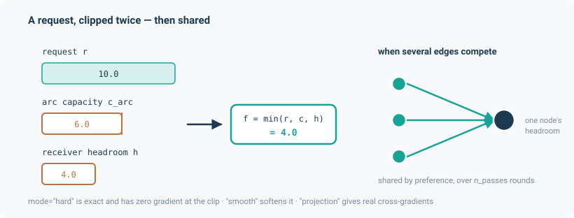

# Flow allocation

Rule-based allocation of water between stores. Nodes are stores (reservoirs, treatment works,
demand points) with a storage ceiling; edges are arcs with a capacity. Each arc carries the flow
that is requested of it, clipped to the arc's capacity and to the free storage at the receiving
node, and storage is conserved exactly at every node. Requests and flows are in m³/s, storage in
m³. The layer is `AllocatedFlowLayer`.

Every other application determines a flow from physics: a potential difference, a closure or
continuity. Here the flow follows a *rule*. Each edge carries a requested flow, typically
produced by an upstream process rather than a pressure difference, and the layer clips it
against two independent bounds, the edge's own capacity and the receiving node's remaining
storage headroom. There is no potential variable anywhere in the calculation (see
[the four flow-determination modes](../../concepts/four-modes.md)).

$$
f = \min\left(r,\; c_{\text{arc}},\; h_{\text{receiver}}\right)
$$

An edge pushes a request at its target; the target accepts up to its own headroom; the
difference is left unmet at the source. The allocation rules (push and pull requests, the
per-arc capacity clip and the receiver's headroom check) follow those of WSIMOD, the Water
Systems Integrated Modelling framework of Imperial College London. The derivation, the three
differentiability modes and the proportional sharing are on
[the physics page](allocation-physics.md).

**Maturity: verified on a stated subset.** The default `"hard"` mode reproduces WSIMOD 0.8.1's
realised flows on its two demonstration models to 1e-16 and on scripted networks with binding
capacities and headroom to 4.4e-16
([evidence](../../reference/verification/water-resources.md)). The `"smooth"` and
`"projection"` modes have no external reference: they are checked against the hard clip and by
gradient checks, and are experimental in that sense.

| Supported | Not supported |
| --- | --- |
| Push and pull requests per arc, clipped by arc capacity and receiver headroom | Queue arcs: travel time and decay of requests in transit (see the [WSIMOD port](wsimod.md)) |
| Exact storage conservation; storage bounded from above | Pass-through nodes that forward only what they can send on within the step |
| Proportional sharing of one node's headroom between competing arcs | WSIMOD's first-come, first-served sharing (the layer shares by preference) |
| Batched storage, requests, capacities and preferences | Pollutants and quality transport on an allocation layer |
| Three modes: `"hard"`, `"smooth"`, `"projection"` | Time-varying capacities and storage bounds |



The layer is listed in the [core catalogue](../../reference/catalogue/core.md). It is set up and
run like every other model; see [Using noodl](../../guide/workflow.md).

## A worked example

```python
import torch
from noodl.layers.allocation import AllocatedFlowLayer
from noodl.topology import Network

F64 = torch.float64

net = Network()
for n in ("A", "B", "C"):
    net.add_node(n)
net.add_edge("A", "B", kind="link")
net.add_edge("B", "C", kind="link")

layer = AllocatedFlowLayer(
    net, "cap", "link",
    s_max=torch.full((net.n,), 100.0, dtype=F64),
    c_arc=torch.full((2,), 10.0, dtype=F64),
)

s0 = torch.zeros(net.n, dtype=F64)
drivers = {"cap.requests": torch.tensor([2.0, 2.0], dtype=F64)}
s1, f = layer.step(s0, drivers, dt=1.0)

# f  == [2.0, 2.0]   — both requests pass through
# s1 == [-2.0, 0.0, 2.0]
#   A is only a source and loses 2; B gains 2 and loses 2; C gains 2.
```

With `c_arc = 1.5`, requests of `[5.0, 5.0]` give `f = [1.5, 1.5]`; with node C already full,
requests of `[2.0, 2.0]` give `f = [2.0, 0.0]`.

Note that `s1[0]` is negative. `step` bounds storage from **above** only: a source node may be
drawn below zero, which is a modelling choice belonging upstream of this layer.

## From a WSIMOD topology

A WSIMOD-style topology (`{"nodes": [{"name"}], "arcs": [{"name", "source", "target",
"capacity"}]}`, here the JSON file of WSIMOD's quickstart) is a network of stores and
capacity-limited arcs, and the layer is built on it directly. Requests and storage are then
given by arc and node name:

```python
import json

import torch

from noodl.layers.allocation import AllocatedFlowLayer
from noodl.model import Model
from noodl.refs import drivers_from, state_from
from noodl.topology import Network

with open("quickstart_topology.json") as f:
    topology = json.load(f)
net = Network(dtype=torch.float64)
for node in topology["nodes"]:
    net.add_node(node["name"])
for arc in topology["arcs"]:
    net.add_edge(arc["source"], arc["target"], kind="link", name=arc["name"])
layer = AllocatedFlowLayer(
    net, "wsimod", "link",
    s_max=torch.full((net.n,), float("inf"), dtype=torch.float64),
    c_arc=torch.tensor([a["capacity"] for a in topology["arcs"]], dtype=torch.float64),
    quantity="storage", unit="m3", flow_unit="m3/s",
)
model = Model(net, [layer])
state = state_from(model, {"wsimod": {"my_groundwater": 5.0}},
                   base={"wsimod.s": torch.zeros(net.n, dtype=torch.float64)})
drivers = drivers_from(model, {"wsimod.requests": {"baseflow": 0.3}},
                       base={"wsimod.requests": torch.zeros(net.b, dtype=torch.float64)})
state = model.step(state, drivers, dt=86400.0)
print(state["wsimod.q"].tolist())
```

```text
[0.0, 0.0, 0.0, 0.0, 0.3, 0.0]
```

WSIMOD's own model, with its orchestration, its node classes and its arithmetic, is the
[WSIMOD port](wsimod.md); this layer is the allocation rule alone.

## Constructing and stepping the layer

```py
AllocatedFlowLayer(
    net, name, kind, *,
    s_max,            # per-node storage ceiling, trailing shape (net.n,); inf for unbounded
    c_arc,            # per-edge arc capacity, in this kind's edge order
    preference=None,  # per-edge sharing weight, strictly positive; None means all ones
    mode="hard",      # 'hard' | 'smooth' | 'projection'
    tau=None,         # temperature; required for mode='smooth'
    n_passes=5,       # fixed sharing rounds
)

s_new, f = layer.step(s, drivers, dt, *, diagnostics=None)
```

The full signature is in the [API reference](../../reference/api/index.md). `step` reads
`f"{name}.requests"` from `drivers` (per edge, m³/s) and returns the new per-node storage and
the realised per-edge flow. `diagnostics`, when given, is filled with `"overflow"` in m³/s per
node: reported, never fed back.

- **`dt` matters.** Headroom is converted to a rate, $(s_{\max} - s)/\Delta t$, so the clip
  bounds the actual storage increase at any timestep, not only at $\Delta t = 1$.
- **`preference` must be strictly positive.** Projection mode divides by it, and a non-positive
  weight would give a clean forward value with a silent NaN gradient.
- **Batches.** Storage, requests, capacities and preferences may each carry their own leading
  batch dimensions; `step` broadcasts them to one common batch shape.
- **In a `Model`,** an allocation layer steps between the potential solves and the transport
  steps, so a transport layer reading `"<layer>.q"` sees a freshly written flow. A model that
  owns one refuses a steady pass and refuses `residuals()`: a clip-and-allocate rule is
  inherently discrete-time and has no steady meaning.

Choosing a mode:

- `"hard"` for forward simulation, and for training that never crosses a binding constraint.
  The gradient through a capacity or headroom crossing is exactly zero.
- `"smooth"` when you need a gradient across a capacity boundary and only care about the
  sensitivity of a flow to its own request.
- `"projection"` when you need gradients between competing edges, that is, through which arc
  absorbs a constraint.

## Where the layer differs from WSIMOD

These differences are deliberate and tested against WSIMOD's own numbers.

- **Several arcs competing for one node's headroom.** WSIMOD serves them in call order. The
  layer shares by preference and ignores order. Two 10-unit pushes into 12 units of headroom
  give `[10, 2]` or `[2, 10]` in WSIMOD, depending on which is called first, and `[6, 6]` in the
  layer. The total and the storage agree. WSIMOD's own proportional sharing happens earlier,
  when a sender or puller sizes its requests, so it is already in the requests the layer
  replays.
- **Same-step outflow.** The layer uses the headroom at the start of the step. WSIMOD frees
  headroom for an inflow if an outflow is called first.
- **Bottlenecks behind a pass-through node.** A WSIMOD `Node` forwards each push immediately
  and hands back what it cannot forward, so a tight arc downstream also limits the arcs
  feeding it. The layer is receiver-local. With `quickstart_demo`'s `catchment_outflow` lowered
  to 0.1, that arc replays exactly, but `baseflow` and `storm_outflow` differ by up to 0.24 and
  0.04.
- **Node-level limits.** These are source availability on a pull, and throughput caps such as
  `oxford_demo`'s `WWTW` node. That is why `sewer_to_wwtw` is left out of the `oxford_demo`
  comparison (20 of 21 arcs compared): it mismatches on 185 of 1,456 steps, although its own
  capacity is 1e15.
- **Not modelled at all.** `QueueArc` and `DecayArc` travel time and decay, `force=True`
  pushes, and pollutants.

## Out of scope

- The WSIMOD `Node` wrapper, that is, embedding a noodl physics `Model` as a live WSIMOD node
  via `push_set` and `pull_set`.
- The other nine WSIMOD pollutants. The layer is species-count-agnostic: this is a matter of
  widening a transport layer's species list, not a change to the layer.
- Species and quality transport riding on an allocation layer.
- Time-varying arc capacities and storage bounds: they are construction-time buffers, since
  WSIMOD's own capacities are static within a run.
