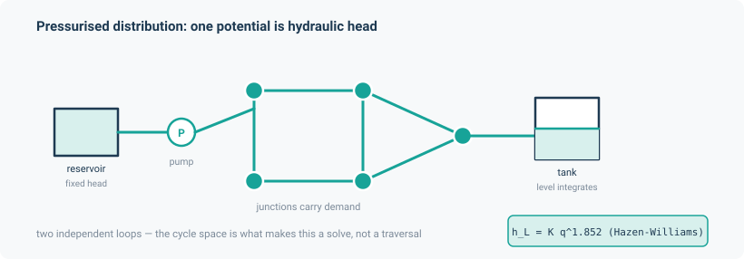

# Water distribution

Pressurised water distribution: reservoirs and tanks at fixed or slowly varying head, and
junctions with demand, are nodes; full pipes, pumps and valves are edges. Water is conserved at
every junction, and flow is driven by differences in hydraulic head.

Every pipe is full and its head loss is a monotone function of the head difference, so the whole
network is **one** `KirchhoffLayer` whose potential is hydraulic head. That is exactly what
distinguishes it from the free-surface [sewer](sewer.md), whose normal flow is set by slope and
upstream inflow rather than by head difference.

**Units.** Head and elevation m, flow and demand m³/s, pressure head m (with a helper to kPa).

```python
from noodl.apps.water import (
    Junction, Reservoir, Tank, WaterPipe, Pump, Valve, WaterNetwork, WaterOptions,
    build_model, water_steady, initial_state, twoloop,
    pressure_head, to_kilopascal, link_table, tank_inflow,
)
```



Every type this application offers — what it does and how to call it — is listed in its [catalogue](../catalogue/water.md). It is set up and run like every other model; see [Using noodl](../usage.md).

## A worked example

```python
from noodl.apps.water import build_model, water_steady, twoloop

model, state, drivers = build_model(twoloop())
model.check(state, drivers).raise_for_errors(strict=True)
final = water_steady(model, state, drivers)

water = model.refs.water
heads = water.head.named(final[water.head])     # m, by node name
flows = water.flow.named(final[water.flow])     # m3/s, by link name
print(round(float(heads["J1"]), 6), round(float(flows["P1"]), 6))
```

```text
49.267725 0.045
```

To change an input, give it by name over the builder's own values. A demand is a
negative source (m³/s withdrawn; `demand=` does the sign for you), and junctions not named
keep their demand. On a model built with `quality=` the quality sink is the
withdrawal of the current hydraulic solution (a scaled or patterned `water.sources`, or the
delivered demand under `pda=True`), so a tracer entering at the reservoir stays at its
concentration at every demand level. A junction with a positive `water.sources` (an injection
of water) is no sink: the injected water carries no tracer of its own and dilutes what arrives
through the pipes, and any tracer injected with it is `quality.sources` (kg/s). On R → A → B
with the reservoir at 100, an injection of 0.005 m³/s and 0.1 kg/s at A and a withdrawal of
0.01 m³/s at B, both junctions read (0.005 × 100 + 0.1) / 0.01 = 60, and the tracer withdrawn
equals the tracer supplied. A STAGNANT node (no inflow and no outflow, e.g. a dead end whose delivered demand is zero under `pda=True` because the pressure is below the minimum) has no steady concentration without decay: `water_steady` raises `UndefinedSteadyState` naming the node and the cause, as the transport layer does for any stagnant node (a steady solve never invents a value). With a bulk decay (`quality > 0`) the node reads 0; or step the quality in time from an initial concentration. Quality advects through every hydraulic edge kind: pipes, pumps and valves. A pressure-driven model (`pda=True`)
refuses both `demand=` and a `water.sources` value, since its demands are withdrawals set
at build time:

```python
from noodl.apps.water import initial_drivers

more = initial_drivers(model, demand={"J2": 0.012})      # m3/s withdrawn at J2
final = water_steady(model, state, more)
print(round(float(water.head.named(final[water.head])["J2"]), 6))
```

```text
48.641165
```

In the dictionaries the heads are `"water.phi"` (full node order) and the flows `"water.q"`
(link order); a tank's level is its head in `"water.phi"` less its bottom (`tank_levels`),
and the pumps' status under tank controls is the state key `"water.link_status"`. Both are set by tank and pump name with
`initial_state(model, values=...)`, the levels under the key `"water.tank_level"`, which
`initial_state` reads and writes into the tank heads (it is no state key).
See [Using noodl](../usage.md).

`twoloop()` is a hand-built network: reservoir `R1` at 50 m, six junctions with demands
5/8/6/10/7/9 L/s, eight Hazen-Williams pipes at $C=130$ forming two independent loops. Its heads
are 49.267731, 48.877316, 48.430882, 48.213867, 48.117119 and 48.122936 m, the same as EPANET 2.2
gives for the equivalent `twoloop_si.inp`.

The same network can be read from an EPANET `.inp` file (see [File formats](../formats/epanet.md)):

```python
from noodl.apps.water import read_epanet_inp, build_model, water_steady

net = read_epanet_inp("twoloop_si.inp")
model, state, drivers = build_model(net)
final = water_steady(model, state, drivers)
```

## The objects

| Object | Fields |
|---|---|
| `Junction(name, elevation, demand=0.0, pattern=None)` | A demand node. |
| `Reservoir(name, head, pattern=None)` | Fixed-head boundary. |
| `Tank(name, elevation, init_level, min_level, max_level, diameter, volume_curve=None, overflow=False, min_volume=0.0)` | A cylinder of `diameter`, or the volume curve `volume_curve` (a `curves` key, level m against volume m³); `overflow` lets it spill when full. |
| `WaterPipe(name, u, v, length, diameter, roughness, minor_loss=0.0, status="OPEN")` | A full pipe. |
| `Pump(name, u, v, curve, power=None, speed=1.0)` | Edge oriented **suction → discharge**; on a head `curve` (a `curves` key) or at a constant `power` (kW), at relative `speed`. |
| `Valve(name, u, v, diameter, kind, setting, minor_loss=0.0, curve=None)` | TCV, FCV, PBV, GPV, PRV or PSV (`curve`: a GPV's head-loss curve). |
| `WaterOptions(demand_model="DDA", minimum_pressure=0.0, required_pressure=0.1, pressure_exponent=0.5, ...)` | Carried from the file's `[OPTIONS]`. |

`WaterNetwork` collects them plus `curves`, `patterns`, `controls` and the timing options.
`nodes()` returns junctions, then reservoirs, then tanks; `links()` returns pipes, pumps, TCVs,
FCVs, PBVs, GPVs, PRVs, PSVs in that order; `validate()` refuses anything out of scope by name.

## `build_model`

```py
model, state, drivers = build_model(
    net,
    headloss=None,      # 'H-W' (default) or 'D-W'; None takes the network's own
    pda=None,           # pressure-driven demand; None takes net.options
    p_min=None, p_req=None, exponent=None,
    quality=None,       # bulk decay coefficient, 1/day; adds a quality TransportLayer
    coupling="pingpong",
    dt=None,            # overrides net.hydraulic_timestep for the tank closure
    friction="composite",  # D-W friction law: 'composite' (default) or 'colebrook'
    pipe_form=None,     # 'flow' (resistance form; the default) or 'potential'
    tank_scheme="forward_euler",
    valve_smoothing=0.0,  # m: smooth the PRV/PSV switch over a band of this width
)
```

`pipe_form` is how the pipes enter the solve. In the **resistance form** (`"flow"`, the default
except with `friction="colebrook"`) each pipe is `dp = h(q)` (`FlowControlledPipe`) with its
flow an unknown, solved from EPANET's own first iterate (every pipe
at 1 ft/s). In the **potential form** (`"potential"`) each pipe's flow is the inverted law
$q = g(dp)$, with no flow unknowns. Both give the same solution to round-off; they differ in how
Newton gets there. The potential form's slope grows without bound as a pipe's flow goes to
zero, so on Net1's 24 h run the step where a control closes the pump and leaves pipe 10
dead-ended needs 136 Newton iterations; the resistance form's slope goes to EPANET's `RQtol`
floor instead, and no step needs more than 6. The whole 24 h run over eight demand
multipliers (`benchmarks/water_eps.py`) takes 2.5 times less time.

`water_steady(model, state, drivers, **solve_kwargs)` wraps `model.steady` with defaults
`atol=rtol=1e-11`, `max_iter=200` (both empirically tuned, the iteration cap for the
potential form; caller overrides win), starts a cold start of the resistance form (every pipe
flow exactly zero) from `model.initial_flows`, and the pumps from their design flows (EPANET's
own first iterate), then checks
every converged power-function pump's flow against its own `q_max()` at its speed and raises
naming the pump and batch instance if it is exceeded — rather than silently accepting an
extrapolated point off the end of the curve. (A segmented curve's last segment and a
constant-power pump are extended without a limit, as EPANET extends them.) A converged pump
carrying flow backwards is refused by name too.

## The physics

### Hazen-Williams

$$
h_L = K q^{1.852} + m q^2, \qquad
K = \frac{10.666829500036\, L}{C^{1.852} d^{4.871}}, \qquad
m = \frac{K_{\text{minor}}}{2 g A^2}
$$

The SI constant was re-derived from EPANET's own US constant 4.727 and matches `wntr`'s `hw_k` to
1.04e-9 relative. With no minor loss the inversion is closed form; with one, it is a batched
monotone root solve bracketed by the pure Hazen-Williams flow as an upper bound.

Below `dp_transition` (default $10^{-9}$ m) the law blends to a laminar linear form to keep the
Jacobian finite. That value is empirically chosen: at 1e-9 the 24-hour tank trajectory is
converged to 8.18e-5 m against EPANET, and Newton iteration counts run 50/93/136/179 at
1e-3/1e-6/1e-9/1e-12.

### Chezy-Manning

`HEADLOSS C-M` is EPANET 2.2's resistance (`hydcoeffs.c`, `resistcoeff`; `input1.c`, `Hexp = 2`),
in feet and cfs with Manning's roughness $n$ (dimensionless):

$$
h_L = (R + m) q^2, \qquad R = \left(\frac{4 n}{1.49\,\pi d^2}\right)^{2} \left(\frac{d}{4}\right)^{-1.333} L
$$

The exponent $-1.333$ is EPANET's literal, not $-4/3$. `ChezyManning` converts $R$ to metres per
$(\mathrm{m^3/s})^2$ with the file's own flow factor (as Darcy-Weisbach does), takes EPANET's
`RQtol` line below the gradient floor, and carries the minor loss $m$ as `K / d^4` with EPANET's
rounded constant. It works in metres of head, so, like Hazen-Williams, it refuses a
non-default `SPECIFIC GRAVITY` or `VISCOSITY` by name. It enters the solve through
`FlowControlledPipe` like Hazen-Williams, so check valves and closed pipes work unchanged.

### Darcy-Weisbach

`CompositeDarcyWeisbach` (`friction="composite"`) is EPANET 2.2's own composite law:
Hagen-Poiseuille, then Dunlop's transition cubic, then Swamee-Jain. It is transcribed from its source
(`hydcoeffs.c`, `DWpipecoeff` and `frictionFactor`), in EPANET's internal feet and cfs:

$$
h_L = \begin{cases}
(16 \pi \nu d R + m \lvert q \rvert)\, q & Re \le 2000 \quad \text{(Hagen-Poiseuille)} \\
(f(Re) R + m)\, \lvert q \rvert q & Re > 2000
\end{cases}
\qquad R = \frac{L}{2 \cdot 32.2\, d A^2}, \quad m = \frac{0.02517\, K_{\text{minor}}}{d^4}
$$

with $f$ Dunlop's cubic interpolation for $2000 < Re < 4000$ and Swamee-Jain above. The
composite is $C^1$: the cubic matches $64/Re$ and Swamee-Jain in value and slope at its ends.
EPANET's constants are kept as EPANET has them, because they are part of what it computes:
$g = 32.2$ ft/s² (not 32.174), the rounded minor-loss factor 0.02517, water at
$\nu = 1.1 \times 10^{-5}$ ft²/s times `[OPTIONS] VISCOSITY`, and the flow-unit factor EPANET
divides a file's flows by (`LPSperCFS = 28.317`, `GPMperCFS = 448.831`, ...;
`WaterOptions.flow_units` carries the file's unit). EPANET has no low-flow linearisation for D-W:
the laminar branch is already linear through $q = 0$, so the element needs no transition blend.
The flow is found by a safeguarded Newton inversion of the odd law $h_L(q)$ with EPANET's own
analytic gradient, and differentiated by the implicit-function rule.

This is the default whenever the head loss is D-W, including every `.inp` read with
`HEADLOSS D-W`, because the application's reference is EPANET. `friction="colebrook"` selects
the framework's generic `Duct` instead (implicit Colebrook, a straight laminar line to its
Re = 2000 value, water at $1.002\times10^{-3}/998.2$ m²/s, standard gravity); it is a different
law and does not reproduce EPANET (3.6e-4 on the two-loop heads, up to 81 % on a pipe's head
loss near Re = 2000).

### Pumps

Each pump takes the curve EPANET 2.2 gives it (`input2.c`, `updatepumpparams`), and its head
gain at flow $q$ and relative speed $w$ follows EPANET's `pumpcoeff` (`hydcoeffs.c`), with the
affinity laws for the speed:

| Pump in the file | Curve | Head gain |
|---|---|---|
| `HEAD` curve of one point $(q_d, H)$ | `PumpCurve`, `three_point_curve`: EPANET's points $(0, 1.33334 H)$, $(q_d, H)$, $(2 q_d, 0)$ fitted as three points: $h_0 = 1.33334 H$, $n = 1.99998$, $r = 0.33334 H / q_d^n$ | $w^2 h_0 - r w^{2-n} q^n$ |
| `HEAD` curve of three points, the first at zero flow | `PumpCurve`, `power_curve` (EPANET's `powercurve`): $h_0$ the first head, $n = \ln\frac{h_0 - h_2}{h_0 - h_1} / \ln\frac{q_2}{q_1}$, $r = (h_0 - h_1)/q_1^n$ | $w^2 h_0 - r w^{2-n} q^n$ |
| any other `HEAD` curve | `PiecewisePumpCurve`: straight segments (`curvecoeff`), the end segments extended | $w^2 h(q/w)$ |
| `POWER` $P$ | `ConstantPowerPump`: $8.814\,P/q$ in feet, horsepower and cfs | $8.814\,P w^3 / q$, converted to SI |

EPANET's own rounded 1.33334, not the manual's 133 % with exact thirds (which would force
$n = 2$, as wntr's `get_head_curve_coefficients` has it): with $n = 2$ a pump at zero flow
sat $6.7 \cdot 10^{-6} H$ below EPANET's (1.05e-6 relative at 63 m) and Net1's flows
missed EPANET's by 2.9e-6 relative instead of 2.6e-7 (MEASURED).
`q_max = w (h_0/r)^{1/n}` is a power function's flow at zero head gain.

Every pump enters the solve in its **head-gain form**, whatever the `pipe_form`, as EPANET and
wntr write it: `FlowControlledPump`, $H_{\text{discharge}} - H_{\text{suction}} =
h_{\text{gain}}(q)$ with the pump's flow an unknown. One law holds every pump of a network,
each on its own curve. The gain is strictly decreasing in $q$, so every head difference has
exactly one flow on the curve:

- where a power function's slope falls below EPANET's `RQtol` (at low flow when $n > 1$) or
  rises above its `CBIG` (at low flow when $n < 1$), and where a constant-power pump's slope
  $8.814 P w^3/q^2$ leaves `[RQtol, CBIG]`, the gain is the curve's tangent there (wntr's
  `get_pump_line_params` construction), continuous in value and slope. EPANET's own lines
  there are its iteration's linearisation, not a decreasing curve; the two agree wherever a
  running pump works;
- a segmented curve whose first point is above zero flow shuts at that point's head, as
  EPANET's `pumpstatus` does (below the point's flow the gain is that head plus a line of
  slope `RQtol`).

The pump's speed is the per-link driver `"water.setting"` (its `SPEED` in the file at the
build), so a calibration can differentiate through it. Its status is `"water.status"`. The
residual of each pump, with $r = dp + h_{\text{gain}}(q)$, is

- $\kappa q$ (no flow) when its status is `CLOSED` or its speed is 0;
- otherwise $\max(-\kappa q, r)$: the pump runs on its curve with $q \ge 0$, or it is shut,
  $q = 0$, where the head asked of it is at or above its shut-off head $h_{\text{gain}}(0)$.
  EPANET closes such a pump (`pumpstatus`, `XHEAD`) and leaves it the closed-link leak
  `excess / CBIG`; here its flow is exactly zero, and `link_states` reports it `CLOSED`.

The branch is selected as for a check valve (`FlowControlledPipe`): the no-flow row only where
$r < -\kappa q$ and the open row's own Newton step would reverse the flow, never at a tie (a
pump with no demand behind it runs at zero flow on its curve, `OPEN`, as EPANET reports it),
and never where shutting the pump, together with the check valves the same iterate shuts
(`ShutLinks`, which the pipes' law fills first), would cut a group of nodes off from every
reservoir and tank. $\kappa$ is 1 m per m³/s. The Jacobian is the closed form `(1, -h'_{\text{gain}})` on
the curve's row.

`PumpCurve.flow` still gives the inverted curve, $q = w((h_0 + dp/w^2)/r)^{1/n}$, with a laminar
blend near shut-off, but the solve does not use it: its slope is infinite at shut-off and
exactly zero beyond it. A Newton iterate beyond shut-off then has no Jacobian entry between the
pump's two sides, and with a pressure-driven demand downstream only the demand's own small slope
ties those heads to a boundary; the next step throws them far outside the curve and the system
goes singular. That was measured on a reservoir, a pump and a pipe feeding a PDA junction
(singular from the fifth iterate on). In the head-gain form the pump's row ties its two heads
together on every iterate, and the same network converges quadratically, in 5 Newton
iterations (19 with `pipe_form="potential"`).

### Valves

A **TCV** (`ThrottleValve`) is a minor loss whose coefficient is its setting, and an **FCV**
(`FlowControlValve`) a fixed flow. A **PBV** (pressure breaker) and a **GPV** (general purpose
valve) follow EPANET 2.2's own coefficient routines (`hydcoeffs.c`, `pbvcoeff` and `gpvcoeff`)
as `BreakerValve` and `GeneralPurposeValve`. All four are implicit laws, whose flow is an
unknown of the layer:

- **PBV:** the head drop from the valve's start node to its end node is its setting,
  whichever way the water flows. Where the open valve's minor loss $m q^2$ exceeds the setting,
  or the setting is 0, it is an open valve instead, $h = m q |q|$, with EPANET's minor-loss
  coefficient $0.02517 K / d^4$ (ft, cfs) and its rounded flow-unit factor.
- **GPV:** $h = \operatorname{sgn}(q)\,(h_0 + r |q|)$ on the segment of its head-loss curve
  that brackets $|q|$ (the first or last segment, extended, outside the curve), with
  $\operatorname{sgn}(0) = +1$.

A valve's flow is an unknown of the solve (sparse LU).

A **PRV** (`PressureReducingValve`) holds the head at its end node at no more than
$H_\text{set} = z + s$ (the node's elevation $z$ plus the setting $s$); a **PSV**
(`PressureSustainingValve`) holds the head at its start node at no less than that node's
$z + s$. Each is one exact complementarity condition on the absolute head at its controlled
node (the law reads its end nodes' heads, `ConstitutiveLaw.reads_heads`), solved in the same
Newton iteration as everything else, with no outer loop over states and no memory of the
previous one (`docs/plans/water-prv-psv-design.md`):

$$\min\bigl(\kappa q,\ \max(\text{held},\ K_m q|q| - \Delta\phi)\bigr) = 0,$$

with $\text{held} = H_v - H_\text{set}$ for a PRV and $H_\text{set} - H_u$ for a PSV, the
controlled head beyond its setting. The selected row is the valve's state: $\kappa q$
(no flow) is `CLOSED`, the held row `ACTIVE` (the controlled head at its setting), the
minor-loss row `OPEN` (the controlled head short of its setting, the valve fully open).
That is EPANET 2.2's three states (`hydstatus.c`, `prvstatus` and `psvstatus`) without
their hysteresis. Inside EPANET's `HTOL` band (1.524e-4 m below the switch) EPANET keeps an
active PRV active with the downstream head at its setting above the upstream head, a
negative drop through the valve; noodl gives the ideal valve there, `OPEN` with no drop, and
the heads differ by less than `HTOL`.

The rows are selected with `torch.where` and fixed tie rules: at a tie of the held and open
rows the held row; the no-flow row only where the flow is not forward. With the fixed
$\kappa$ alone (1 m per m³/s for a valve without a minor loss) an iterate carrying 20 L/s
forward through a PRV whose downstream head is 7 m above its setting picks the no-flow row
and cuts off the junctions downstream, with their demand (MEASURED: a singular step). A
side of the valve with no demand and no other way to a reservoir or tank (a dead end)
carries no flow; the valve then takes a row that ties that side's head, with EPANET's
state: a dead end on a PRV's end leaves it `ACTIVE` at its setting (or `OPEN` at the
upstream head below it), on a PSV's end `OPEN` at its upstream head (or `CLOSED` where that
is below its setting); a dead end on either valve's start closes it (no water flows out of
a group without demand). A closed valve's dead end is held at the head of its other side,
the `1 / CBIG` limit. A valve with both sides dead (a part without demand that closed
links cut off) is refused by name.

The gradient is the implicit-function one of the selected row: through an `ACTIVE` PRV the
downstream head moves one for one with the setting, through an `OPEN` or `CLOSED` one not at
all. The solution is continuous across a switch and its derivative jumps there.
`build_model(valve_smoothing=eps)` (metres) replaces the `min` by the Fischer-Burmeister
function $a + b - \sqrt{a^2 + b^2 + 2\epsilon^2}$ and the `max` by its smooth counterpart, for an
optimiser that must cross a switch: the derivative is then continuous, and the answer moves
by $O(\epsilon)$ near a switch (within 2e-3 m of the exact one at $\epsilon$ = 1 mm,
`test_smoothed_prv_converges_to_exact`).

`validate()` refuses, by name, a PRV or PSV whose controlled node is a reservoir or tank,
whose setting or minor loss is negative, and two valves that hold one node twice: two PRVs
sharing their end node or in series, two PSVs sharing their start node or in series, a PSV
starting at a PRV's or an FCV's end, a PRV ending at an FCV's start (EPANET's own errors 219
and 220, `valvecheck`); the error names both valves. Unlike EPANET, a PRV or PSV may start or
end at a reservoir or tank on its other side.

### Link status, settings and check valves

Every link's status, setting and allowed direction are drivers, one value per link in
`model.link_names` order (pipes, pumps, then TCVs, FCVs, PBVs, GPVs, PRVs, PSVs):

| Driver | Values |
|---|---|
| `"water.status"` | `CLOSED` 0, `OPEN` 1, `ACTIVE` 2 (`noodl.apps.water.controls`); `ACTIVE` only for a valve, which then acts on its setting |
| `"water.setting"` | a pump's relative speed, a PBV's head drop, a PRV's or PSV's pressure head (m; the layer's potential unit), an FCV's flow (m³/s), a TCV's loss coefficient; unused for pipes and GPVs |
| `"water.one_way"` | 0 both directions, +1 forward flow only, -1 reverse flow only |

`build_model` fills them from the file: a `CLOSED` pipe or a `[STATUS]` word sets the status, a
`CV` pipe is forward-only, a valve's setting (or a numeric `[STATUS]` value) is its setting,
and every valve starts `ACTIVE`. They are set by link name like any other driver:

```python
from noodl.apps.water import CLOSED, link_states

model, state, drivers = build_model(twoloop())
closed = initial_drivers(model, values={"water.status": {"P7": CLOSED}})
final = water_steady(model, state, closed)
print(link_states(model, final, closed).tolist())
```

```text
[1, 1, 1, 1, 1, 1, 0, 1]
```

A `CLOSED` link carries no flow: its residual is $\kappa q$. A valve whose status is `OPEN`
is its minor loss, $h = K_m q|q|$, whatever its setting. A check valve is one exact
complementarity condition, solved in the same Newton iteration as everything else, with no
outer loop over statuses: $\max(-\kappa q,\ \Delta\phi - h(q)) = 0$, either the pipe flows
forward with $\Delta\phi = h(q)$, or it holds $q = 0$ against a reverse head (the design is
in `docs/plans/water-prv-psv-design.md`). $\kappa$, a pipe's own head-loss slope at 1 ft/s,
only scales the row. Newton picks the no-flow branch only where the open equation's residual
is below both $-\kappa q$ and $-h'(q)\,q$: with $\kappa$ alone, an iterate that overshoots
forward closes an open check valve, sets every pipe in series with it to exactly zero flow,
and cycles (`FlowControlledPipe`). An iterate that would close every check valve feeding a
junction, which leaves the step singular, keeps open the one whose open equation predicts the
most forward flow, so the step is taken; `water_steady` then refuses a converged check valve
carrying flow the wrong way. Closed links and check valves need the pipes' resistance form
(`pipe_form="flow"`, the default); `pipe_form="potential"` refuses them.

`link_states(model, state, drivers)` gives every link's state in a solution: `CLOSED`, `OPEN`
or `ACTIVE`, the codes `wntr` reports EPANET's in (an `ACTIVE` PRV or PSV: the row its
condition selects there). `water_steady` refuses, before it solves, a
junction with a demand that closed links cut off from every reservoir and tank, and one that
no water reaches through the open links in the directions check valves and full or empty tanks
leave them (a pipe into an empty tank only fills it). A group of
junctions without demand that is cut off at the solution, by closed links or by check valves
holding no flow, has no head of its own in the exact equations: any head that keeps those
valves shut solves them. EPANET gives each closed link the conductance $1/C_\text{BIG}$ and
opens a check valve whose upstream head is the higher, and as $C_\text{BIG}$ grows its
heads tend to the solution of the convex program

$$\min_H \tfrac12 \sum_{(a,b)} (H_a - H_b)^2 \quad \text{subject to} \quad H_u \le H_v
\text{ for every check valve } u \to v,$$

the sum over every closed link and every check valve holding no flow, with the heads outside
the group at the solve's own. It is the resistor-and-diode network with one conductance per
link and an ideal diode across each check valve: the constraints' multipliers are the diodes'
flows, so a check valve is `OPEN` where its multiplier is positive (it ties its two ends) and
`CLOSED` where it is zero. `water_steady` sets the group's heads to that solution, with every
flow into it exactly zero (`noodl.apps.water.elements.PIN_KEY`), by the dual active-set
method of Goldfarb and Idnani on the group's nodes alone (`_dual_active_set`: the objective
rises strictly over every full step and no active set returns, so it ends). For a single
junction behind shut valves that is the plain average of the far ends; a valve the average
would drive is open and the junction takes its far end's head; and a valve that opened in an
intermediate active set is shut again where a later one leaves it with nothing to carry. The
heads are a linear map of the solved heads around them for the active set found, so a
gradient reaches them.

The TCV's coefficient is EPANET's own, $0.02517\,K/d^4$ in feet and cfs: $8/(32.2\,\pi^2)
= 0.025173$ (EPANET's 32.2 ft/s² gravity) rounded to four figures, 9.2e-4 below the exact
$8/(g\pi^2) = 0.0251933$ a `MinorLoss` uses.

### Tanks and controls

Every tank is a `LinearStorage` of its cross-section area $A$ in the water layer
(`noodl.NodeStorage`), or, when any tank of the network has a volume curve, every tank is one
`TankVolumeCurve` (a cylinder as the two-point curve of its area); a tank is an ordinary node
of `"water.phi"`, its level is its head less
its bottom (`tank_levels`), and the flow into it is `"water.storage_flow"`, which `tank_inflow`
returns. `build_model(tank_scheme=...)` chooses how the level moves.

With the default `tank_scheme="forward_euler"` the tank steps by EPANET's own method. It is a
boundary node of the layer, held at its step-start head through the hydraulic solve, and the
step then moves it by explicit Euler, $H \mathrel{+}= q\,\Delta t / A$
(`KirchhoffLayer.advance_storage`). `TankLevels` is a `Model` closure declaring
`state_keys = ("water.link_status",)`. Its `__call__` applies the controls to the levels and
returns updated drivers, among them every link's `"water.status"`: the pumps' from
`"water.link_status"`, every other link's from the drivers' own. `event_step(level, rate, dt)` implements EPANET's adaptive
step-shortening to the next control crossing.

That shortening is not optional. A fixed one-hour step was measured to diverge from EPANET by
**2.07 m** on Net1, because the pump switches an hour late; with event shortening the same
trajectory matches to **3.826e-5 m**.

`water_event_step(model, state, drivers, dt_max)` takes one such step. It solves once
(`water_steady`, with every tank held), shortens `dt_max` to the next control crossing at the
solved inflow, moves the tanks, and returns `(state, dt)`. An extended-period run therefore
looks like this:

```py
while t < duration:
    drivers["water.sources"] = base_demand * pattern_factor(t)
    state, dt = water_event_step(model, state, drivers, report_end - t)
    t += dt
```

Gradients with respect to a tank's area (the storage's capacity `C`) reach the levels through
the move of each step.

**Volume curves.** A tank with a volume curve is a `TankVolumeCurve`: its volume is EPANET's
`tankvolume`, linear between the curve's points and the end values beyond them (`interp`,
`project.c`), and its step is by volume, $V \mathrel{+}= q\,\Delta t$, $H = $ `tankgrade`$(V)$
(`hydraul.c`), through `NodeStorage.potential_of`, the inverse of the stored amount, which
`KirchhoffLayer.advance_storage` reads for a storage that is not linear. The control crossings
and the time to fill are found by volume too, as EPANET's `controltimestep` and
`tanktimestep` find them. Gradients reach the curve's volumes through the steps (against
central differences: 1.4e-9 relative). `validate()` refuses a curve that does not cover the
tank's minimum and maximum levels, as EPANET does (`input1.c`, error 225).

A curve may have flat segments (two points with the same volume), as EPANET allows: such a
segment has no area, and the level jumps across it. EPANET's `tankgrade` gives the flat volume
the segment's lower level and any volume above it a level above its upper one, and
`potential_of` is the same transcription. A tank whose maximum (minimum) level lies on a flat
stretch has that stretch's volume as its `Vmax` (`Vmin`) and, filled (drained) to it, is put
at `tankgrade(Vmax)`, the stretch's lower end, as `tanklevels` puts it. A tank on a volume
curve tests its level controls by volume, as EPANET's `controls` (`hydraul.c`) does,
$V(y) \ge V(y_c) - |q|$ (ABOVE) and $V(y) \le V(y_c) + |q|$ (BELOW) with $q$ one second of
the last solve's inflow, so on a flat stretch every control level on it is reached at once.
The times to a control or a limit use the inflow, not an area.

**Full and empty tanks.** A tank within EPANET's `HTOL` (0.0005 ft) of its maximum level is
full and one within `HTOL` of its minimum is empty (`hydstatus.c`, `tankstatus`). At the step
start `TankLevels` then gives every pipe to it the one direction that drains a full tank or
fills an empty one (`"water.one_way"`, the check-valve condition, solved exactly), closes a
pump discharging into a full tank or drawing from an empty one, and closes a pipe both
directions are then forbidden (a check valve into a full tank); all of it for that step
only, in `"water.status"` and `"water.one_way"`, not in the carried state. As in EPANET a
link whose start node is a tank or reservoir is examined at its start node only, so a pump
from a reservoir into a full tank keeps running (EPANET then puts the tank back at its maximum
each step, and the water is lost). A valve at a full or empty tank is refused by name.
`water_event_step` ends a step when a tank fills or empties (`TankLevels.time_to_limit`, rounded
to whole seconds as `tanktimestep` rounds it) and puts a tank within one second's inflow of a
limit on it (`tanklevels`). A tank with `overflow=True` is never full: its inlet stays open,
its level is held at the maximum, and `tank_overflow(model, state, stepped, dt)` is the flow
spilt over the step. Volume curves and overflow are refused with the implicit schemes below,
which also refuse a level outside the limits by name, since a tank moved inside the solve has
no step start to close links at.

**Tanks stepped inside the solve.** `build_model(net, tank_scheme="backward_euler")` (or
`"trapezoidal"`) makes every tank an interior node instead, its level stepped
implicitly inside the solve: backward Euler, $q = A\,(H - H_{\text{prev}})/\Delta t$, or
trapezoidal. `water_step(model, state, drivers, dt)` takes one step (`Model.step`, with
`water_steady`'s Newton defaults); `tank_levels(model, state)` reads the levels from the solved
heads; the level-triggered controls stay a closure (`TankStorageControls`), acting on the
step-start levels. The step is differentiable through time (the gradient of a level after
several steps matches central differences). It is **not** the EPANET comparison mode: the
implicit step differs from EPANET's explicit one by the step's own discretisation error. Both
converge to the same trajectory, at first order: on Net1, halving the storage step halves its
distance from a fine explicit run. Its `event_step` never shortens a step below 1 s (the
implicit step lands just short of a projected crossing, and a far shorter step stalls Newton),
and with steps as long as an hour a switch can land up to a step late, so sub-steps of a few
minutes are the useful range. Not with `quality`: the combination is refused with a
`ValueError` (a storage tank is an interior node with node storage, which
the quality layer does not model as a well-mixed volume); use the default `tank_scheme` for
water quality, where a tank is a quality boundary whose concentration the caller sets.
A constant tracer is preserved (every junction stays at the source concentration) across both
`pipe_form`s, TCV, PBV and GPV valves, tanks and `pda`, tested in `tests/apps/water`.

### Pressure-driven demand

EPANET's Wagner function (Manual eq. 13.6), with $p = H - z$:

$$
d(p) = \begin{cases}
D & p \ge P_{\text{req}} \\
D \left(\dfrac{p - P_{\min}}{P_{\text{req}} - P_{\min}}\right)^{e} & P_{\min} < p < P_{\text{req}} \\
0 & p \le P_{\min}
\end{cases}
$$

Implemented with a guarded kink so both `where` branches stay finite and differentiable.
`PressureDrivenDemand` refuses `p_req <= p_min` — a zero-span demand curve.

### Emitters

An emitter is a flow that leaves a junction as a power of its pressure head,
$q = \operatorname{sign}(p)\, C |p|^{n}$ with $p = H - z$ and $n$ the `EMITTER EXPONENT` (default
0.5), `EmitterOutflow` (a potential-dependent `NodeWithdrawal`). EPANET models it as a fictitious
pipe to a reservoir at the junction's elevation (`hydcoeffs.c`, `emittercoeffs`,
`emitterheadloss`); that loss is odd in the flow and not clipped, so **at negative pressure an
emitter is an inflow** (verified against EPANET). Below `dp_transition` (1e-9 m) the law is its
tangent line, which keeps the slope finite at $p = 0$. The coefficient is differentiable
(`learnable`), and matches central differences to 4.8e-11 relative. Emitters add no work to a
network without them.

## Verification

Against the real EPANET 2.2 engine through `wntr` 1.5.0, which bundles `epanet22.dll`. Note the
reference implementation's own floor: `EpanetSimulator` reads EPANET's binary output, whose
on-disk reals are **float32**, so roughly 1e-7 relative is EPANET's own precision, not noodl physics'.

| Check | Tolerance | Measured |
|---|---|---|
| `twoloop_si.inp` heads and flows | rel 1e-6 | **4.361e-7** heads, **8.090e-8** flows |
| `twoloop_si.inp`, noodl physics' own nodal continuity | 1e-13 | **2.093e-14** |
| Net1 single period: heads, flows, pump head gain, pump flow | 1e-6 / 1e-6 / 1e-6 / 1e-8 m³/s | 7.224e-8, 2.647e-7, 1.942e-7, 3.2e-9 m³/s |
| Net1 24 h tank level with level-triggered pump controls | 2e-4 m | **3.826e-5 m** worst of 25 steps |
| Net1 24 h, tank on a five-point volume curve: levels, pipe 110 flow | 2e-4 m / 1e-6 m³/s | 6.9e-5 m, 5.5e-8 m³/s |
| Net1 24 h, tank on a volume curve with a flat segment: below the range, crossed by the level (110-120 ft), the tail from 110 ft: levels, pipe 110 flow | 2e-4 m (tail 5e-4 m, see Limitations) / 1e-6 m³/s | 6.9e-5, 1.7e-4, 3.8e-4 m; 5.6e-8, 5.6e-8, 4.4e-7 m³/s |
| Net1 24 h without controls: the tank fills, its inlet closes; levels, pipe 110 and pump flows | 2e-4 m / 1e-6 m³/s | 2.5e-5 m, 3.7e-8 m³/s |
| Net1 24 h at 1.5 times the demand: the tank empties and refills | 2e-4 m / 1e-6 m³/s | 2.3e-5 m, 3.2e-8 m³/s |
| A pump into a tank that starts full (closed, then filling it to full many times an hour), 12 h | 2e-4 m / 1e-6 m³/s | 5.3e-6 m, 8.9e-9 m³/s |
| Net1 24 h, the tank allowed to overflow: held at its maximum with its inlet open | 2e-4 m / 1e-6 m³/s | 2.5e-5 m, 2.5e-8 m³/s |
| Darcy-Weisbach, `twoloop_si.inp` heads and flows | rel 1e-6 | 5.819e-8 heads, 6.482e-8 flows |
| Darcy-Weisbach, Net1 single period: heads, flows | 1e-6 / 1e-5 | 7.009e-8, 3.986e-6 |
| Darcy-Weisbach, laminar + transitional + turbulent pipes (`lowflow_dw_si.inp`): heads, flows, per-pipe head loss | 1e-6 / 1e-6 / 2.65e-7 m | 3.5e-8, 9.4e-8, 9.6e-8 m |
| Emitters at J4 and J6 vs EPANET, with EPANET's flow unit (heads, emitter outflows, flows) | 1e-6, 1e-6 m3/s, 1e-6 m3/s | 8.640e-8, 7.4e-8, 3.7e-7 (file's values: heads 1.03e-6) |
| An emitter at negative pressure (J4 at 60 m, an inflow) vs EPANET | 1e-6, 1e-6 m3/s, 1e-6 m3/s | 6.99e-8, 5.7e-8, 2.6e-7 |
| `HEADLOSS C-M` (n = 0.011) vs EPANET | 1e-6, 1e-6 m3/s | 7.6e-8 heads, 8.3e-9 m3/s flows |
| Emitter coefficient gradient vs central differences | 1e-8 | 4.8e-11 |
| Pressure-driven demand vs EPANET's `DEMAND MODEL PDA` | 1e-5 | 3.521e-7 heads, 2.184e-7 demands |
| A pump feeding pressure-driven demand (two-loop with a pump, every junction pressure-limited), both `pipe_form`s | 1e-5 | 3.526e-7 heads, 2.354e-7 flows, 2.355e-7 demands |
| PBV (active and open) and GPV on the two-loop: heads, flows, the valve's head loss | 1e-6 / 1e-6 m³/s / 1e-5 | 5.5e-7, 2.6e-7 m³/s, 6.8e-6 |
| PRV and PSV, the eleven cases below: heads, flows, states, controlled head | 1e-6 / 1e-6 m³/s / equal / 1e-6 m | 9.2e-8, 3.9e-7 m³/s, all equal, 0.0 m |
| PRV inside EPANET's `HTOL` band (EPANET `ACTIVE`, noodl `OPEN`): heads | `HTOL` = 1.524e-4 m | below `HTOL` at three points in the band |
| Pumps on the two-loop (heads, flows, states): Net3's three-point curve ($n = 1.77$); Anytown's five-point curve on its first and second segments; Net6's constant-power pump | 1e-6 / 1e-6 m³/s / equal | 2.4e-7, 1.8e-9; 1.3e-7 and 2.2e-6 (5.2e-7 with EPANET's LPS factor, see Limitations), 7.2e-9; 2.8e-7, 1.8e-9 |
| A pump shut beyond its shut-off head; a zero-demand group behind a pump (shut and running at zero flow); a pump and a check valve shutting together around a group; a segmented curve starting above zero flow, shut at its first point's head | 1e-6 / 1e-6 m³/s / equal | 1.1e-7, 1.8e-8 m³/s (EPANET's leak); all states equal |
| Pump speed 0.8 through `"water.setting"` against `SPEED 0.8` in the file, every curve kind | 1e-6 / 1e-6 m³/s / equal | 2.2e-7 to 3.8e-7, 1.8e-9 |
| ky10 at time zero (13 constant-power pumps, PRVs, tanks), EPANET's demands | 1e-6 / 1e-6 m³/s / equal | 6.3e-7, 9.1e-8 |
| ky4 at time zero (two constant-power pumps, one closed, an empty tank, 959 junctions), demand pattern at t = 0, EPANET at `ACCURACY 1e-8` | 1e-6 / 1e-6 m³/s / equal | 8.2e-8, 2.0e-7 (two parallel-pipe pairs: 1.9e-6, see Limitations) |
| Anytown at time zero, pumps running, tanks at mid-level, placeholder pipes 12 in (three parallel pumps on the five-point curve) | 1e-6 / 1e-6 m³/s / equal | 2.6e-7, 9.9e-8 |
| Head loss sums to zero around every cycle-basis loop | 1e-12 | **exactly 0.0** |
| Autodiff vs central differences | 1e-6 × scale | 3.212e-6 / 2.505e-10 / 9.2e-10 / 2.753e-9 |
| d(junction heads)/d(pump speed), every curve kind, vs central differences | 1e-6 relative | 3.1e-10 or better |
| TRACE water quality, single source | 1e-3 | 6.438e-12 percentage points |
| Golden regression | 1e-10 | **0.0** |

Four rows deserve comment.

**Continuity** is machine-precision exact for noodl physics (2.093e-14), while EPANET itself misses
continuity at Net1 node 13 by 4.5e-10 m³/s. The ~1e-7 residuals on `twoloop_si.inp` and the
Net1 single period are attributable to EPANET's float32 output path and its own mild continuity
violation, not to this solver.

**Darcy-Weisbach reaches the same floor as Hazen-Williams.** With EPANET's own composite law
(above) the D-W rows sit at the float32 output floor. The per-pipe loss bound is derived, not
fitted: EPANET stores its heads as float32 feet in its hydraulics file and reports them as
float32 metres, so each reported head can be off by half a spacing in each, and a loss by twice
that, $2(0.3048 \cdot 2^{-22} + 2^{-24})$ m for heads between 1 and 2 m. Two EPANET details
matter at this level: the rounded flow-unit factor (with the exact one the two-loop heads miss
by 4.3e-7 instead of 5.8e-8) and, for the low-flow network, `ACCURACY 1e-8` in the fixture,
since at EPANET's default 1e-3 its own loop flows stop 5e-7 short of converged.

**The valve row compares flows absolutely.** EPANET holds an active PBV's head drop with a
penalty ($10^8$, `CBIG`), so its own flows are not continuous through the valve: P2 and the
valve are in series through a demand-free junction, yet EPANET reports them 1.6e-7 m³/s apart,
and the drop across the valve as 4.999997 m for a 5 m setting. noodl physics' flows agree to
round-off and its drop is the setting.

**PRV and PSV.** The eleven cases of `docs/plans/water-prv-psv-design.md` (section 4),
`test_prv_psv_match_epanet`. The two-loop cases add junction J7 (P2 ends there) and the valve
V1 from J7 to J2 (250 mm); the series cases have pipes of 1000 m, 200 mm, C = 100 and valves
of 200 mm, with a demand of 20 L/s at the end of the PRV line. Heads are compared with the
demands EPANET computes with (its rounded LPS factor, see Limitations; with the file's demands
the worst is 2.4e-6, on the C = 100 lines), and the two-loop cases with `ACCURACY 1e-8`: at
the fixture's 0.001 EPANET stops with an active PRV's flow 5.8e-6 m³/s short of its node
balance, and its heads 5.8e-6 relative from converged (MEASURED).

| Case | Network | EPANET state | noodl state | Heads (rel) | Flows (m³/s) |
|---|---|---|---|---|---|
| PRV active | two-loop, PRV 48 m | ACTIVE, $H_{J2}$ = 48 | ACTIVE, $H_{J2}$ = 48 exactly | 6.4e-8 | 2.2e-7 |
| PRV open | two-loop, PRV 49.9 m | OPEN | OPEN | 5.3e-8 | 2.5e-7 |
| PRV open with minor loss | R1 40 m, PRV 50 m, $K$ = 10 | OPEN (0.206 m drop) | OPEN | 7.8e-8 | 1.1e-7 |
| PRV closed, reverse flow | two-loop, V1 from J2 to J7, 49.9 m | CLOSED | CLOSED | 9.2e-8 | 2.5e-7 |
| PRV closed, downstream above setting | two-loop, PRV 45 m | CLOSED, $H_{J2}$ = 45.298 | CLOSED | 9.2e-8 | 2.5e-7 |
| PSV active | R1 100 m, PSV 70 m, R2 20 m | ACTIVE, $H_{J1}$ = 70 | ACTIVE, $H_{J1}$ = 70 exactly | 0 | 3.3e-7 |
| PSV open | the same, 30 m | OPEN | OPEN | 6.3e-8 | 3.9e-7 |
| PSV closed, upstream below setting | R1 60 m, 70 m | CLOSED | CLOSED | 0 | 3.7e-8 |
| PSV closed, reverse | R1 60 m, 30 m, R2 80 m | CLOSED | CLOSED | 0 | 1.9e-8 |
| PRV and PSV in series | R1 100, PRV 60, J3 10 L/s, PSV 55, R2 10 | both ACTIVE | both ACTIVE, 60 and 55 exactly | 3.2e-8 | 1.3e-7 |
| Near the switch | PRV 50 m, R1 53.80 to 53.85 m (switch 53.8214) | OPEN below, ACTIVE above | the same | 5.3e-8 | 1.1e-7 |

Also compared: a PRV or PSV feeding a dead end without demand (EPANET's states and heads), a
PRV directly downstream of a reservoir (against EPANET with a 1 mm pipe between them, which
EPANET needs), the PRV-and-PSV line with Darcy-Weisbach (9.0e-7), and gradients through an
active PRV and PSV (demands, roughness, setting) against central differences
(`max|analytic - fd| <= 1e-6 max|fd|`), with $dH_{J2}/ds = 1$ exactly downstream of an
active PRV, 0 through an open one, and the jump from 1 to 0 across the switch.

**The loop head-loss row is a formulation identity, not a comparison** — head loss summing to zero around every
independent loop is a property of the cycle-space formulation, and it holds exactly.

## Limitations

- **Not modelled, refused by name:** time-based controls and `[RULES]`;
  pump speed patterns and a numeric `[STATUS]` on a pump (a pump's speed is the driver
  `"water.setting"`); a valve at a full or empty tank;
  leakage; energy and cost reports; pipe and valve
  controls. A file using any of these raises an error naming the feature.
- **Hazen-Williams heads carry EPANET's rounded flow-unit factor as a difference.** EPANET
  converts an LPS file's flows with `LPSperCFS = 28.317` (exact 28.3168466), so its internal
  flows are 5.4e-6 relative smaller and its Hazen-Williams losses 1.0e-5 smaller than this
  model's (MEASURED: scaling the demands by that factor removes 88-95% of the head differences).
  On ordinary networks that is below 1e-6 relative in the heads; on one with 110 m of losses
  it is 3e-5.
- **A zero-demand group of several junctions joined by a link inside it, fenced off by
  check valves**, is held at the `1 / CBIG` limit head (75 m between reservoirs at 100 and
  50 m). EPANET's head there is not that limit. MEASURED, for J - P5 - L fenced off between
  those reservoirs: 73.2097 m with P5 5 m long, 75.0213 m at 500 m, 74.9940 m at 5000 m
  (not monotonic in the length, so not a converged limit), unchanged with `ACCURACY 1e-8`;
  the 2.3e-8 m³/s EPANET reports in P5 is the `1 / CBIG` flow through the closed check
  valves (25 m over `CBIG`). Why EPANET's head moves by up to 1.8 m is a hypothesis only:
  it may stop on an unconverged iterate for a group whose flows are all below its
  relative-flow test. Tests: `test_a_group_fenced_off_by_check_valves_is_held_at_the_limit_head`
  (2.8e-4 relative) and the internal-check-valve case of
  `test_check_valves_fencing_a_junction_match_epanet` (4.1e-5: J1 = J2 = 56.6667 m, the
  limit, against EPANET's 56.6690; MEASURED, EPANET's head there moves with the internal
  pipe's length as well, 55.3140 m at 5 m, 56.6690 at 500 m, 56.6655 at 5000 m, unchanged
  with `ACCURACY 1e-8`). A single fenced-off junction, with no link inside the group, matches
  EPANET to 3e-9, and a junction fed from the highest of several reservoirs through one
  check valve, to 8.5e-8 (EPANET's float32 head).
- **PRV and PSV inside EPANET's `HTOL` band.** Within 1.524e-4 m below a PRV's switch EPANET
  keeps it `ACTIVE` with a negative drop (its status rules have hysteresis); noodl gives the
  ideal valve, `OPEN`. The heads differ there by less than `HTOL`
  (`test_prv_inside_htol_band`). EPANET's `XPRESSURE` (an active valve that cannot deliver its
  setting) has no counterpart: such a valve is `OPEN` in the exact condition.
- **A group behind a closed link, fed only through it, has EPANET's head only in the limit.**
  A PRV (or any valve) `CLOSED` by `[STATUS]` in front of junctions without demand holds them
  at the `1 / CBIG` limit, the head on the other side (60 m); EPANET reports 53.687 m for the
  same network, with a PRV or a TCV alike
  (`test_a_closed_prv_cutting_off_a_junction_is_held_at_the_limit_head`). The same holds for a
  PRV or PSV that closes itself in front of a dead end: a PSV whose upstream head (40 m) is
  below its setting, EPANET 35.791 m behind it; a valve with the dead end on its start,
  EPANET 39.997, 60.0006 or 53.687 m against the limit's 40 or 60 m; the states agree
  (`test_a_valve_feeding_a_dead_end_without_demand_matches_epanet`).
- **A zero-demand group between a pump and a check valve to a higher reservoir has no
  unique head.** Every head from R1 plus the pump's shut-off head up to R2 satisfies every
  link with no flow anywhere. EPANET's value is set by the ratio of its closed-link leaks
  and its status path: with R1 at 50 m and R2 at 100 m it shuts the pump and reports
  74.48 m. noodl returns the lower end, the pump running at zero flow at its shut-off head
  (63.3334 m), which EPANET also returns when a CLOSED pipe replaces the check valve. With
  any demand, or R2 below that shut-off head, the two agree
  (`test_a_pump_and_a_check_valve_shutting_together_match_epanet`).
- **A zero-demand group between a stopped pump and a check valve has no unique head
  either.** With the pump CLOSED or at speed 0 every head up to R2 satisfies every link;
  noodl gives the `1 / CBIG` limit with the check valve shut (the average of R1 and R2:
  75 m for 50 and 100 m), the same for a CLOSED pump and one at speed 0, and EPANET keeps
  the check valve OPEN from its first iterate (its `cvstatus` holds a status inside `HTOL`)
  and reports R2's head (`test_a_stopped_pump_and_a_check_valve_fencing_a_group`).
- **The Colebrook option is not EPANET below Re = 4000.** With `friction="colebrook"` a laminar
  D-W pipe's head loss follows a straight line to the Colebrook value at Re = 2000, not
  Hagen-Poiseuille, and Dunlop's transition cubic is not used. The default `friction="composite"`
  reproduces both.
- **Water-quality tracing is verified on a single source only.** The TRACE check uses a
  network with one source, where the answer is 100 % everywhere it reaches; mixing of several
  traced sources has not been compared against EPANET.
- **Tank area does not enter a single `water_steady` call.** Only the tank's head enters the
  steady solve, so gradients with respect to tank area come from a time-stepped run
  (`water_event_step`), not from the steady state.
- **An empty tank that was a part's only supply** leaves that part cut off: the pipe to it
  then refuses to drain it, and the solve is refused by name before it starts ("junction(s)
  ... have a demand that no reservoir, tank or inflow reaches"), where EPANET reports negative
  pressures (wntr's Anytown as shipped: pumps at speed 0, tanks at their minimum).
- **A volume that decreases along the curve is refused.** EPANET 2.2 accepts it (wntr 1.5.0
  solves Net1 with `(110, 80000)` after `(60, 90000)`), but a volume that falls as the level
  rises is not physical; `validate()` and `TankVolumeCurve` refuse it by name. Flat segments
  are accepted.
- **Control crossings are not rounded to whole seconds yet.** EPANET rounds the time to a tank
  control's level (`controltimestep`, `ROUND(v / q)`); `water_event_step` steps to the exact
  crossing. Where a pump switches often this adds up: Net1 on a volume curve with a flat tail
  at 110 ft switches 34 times a day and its levels differ from EPANET's by 3.8e-4 m (2.4e-5 m
  with the crossings rounded). The extended-period driver `water_run`, still to come, takes
  EPANET's step rule.
- **Links of extreme resistance that must carry a demand are not solved.** Anytown's 0.0001 in
  placeholder pipes alone feed three junctions; EPANET reports heads of -9.9e24 m there, and
  noodl's Newton cannot bring a row whose two terms are 9.9e24 m below its tolerance (one
  rounding step there is 2^30 m): it raises the "singular" error of a numerically singular
  Jacobian. The Anytown comparison gives those pipes 12 in.
- **Near-zero flows in parallel pipes are EPANET's to within its convergence.** On ky4, two
  pairs of pipes joining the same junctions carry 1e-6 to 2e-5 m³/s on head-loss slopes of
  1e-4 to 1e-2 m per m³/s; EPANET's split leaves their Hazen-Williams losses 1.0e-7 m apart,
  and its flows differ from noodl's (whose losses cancel to 3.5e-10 m) by up to 1.9e-6 m³/s.
- **Tank steps are whole-network.** `water_event_step` shortens the step to the earliest
  time any tank fills or empties, over every instance of a batch.
- **Tank level events are not batch-safe.** `TankLevels.event_step` indexes tanks along the
  first tensor dimension, so a batched `(B, n_tanks)` rollout with level-triggered controls
  gives wrong results. Run batched tank simulations one instance at a time.

## Install

Nothing beyond the base dependencies, plus optionally `sparse`. `wntr` — the EPANET reference
implementation — is test-only and deliberately **not** a runtime extra, because it pulls in a
measured 351 MB of mandatory dependencies.

```bash
pip install "noodl-physics[dev]"     # only if you want to run the EPANET parity tests
```
