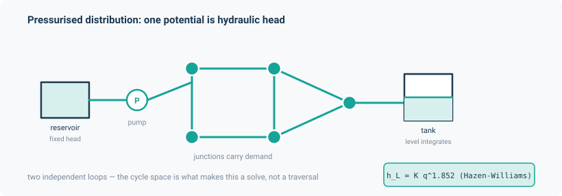

# Water distribution

Pressurised water distribution: reservoirs and tanks at fixed or slowly varying head, and
junctions with demand, are nodes; full pipes, pumps and valves are edges. Water is conserved at
every junction, and flow is driven by differences in hydraulic head. The application reads
EPANET `.inp` files and runs them batched and differentiable.

Every pipe is full and its head loss is a monotone function of the head difference, so the whole
network is **one** `KirchhoffLayer` whose potential is hydraulic head. That is what distinguishes
it from the free-surface [sewer](../sewer/index.md), whose normal flow is set by slope and
upstream inflow rather than by head difference.



## Equivalence with EPANET

The reference tool is **EPANET 2.2** (also used through WNTR). On the supported subset below,
noodl reproduces EPANET's hydraulics and water quality: heads and flows agree to a relative
1e-6 in steady state, which is the precision of EPANET's own float32 output file, and to 1e-5 in
extended-period runs of whole networks; Net6 is looser (heads 2e-5, flows 5e-4). Water quality
agrees to 1e-5 of the quality's scale, and to 1.7e-5 to 2.5e-5 at dead ends. The rows are on the
[verification page](../../reference/verification/water.md). Where the formulas are EPANET's own constants and
algorithms (its composite Darcy-Weisbach law, rounded unit factors, whole-second step lengths, the
Lagrangian quality procedure), they are transcribed, not approximated.

**Maturity: verified on a stated subset.** Each feature below is compared with the live EPANET
2.2 engine (`epanet22.dll`, bundled in `wntr` 1.5.0) on small purpose-built networks and on
EPANET's own examples (Net1, Net3, Net6) and on the Anytown, ky4 and ky10 networks; the
tolerances and measured values are on the
[verification page](../../reference/verification/water.md). It is not "complete" because
EPANET features outside the list are refused, a few cases have no unique EPANET answer
(zero-demand groups behind closed links), and one long quality comparison (ky10) is verified for
its first 6 h 55 min only; see [Limitations](limitations.md).

## Supported and not supported

**Supported**

- Hazen-Williams, Chezy-Manning and Darcy-Weisbach (EPANET's composite law) head loss, with minor
  losses.
- Reservoirs, cylindrical tanks and tanks on a volume curve, with overflow; full and empty tank
  logic.
- Pumps on a head curve (one point, three points, or any other curve) or at constant power, with
  relative speed and speed patterns; pump energy and cost.
- All six valve types (TCV, FCV, PBV, GPV, PRV, PSV), check valves, closed pipes and link
  status and settings.
- `[CONTROLS]` of every form EPANET accepts (a numeric setting on a pipe is refused by
  `validate()`), and `[RULES]` with EPANET's own premise logic.
- Demand patterns, reservoir head patterns, `[TIMES]` options, pressure-driven demand and
  emitters.
- Extended-period simulation with EPANET's event-shortened steps.
- Water quality: CHEMICAL, AGE and TRACE, bulk, wall and tank reactions, sources, tank mixing
  models.
- Batches of instances and gradients of heads, flows, levels, demands and quality with respect to
  the drivers (demands, head and speed patterns) and the initial state. In a model built from a
  file the coefficients (roughness, tank area, reaction rates) are fixed at build time and are not
  learnable; see [Limitations](limitations.md).
- Reading an EPANET `.inp` in any of its flow units, converted to SI.

**Not supported (refused by name, or not modelled)**

- EPANET-MSX (multi-species quality) and EPANET 2.3 features.
- A valve at a full or empty tank; a control on a reservoir; `FILLTIME`, `DRAINTIME`, `DAY` and
  `POWER` rule premises.
- More than one demand pattern on a junction.
- Bulk or tank reaction orders between 0 and 1, and `ORDER WALL` other than 0 or 1.
- A tank volume that decreases as its level rises.
- Volume curves, overflow and water quality with the implicit tank schemes.
- The `1 / CBIG` leak of closed links, which EPANET carries and noodl does not (a stated difference; it moves tank
  levels by up to 2e-3 m over the 96 h of the largest network compared).

## A worked example

```python
from noodl.apps.water import build_model, water_steady, twoloop

model, state, drivers = build_model(twoloop())
model.check(state, drivers).raise_for_errors(strict=True)
final = water_steady(model, state, drivers)

water = model.refs.water
heads = water.head.named(final[water.head])     # m, by node name
flows = water.flow.named(final[water.flow])     # m3/s, by link name
print(round(float(heads["J1"]), 6), round(float(flows["P1"]), 6))
```

```text
49.267725 0.045
```

`twoloop()` is a hand-built network: reservoir `R1` at 50 m, six junctions with demands
5/8/6/10/7/9 L/s, eight Hazen-Williams pipes at $C=130$ forming two independent loops. Its heads
are 49.267731, 48.877316, 48.430882, 48.213867, 48.117119 and 48.122936 m, the same as EPANET 2.2
gives for the equivalent `twoloop_si.inp`. To read an EPANET file instead, use `read_epanet_inp`
([Build and solve a network](steady.md#read-a-network-from-a-file)). The model is set up and
run like every other one; see [The workflow](../../guide/workflow.md).

## In this section

| Page | Kind | What it covers |
| --- | --- | --- |
| [Build and solve a network](steady.md) | Guide | Objects, `build_model` options, steady solve, changing inputs by name |
| [Extended-period simulation](extended-period.md) | Guide | `water_run`, patterns, reports, batches, pump energy |
| [Tanks, controls and rules](tanks-controls.md) | Guide | Tank moves, `[CONTROLS]`, `[RULES]` |
| [Water quality](quality.md) | Guide | Age, chemicals and trace; reactions, sources, mixing, gradients |
| [Valves and link status](valves.md) | Guide and physics | Valves, closed links, check valves |
| [Physics](physics.md) | Explanation | Head loss, pumps, pressure-driven demand, emitters |
| [Importing EPANET files](epanet.md) | Reference | How to load, what is read, what is refused |
| [Limitations](limitations.md) | Reference | What is not modelled; differences from EPANET |
| [Verification](../../reference/verification/water.md) | Evidence | Tolerances and measured values against EPANET 2.2 |
| [Catalogue](../../reference/catalogue/water.md) and [API](../../reference/api/index.md) | Reference | Every class and function |
