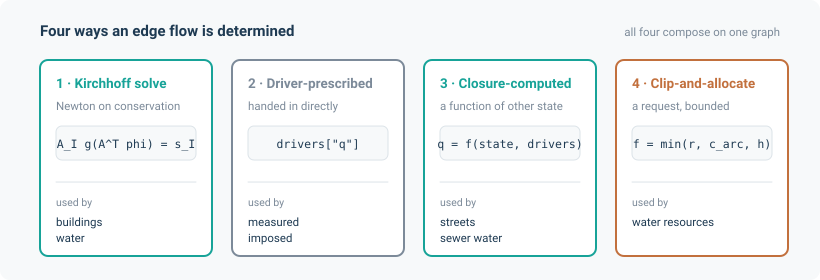

# The four flow-determination modes

Every edge of a network carries a flow, and there are four different ways that flow can be determined. Choosing the right one for your problem matters more than any other modelling decision. The four compose on one graph, so a single model can use several of them on different edge kinds.

| # | Mode | The flow comes from | Implemented by | Used by |
|---|---|---|---|---|
| 1 | **Kirchhoff solve** | Both Kirchhoff laws plus the constitutive laws on the edges, solved together. Newton's method on a nodal conservation residual: $A_I\,g(A^\top\phi) = s_I$ (an implicit law adds its flow as an extra unknown) | `KirchhoffLayer` | [Building physics](../applications/building/index.md), [water distribution](../applications/water/index.md), [electrical circuits](../applications/electrical/index.md), and the sewer's headspace air and dynamic-wave water |
| 2 | **Driver-prescribed** | Handed in directly as a driver value | any `TransportLayer` with no Kirchhoff-layer owner | No application alone; the escape hatch for a flow you measured or imposed, and how a [coupled model](../guide/coupling.md) receives the flow the other model computed |
| 3 | **Closure-computed** | Computed from other state by an arbitrary function | a closure writing `"<layer>.q"` | [Street air quality](../applications/street/index.md), the sewer's kinematic-wave water, [WSIMOD](../applications/water-resources/wsimod.md) |
| 4 | **Clip-and-allocate** | A *request*, clipped against arc capacity and receiver headroom: no potential variable anywhere | `AllocatedFlowLayer` | [Flow allocation](../applications/water-resources/allocation.md) |

## Each mode in practice

**1. Kirchhoff solve.** A building's airflow network. Pressures are unknown; flows follow from them through the constitutive law of each opening. The water application solves for hydraulic head in the same way, and the electrical application for node voltage, with the currents of ideal sources, inductors and transformers as extra unknowns. The sewer's headspace air is a full Newton solve on the same graph that carries the water.

**2. Driver-prescribed.** Not usually chosen alone. If a flow was measured, or imposed by another model at a shared boundary, it is handed in as a driver and the transport layer advects with it.

**3. Closure-computed.** A street canyon. The along-canyon velocity is a closed-form function of the wind aloft and the canyon geometry, so there is no potential to solve for; the street application computes every flow and writes it. The sewer's kinematic-wave water side likewise: on a tree the cycle space is empty, so continuity alone fixes every pipe discharge in closed form, with no solve. WSIMOD is a closure too: its own day of push and pull requests, transcribed call for call, so the flows are WSIMOD's rules.

**4. Clip-and-allocate.** A water-resources network. An arc *requests* a transfer; the receiving reservoir accepts what its remaining headroom allows; the rest is unmet. There is no head, no pressure, no potential: the rule *is* the physics.

## Why the choice matters

Modelling a gravity sewer as a potential problem, or a water-allocation rule as a pressure network, produces a model that converges to a confidently wrong answer. The mode is a statement about the physics of the system, not a numerical preference.

The applications between them cover all four modes, and they share machinery in ways that would be coincidence if the factorisation were wrong. The sewer's headspace air layer uses the same `Stack` buoyancy term the building application uses for room air. The water application's Darcy-Weisbach pipes can be the framework's own `Duct` element in volumetric form, though by default they follow EPANET's own composite friction law. The sewer and water `.inp` readers share one tokenizer. The `solve_monotone` root-finder that inverts Manning's equation for sewer depth also solves the per-node quadratic programme inside the allocation layer's projection mode.

For how each kind of layer works and how a `Model` steps several together, see [Layers and models](layers.md).
