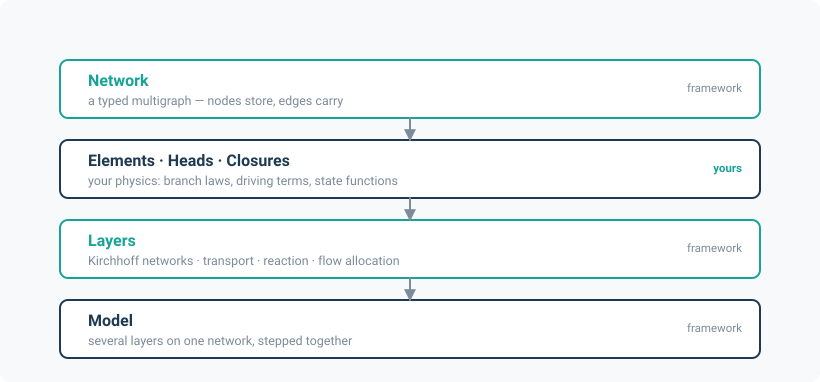
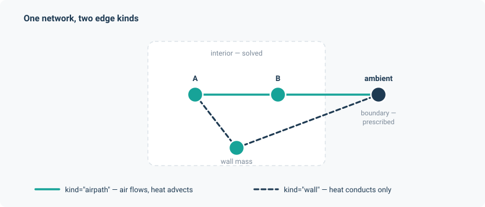

# Anatomy of a model

Every noodl physics model is the same four-part object, whatever the physics: a network, the laws and heads on its edges, layers that solve or advance it, and a model that steps several layers together.

```
Network            a typed multigraph: nodes hold storage, edges carry flow
  |
  +-- Laws         the constitutive law on each edge kind
  +-- Heads        terms added to the potential difference (stack, wind, drag)
  +-- Closures     arbitrary functions of state that produce driver values
  |
Layers             Kirchhoff, transport, reaction, flow allocation
  |
Model              several layers on one network, stepped together
```

Read it bottom-up and it is a simulator. Read it top-down and it is a factorisation: the framework owns the graph, the conservation law and the solve; your problem owns the constitutive laws, the heads and the closures. Everything domain-specific in the [applications](../applications/index.md) lives in those last three boxes.



## The central claim

A node conserves. An edge constitutes. That separation is what lets one piece of machinery carry a building's pressure network and a sewer's headspace air.

Concretely, a Kirchhoff layer assembles and solves

$$
A_I \, g\!\left(A^{\top}\phi + \text{head};\ \theta\right) - s_I = 0
$$

where $A$ is the network's incidence matrix, $A_I$ its interior rows, $g$ the stack of element laws, $\phi$ the nodal potentials, $\theta$ the element parameters and $s_I$ the nodal sources. The framework supplies $A$, the Newton solve and the adjoint. You supply $g$.

Storage and transport add time: nodes accumulate, edges advect what the flows carry. The same incidence structure serves both, which is why heat riding on an airflow needs no new operator, only the flows of the kinds it advects on.



## What noodl physics does not decide for you

Three choices are deliberately left in your hands, and each has bitten someone:

- **How a flow is determined.** A Kirchhoff solve is one of four options, not the default answer. A sewer's tree flow comes from continuity, a street's from a closure, a water-resources arc's from a clipped request. See [The four flow-determination modes](four-modes.md).
- **How tightly coupled layers must agree.** `coupling="pingpong"` takes one pass and is first-order accurate in `dt`; `coupling="iterate"` iterates to a tolerance you set. The default is the cheap one, which is wrong for a strongly two-way coupled model. See [Layers and models](layers.md).
- **Which linear backend runs.** `method="auto"` picks on measured evidence, but an explicit choice is always honoured. See [Solvers](solvers.md).

## The pages of this section

| Page | What it explains |
|---|---|
| [The four flow-determination modes](four-modes.md) | How a flow is determined, and which applications use each way. |
| [Networks](networks.md) | The typed multigraph, its incidence and cycle operators, boundary and interior, Tellegen's theorem. |
| [Constitutive laws and heads](elements.md) | The laws on edges, and the head terms added to potential differences. |
| [Layers and models](layers.md) | The layer types, and how a `Model` steps several together. |
| [Solvers](solvers.md) | The matvec-free linear-operator idea, Newton, and how `method="auto"` chooses a backend. |
| [Differentiability](differentiability.md) | What gradients flow through, and the adjoint. |
| [Theory and related work](theory.md) | The graph theory behind the framework, and how it relates to existing network solvers. |

Subnetworks, devices and serialisation are covered in the [user guide](../guide/index.md), and the options of every layer in [Transport and model options](../reference/transport-options.md).
