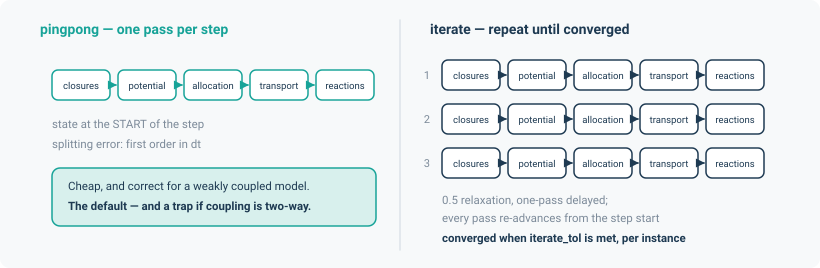

# Layers and models

A **layer** is one physical process on one network. A **`Model`** holds several layers on one network and steps them together. This page explains what each kind of layer does and how a model orders them within a step. Every option is in [the option reference pages](../reference/index.md); the four ways a flow can be determined are on [their own page](four-modes.md).

## The layer types

- **`KirchhoffLayer`** solves for nodal potentials such that flow is conserved at every interior node, with Newton's method on the nodal residual $A_I\,g(A^\top\phi + \text{head}) = s_I$. This is the first flow-determination mode. A law that cannot give its flow from its own potential difference (an ideal source, an inductance, a transformer) adds that flow as an extra unknown, and a layer built with `phasor=True` solves the sinusoidal steady state with complex potentials. Nodes may store an amount (a capacitor to ground, a tank, the air in a zone), which the layer turns into a withdrawal over each step. The same layer serves one steady point, a consistent initial point, a time step or a phasor.
- **`TransportLayer`** advects one or more species, or heat, along the flows of its edge kinds, with storage at nodes, $\mathrm{d}x/\mathrm{d}t = Mx + Nx_b + s/\text{capacity}$. It takes its flows from a Kirchhoff layer, a closure or a driver, and may add conduction on other edge kinds. Three time schemes are available: an exact matrix exponential, implicit Euler and the trapezoidal rule; heat uses the exact one and species the implicit one.
- **`Reaction`** is applied to a transport layer's state after its step, operator-split. The core ships only the protocol; applications bring their own (the street application's photostationary NO/NO2/O3 chemistry, the sewer's sulfide generation). First-order decay is not a reaction: it is the transport layer's `removal`, solved together with the transport in the same step.
- **`AllocatedFlowLayer`** is the fourth mode: each edge carries a requested flow, and the layer clips it against arc capacity and the receiver's remaining headroom, sharing proportionally when several edges compete for one node. It is inherently discrete-time, so a `Model` that owns one refuses a steady pass. See [Flow allocation](../applications/water-resources/allocation.md).

Two details of the transport layer explain most of its behaviour. Nodes that no edge of the layer's kinds touch are inactive and have no row at all, so a wall-mass node with conduction edges and no air path is an unknown of a thermal layer and not of a species layer over the same network. And a node with no storage that only conduction joins to the rest of the network is folded into its neighbours by a Schur complement (the "combined surface coefficient" of building physics and the star-delta transform of circuit theory), so every scheme can step it.

Units are metadata: every key of a layer is a field carrying its unit, and `Model.check()` warns when a closure declares a different one. Nothing is converted.

## Heads: stack, wind and drag

A *head* is a term added to an edge's potential difference: the buoyancy of a warm column of
air (stack), the wind pressure on an opening, the drag a moving surface exerts on the air above
it. A buoyancy head is a driver, like wind speed: a `KirchhoffLayer` reads the optional driver
`"<layer>.edge_head"` (`(..., b)`, one value per edge in the layer's edge order, in the potential's
unit; absent means zero) and adds it to every edge's `phi[src] - phi[tgt]` once.

`noodl.heads.EdgeHeads` is the `Model` closure that writes it. Give it the layer and the head
terms (`Stack`, `DuctStack`, `Wind`, `DriverHead`, ...); it adds them up in the columns of
each term's kind and writes the total:

```py
from noodl.heads import EdgeHeads, Stack

heads = EdgeHeads(air, [Stack.from_network(net, "airpath")])   # writes "air.edge_head"
model = Model(net, {"air": air}, closures=[density_closure, heads])
```

A term is a function of the drivers only, never of the potential, so the Jacobian stays exact
and symmetric. Because the head is a driver, a gradient reaches whatever produced it: a head
may depend on a learnable parameter that a closure reads. A kind whose law is dynamic (a
capacitance, an inductance) takes no head: `EdgeHeads` refuses such a term, and a non-zero
head entry on a dynamic edge is refused when the layer is solved (on the CPU; on an accelerator
that value check is skipped to avoid a host wait, so a head given directly there, without
`EdgeHeads`, is the caller's responsibility). A term that holds tensors needs
its own `to(device=None, dtype=None)` method for `Model.to` to move them (the terms in
`noodl.heads` do not).


## The `Model`

`Model` collects named layers on one network, together with closures and reactions, and offers `step` (one time step), `steady` (the steady state) and `residuals`. State and driver keys are namespaced by layer name (`"air.phi"`, `"thermal.x"`, `"air.q"`); the table of keys is in the [options reference](../reference/model-options.md#key-conventions).

### The order within a pass

Closures, then potential solves, then allocation steps, then transport steps, then reactions (reactions before the transport steps under `reaction_order="before_transport"`, which the sewer uses because SWMM reports its water quality after mixing).

A Kirchhoff layer whose laws are implicit, dynamic or read the context is handed what it needs: the warm start of its flows, the time at the end of the step and the step-start state as history. How each case is handled is in the [options reference](../reference/model-options.md#layers-with-flow-unknowns-dynamic-laws-or-laws-that-read-the-context).

A reaction is not applied by `Model.steady`: a steady state under a reaction is a different fixed-point problem, not the transport steady state. The street and sewer applications each provide a helper that iterates transport and chemistry together to a joint fixed point.

### Closures

A closure is `(state, drivers) -> driver updates`. It is the escape hatch for anything that is a
function of solved state: air density from temperature, canyon velocities from wind, tank levels
from the previous step.

```py
def density(state, drivers):
    T = state["thermal.x"]
    return {"rho": P_REF / (R_AIR * T)}
```

Closures may not write layer state keys. A closure may carry its own state across steps, and one that integrates over the step receives the step's interval; both are declared on the closure, and the declarations, with the clock rules, are in [Model options](../reference/model-options.md#closures). The declared reads and writes also let `model.check` find closures that overwrite each other ([what a closure may declare](../reference/model-options.md#what-a-closure-may-declare)).

### The two couplings



`coupling="pingpong"` (**the default**) takes exactly **one** pass per step, with the state at
the *start* of the step. It is cheap, it is what a weakly coupled model wants, and its splitting
error is first order in `dt`.

`coupling="iterate"` — Hensen's "onion" — repeats that pass within the one step until the
transport states named in `iterate_tol` stop changing, at most `iterate_max` times. Successive
substitution with 0.5 relaxation, applied with a one-pass delay: pass 1 sees the step-start
state, pass 2 sees pass 1's transport states unrelaxed, and from pass 3 on each pass sees the
mean of the two before it. Every pass re-advances from the step-start state, so passes never
compound into `passes × dt`.

`coupling="pingpong"` is the default and a strongly two-way coupled model needs `"iterate"`; see [Troubleshooting](../guide/troubleshooting.md) for the trap in that default.

`iterate_tol` is absolute, in each layer's own units, so a species layer whose mass fractions are about $10^{-3}$ and a thermal layer in kelvin cannot share a tolerance. It has a floor set by the potential solve's own residual, convergence is decided per batch instance, and a Kirchhoff layer may be named as well as a transport layer. The details are in the [options reference](../reference/model-options.md#model).

### Introspection

```py
model.residuals(state, drivers)   # per-layer nodal balance residual
model.ports(state)                 # what a coupled or external model may prescribe and read
```

`Model.ports` reports what a coupled or external model may prescribe and read; see [Coupling](../guide/coupling.md) and [Introspection](../reference/model-options.md#introspection).

### Differentiability

Ping-pong is one pass of differentiable operations. Iterate runs its passes to convergence without a graph, then re-runs one pass on the graph and attaches the implicit adjoint of the interface equations, so memory is one pass. The full contract is in [Differentiability](differentiability.md#what-is-guaranteed) and [Coupling](../guide/coupling.md#gradients-across-the-join); the keyword arguments that reach the solves are in [Model options](../reference/model-options.md#differentiability).
