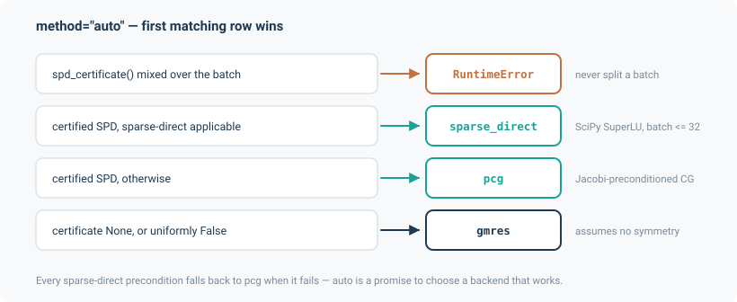

# Solvers

Underneath every layer is the same stack: a **linear operator** that knows how to apply itself
but need not store itself, a **Newton** iteration built on it, and a **selection** rule that
picks a linear backend on measured evidence.

## The `LinearOperator` contract

Operators are matvec-free. An operator must apply itself; everything else is optional and
advertised:

```python
class LinearOperator(Protocol):
    shape: tuple[int, ...]
    dtype: torch.dtype
    device: torch.device
    symmetric: bool

    def matvec(self, x: Tensor) -> Tensor: ...
    def rmatvec(self, x: Tensor) -> Tensor: ...
    def diagonal(self) -> Tensor: ...              # for Jacobi preconditioning
    def assemble(self) -> Tensor | None: ...       # dense form, if it has one
    def spd_certificate(self) -> Tensor | None: ...
```

An operator may additionally implement `assemble_sparse() -> (row, col, values)` — the
`SparseAssembling` protocol — which is what unlocks the sparse-direct backend.

Four implementations ship:

| Operator | What it represents |
|---|---|
| `DenseOperator` | A plain matrix. The retained reference against which the others are checked. |
| `GraphLaplacianOperator` | $A_I \operatorname{diag}(g) A_I^\top$, built from `endpoints` and `accumulate` — never forming $A$. This is the Jacobian of a Kirchhoff layer. |
| `ShiftedOperator` | `scale * base + diag(shift)`: a wrapped operator with a diagonal added. Two uses: a Kirchhoff layer's Jacobian with potential-dependent nodal sources (Laplacian plus shift), and the implicit/trapezoidal transport step `S - alpha M`. |
| `AdvectionOperator` | The upwind advection operator a transport layer solves against. |

The point of the contract is that a network with $10^5$ edges assembles an $O(E)$ sparse triplet
or applies itself in $O(E)$ work, and never materialises an $n \times b$ dense matrix.

## The SPD certificate

`spd_certificate()` returns a tensor, or `None` for "cannot say". This drives backend selection,
and it is deliberately conservative: an operator asserts SPD only when it can prove it.

`GraphLaplacianOperator` certifies when its conductances are positive and the interior is
grounded. `ShiftedOperator` (a Laplacian plus a diagonal) — the Jacobian of a layer carrying potential-dependent nodal
sources — delegates to the Laplacian and keeps the certificate **only when every shift entry is
non-negative**: a non-negative diagonal added to an SPD matrix is SPD, a negative one might not
be, so the certificate is dropped rather than asserted. The solve then routes to GMRES, which
needs none.

### Grounding

`noodl.solvers.grounding` provides `spd_certificate` and `spd_diagnosis`. The second is the
useful one when something goes wrong: a potential problem needs one grounded (boundary) node per
connected component, and a network that has lost grounding — a fan reaching shutoff, a damper
closing, a component that turns out to be isolated — produces a singular operator. `spd_diagnosis`
names which component is ungrounded rather than leaving you with a failed solve.

This can happen *mid-iteration*, which is why `newton` takes a `where` label and every layer
passes something specific like `"KirchhoffLayer 'air' solve"`. In a composed model over one
network, a bare "newton: did not converge" is not enough to find the culprit.

## `solve`: the `auto` table

```python
from noodl.solvers.select import solve

result = solve(op, b, method="auto", rtol=1e-10, on_failure="raise")
```



`method="auto"` resolves by this table, top to bottom, first match wins:

| Condition | Backend |
|---|---|
| `spd_certificate()` mixed across the batch | **`RuntimeError`** — never split a batch |
| Certified SPD, and sparse-direct applicable | `sparse_direct` (SciPy SuperLU, per instance) |
| Certified SPD, otherwise | `pcg` (Jacobi-preconditioned conjugate gradients) |
| Certificate `None`, or uniformly `False` | `gmres` (assumes no symmetry) |

"Sparse-direct applicable" is a conjunction: the operator declares `assemble_sparse` *and*
returns a sparse form from it, SciPy is importable, the solve is grad-safe, **and** the flat
batch size is at most **32**. Every one of those is a *fall back to PCG* when it fails, never a
refusal — `auto` is a promise to choose a backend that works.

### Why that default, and why the batch threshold

Measured on the reference composed model (1028 unknowns, ~5300 nonzeros, float64, 14 threads,
median of 3 warm runs):

| Pass | Ensemble | PCG | sparse-direct | |
|---|---|---|---|---|
| forward | 1 | 128.4 ms | 28.0 ms | 4.59x faster |
| forward | 100 | 2399 ms | 2182 ms | a tie |
| forward | 1000 | 29489 ms | 19263 ms | 1.53x faster |
| backward | 1 | 44.9 ms | 13.8 ms | 3.25x faster |
| backward | 100 | 1741 ms | 476 ms | 3.66x faster |

PCG needed 168–180 iterations per Newton step at this conditioning; the factorisation needs one.
But SuperLU is driven by a per-instance Python loop whose cost is *linear* in the ensemble,
while PCG's batched arithmetic is sub-linear — hence the threshold at 32 rather than an
unconditional preference. A batched vendor backend would replace the loop, not the algorithm.

Because the choice depends on runtime predicates a caller cannot otherwise observe — the batch
size, and whether SciPy is importable at all — `diagnostics` reports `method` (what you asked
for) and `backend` (what ran) separately. Without that distinction, an installation missing the
`sparse` extra looks identical to one that has it, at 4.6x the cost.

### Failure

`pcg` and `gmres` never raise. `select.solve` is the single layer where a failed *numerical*
solve becomes an exception, and `on_failure="return"` is the narrow escape hatch that returns a
`SolveResult` instead.

An **eligibility refusal** is different and always raises, whatever `on_failure` says: requesting
`method="cg"` on an operator that cannot certify SPD, or letting `auto` see a batch where some
but not all instances certify, is a modelling error, not a numerical one. There is no
per-instance result to return.

`SolveResult` carries `x`, `converged`, `iterations`, `residual` and `status` per instance, with
`status` one of `CONVERGED`, `MAX_ITER`, `BREAKDOWN`, `SINGULAR`. `raise_on_failure(where)` names
every non-converged batch index with its status and residual, and returns `self` when all
converged, so it chains.

## Newton

```python
from noodl.solvers.newton import newton

result = newton(residual, operator, x0, atol=None, rtol=None, max_iter=50,
                omega=0.75, switch_ratio=0.5, method="auto", where="my solve")
```

Damped, batched Newton. `NewtonResult` carries `x`, `converged` (per instance), `iterations`,
`residual_norm`, `linear_iterations` and `backend`.

**Tolerance defaults.** `atol` and `rtol` both default to `None`, meaning *derive from the
working dtype*: each independently becomes $\sqrt{\varepsilon}$ for the dtype of the residual
tensor actually returned — about `1.2e-4` for float32, `1.5e-8` for float64. This is the standard
"half the significant digits" heuristic. Asking for tighter than that requests precision the
dtype does not have: the residual floors below the target and `converged` never becomes true. An
explicit value always overrides, and the two are independent.

**`linear_iterations`** is, per instance, the *maximum* inner-solver count over the Newton steps
taken — the worst single linear solve. That is what a performance budget or a preconditioner
decision is made against, and it is monotone in problem difficulty in a way a sum over a varying
number of steps is not. It is `None` only when no linear solve happened at all, never as a
stand-in for an unknown count.

Convergence is per batch instance, and the mask is computed on detached copies so it never enters
the autograd graph.

**Kinked monotone laws: `line_search="convex"`.** When every branch flow is non-decreasing in its
own potential difference and every nodal withdrawal in its own potential, the residual is the
gradient of a convex function $E$ and the Newton direction is a descent direction of $E$. A
law with kinks (a flat-steep-flat S-curve, a stiff bed meeting a soft storage line) can still
send the damped Newton into a cycle it never leaves, because the step crosses a kink and lands
past the minimum of $E$ along it. With `line_search="convex"` such a step, recognised by the
directional derivative $\phi'(t) = r(x + t d)\cdot d$ at its end, is cut back to that minimum by
a regula falsi on the monotone $\phi'$; a step that does not overshoot is taken unchanged, so a
smooth solve is bitwise the same.

**Round-off floor: `step_floor`.** An `atol` below the round-off of the residual's own terms (a
stiff law at a large potential) cannot be met: the iterate stands still and the solve fails.
`step_floor=k` ends an instance as converged once its Newton step is within `k` ULPs of the
iterate in every component, i.e. at the floor. Both options are off by default; a layer that
needs them sets them as its `newton_defaults` (the sewer's dynamic wave does).

## When Newton fails: the fallback ladder

A potential solve that does not converge from its starting point can often be rescued by
starting again from a better one. A `KirchhoffLayer` built with `fallback=` (or a `solve` call
given one) climbs a short ladder when, and only when, Newton did not converge, and stops at the
first rung that does:

```python
air = KirchhoffLayer(net, "air", laws, boundary=["ambient"],
                     fallback=("linear_guess", "storage_ramp"))
```

- **`"linear_guess"`: start again from the linear guess.** The network linearised at zero
  (`linear_init`) is solved once and Newton starts from there. A warm start from the previous
  step's potentials is usually better, but after a large change (a fan slowing down, whose
  iterates then swing between the ends of its curve) it may not be. The rung is skipped when
  the failed solve already started from the linear guess, which a cold solve of a layer
  without flow unknowns does; a layer with flow unknowns starts a cold solve from zeros, so
  the rung runs there.
- **`"storage_ramp"`: let the network settle from the linear guess through a fictitious
  storage that is removed in steps.** Every row gets a storage term, as if each node held
  some amount that resists a change of its potential: its balance gains
  $g\,(x - x_\text{prev})$, with $g$ a multiple of that row's own Jacobian diagonal. A large
  storage makes each change small and the Jacobian strongly diagonal, so Newton converges
  from a poor start; the storage is then divided by ten, three times (multiples 1, 0.1, 0.01
  and 0.001), each stage starting from the last one's result, and the ordinary solve starts
  from where it settled. This is pseudo-time stepping: the stages are steps of a made-up
  transient whose end is the steady solution (`noodl.solvers.continuation.storage_ramp`). A
  potential (balance) row takes the size of its diagonal, a capacity at the node; the row of
  a flow unknown takes it with its sign, an inertia of the flow, because a relation may be
  written either way round and a shift of the other sign would cancel its diagonal. A row
  with a zero diagonal gets nothing: an ideal source's, and the balance of a node whose
  every edge is a flow unknown (a water network in its resistance form, where only the
  flows' rows carry the ramp). When the linear guess cannot be formed (it is singular, as
  for that water network at zero flow) the ramp starts where the failed solve did. On a
  layer without flow unknowns the shift keeps the operator symmetric positive definite, so
  the SPD certificate and its solvers still apply.

The whole batch is solved again on each rung. Only non-convergence (`ConvergenceError`) of
the first solve climbs the ladder; any other error of it passes through. A rung that does not
converge (`ConvergenceError`), or whose linear guess is singular (`SingularSystemError`) or
not grounded (`GroundingError`), has failed, and the next one is tried; any other error of a
rung (a bug in a law, say) passes through. The three are `RuntimeError`s, importable from
`noodl.solvers`, so code that catches `RuntimeError` keeps working and code that wants to
tell them apart can match on the type rather than on the message. On a layer with flow unknowns, the rank test that names a singular system diagnoses a
failure only once every rung has failed too, in every `on_failure` mode: a Jacobian that is
singular at the last iterate is often a symptom of a bad start, which a rung cures, and a
system that is singular in itself fails every rung and still ends in that error. Nothing of
the ladder is differentiated: the rung's solve is the layer's ordinary one from a new
starting point, so the gradient is the implicit one at the exact root.
`diagnostics["fallback"]` names the rung that converged (`None` when none was needed or none
worked) and `diagnostics["fallback_iterations"]` the storage stages' Newton iterations;
`Model.step` sums the rungs taken per layer over a step's passes into
`diagnostics["fallbacks"]` (present only when some layer has a ladder). When no rung
converges the first failure stands. The default is no ladder (`fallback=()`), which runs
exactly the plain solve, with the rank test at once. The building application's air layers
are built with `fallback=("linear_guess",)`.

## Monotone scalar solves

`noodl.solvers.scalar.solve_monotone` is a batched bracketed root-finder for a scalar equation
known to be monotone. It appears wherever a closed-form inversion does not exist but monotonicity
is provable:

- The sewer's Manning normal-depth inversion — discharge is strictly increasing in depth up to
  $h/D = 0.938$, so the ascending branch is the entire invertible domain.
- The sewer's implicit-Euler storage sweep.
- The water application's Hazen-Williams inversion with a minor-loss term.
- `AllocatedFlowLayer`'s projection-mode QP, whose KKT stationarity reduces to one scalar
  monotone equation per node.

Monotonicity is what makes bracketing safe, and each caller documents why it holds.

## Implicit solve and the adjoint

`noodl.solvers.implicit` is what makes the whole package differentiable at reasonable cost.
`implicit_solve` wraps a Newton solve in a `torch.autograd.Function` whose backward applies the
implicit-function theorem at the converged solution rather than unrolling the forward iteration.
`adjoint` solves the transposed system, using `TransposeOperator` to present any operator's
`rmatvec` as a forward action.

The cost is one extra linear solve on the backward pass, independent of how many Newton
iterations the forward took. [Differentiability](differentiability.md) covers what this means for
your model.
