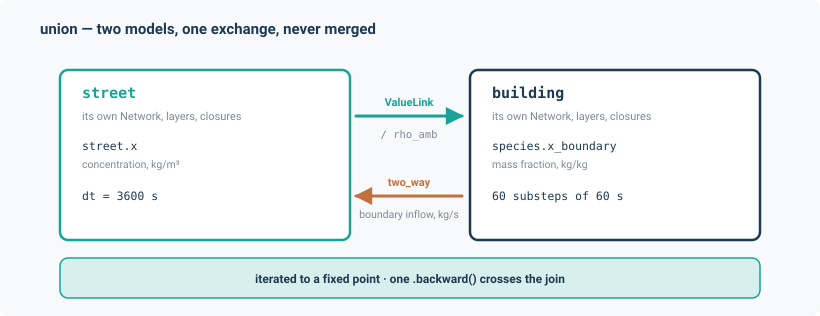

# Coupling two models

How to couple two separately built models that meet at a shared boundary, each on its own network:
a street canyon and a building ventilated from it, for example, where infiltration draws the
street's air into the building and the building acts as a sink on the street. Each model conserves
its own quantities on its own graph. At the boundary they exchange named values each step (a
concentration one way, a mass flux in kg/s the other), iterated to a fixed point, so that what one
side loses the other gains. The join is differentiable: gradients flow across it as if the two
models were one.

This is different from several layers on one network inside one `Model` (a building's airflow and
heat balance), which is set with `coupling="pingpong"` or `coupling="iterate"`; see
[Layers and models](../concepts/layers.md).

## Couple two models

`union` takes each model with its state and drivers, as the application builders return them
(`street_aq.build_model`, `project_to_model`, `sewer.build_model`, `water.build_model` and
`electrical.build_model` all return a `(model, state, drivers)` triple), and the links between
them. It returns a `CoupledModel` and fresh copies of the states and drivers; it never mutates its
inputs.

```py
from noodl.couple import ValueLink, DriverAlias, union

link = ValueLink(
    from_model="street", from_key="street.x", from_index=0,
    to_model="building", to_key="species.x_boundary", to_index=0,
    convert="concentration_to_mass_fraction",
    two_way=True,
)

coupled_model, state, drivers = union(
    {
        "street": (street_model, street_state, street_drivers),
        "building": (building_model, building_state, building_drivers),
    },
    shared=[link],
)

state = coupled_model.step(state, drivers, dt=1.0)
```

With `street.x[0] = 3.0` kg/m³ and the building's `rho_amb = 1.2`, the building sees a boundary mass
fraction of 3.0 / 1.2 = 2.5 kg/kg for that step. `state` and `drivers` are dictionaries keyed by
the tags you gave (`state["street"]`, `drivers["building"]`).

`union` exchanges named values between two ordinary `Model.step` calls. It does not merge the
networks, rebuild the layers or reconstruct the closures, and it never imports from
`noodl.apps.*`: it reads and writes named keys and applies registered unit conversions. Each
model's own `step` stays an ordinary, unmodified call, and after a union the original models
still run standalone, bit for bit. Because autograd tracks the computation rather than Python
objects, one `.backward()` differentiates across the join.



## Links

### `ValueLink`

```py
ValueLink(
    from_model, from_key, from_index,
    to_model, to_key, to_index=0,
    convert=None,          # a registered conversion name, applied forward
    two_way=False,
    convert_back=None,     # applied to the feedback flux
    sources_key=None,      # defaults to "<from layer>.sources"
)
```

- `from_key` is a transport layer's state key `"<layer>.x"`; `from_index` is a position on that
  layer's active interior axis.
- `to_key` must be a transport layer's boundary driver `"<layer>.x_boundary"` (construction
  raises if not); `to_index` is a position on the boundary axis.
- `sources_key`, if given, must end `.sources`.
- Two-wayness is set per link through `two_way`, not by an argument to `union`. The two-way
  feedback is added to the source term, never overwritten, so a lateral load already in
  `sources` survives.

In a union with no two-way link, the single pass reads the forward value from the step-start
state. In a union that also has a two-way link, every pass, one-way links included, reads from the
previous pass's output, so a one-way link there carries an end-of-step value. One-way links are
never part of the convergence test.

### `DriverAlias`

```py
DriverAlias(
    source=("street", "theta_w"),
    targets=(("building", "theta_w", "math_rad_to_compass_deg"),),
)
```

The source is authoritative; every target driver is overwritten from it through its own
conversion. It is applied once per step, before any pass, because drivers do not change between
passes.

### Unit conversions

| Name | Formula |
|---|---|
| `concentration_to_mass_fraction` | x = c / rho_amb |
| `mass_fraction_to_concentration` | c = x * rho_amb |
| `math_rad_to_compass_deg` | W_d = (270 deg - theta in degrees) mod 360 deg |
| `compass_deg_to_math_rad` | theta = rad(270 deg - W_d) mod 2 pi |

The density pair is a genuine unit mismatch: the street application's state is a concentration in
kg/m³, while CONTAM's species convention is a mass fraction in kg/kg, related by the local air
density. The wind-direction pair exists because the two conventions differ in origin and in sense:
CONTAM's W_d is degrees clockwise from north, the direction the wind blows from; the street
application's theta_w is radians counter-clockwise from east, the direction it blows toward. A west
wind is W_d = 270 deg and theta = 0; a north wind is W_d = 0 and theta = 3 pi / 2.
`apply_conversion(name, value, drivers)` applies a registered conversion, and raises with the
sorted list of registered names for an unknown one: an unregistered conversion is never treated as
identity.

The backward link of the canonical pairing takes `convert_back=None`: the feedback is the
recipient's own integrated boundary transfer divided by `dt`, a mass flux in kg/s on both sides.

## Step options

`union` also takes `substeps={tag: k}` (step that model `k` times per outer step),
`relaxation=0.5`, `iterate_rtol=1e-8`, `iterate_atol=0.0`, `iterate_max=50` and
`adjoint_rtol=1e-10` (the tolerance of the implicit adjoint solve, not of the primal).

```py
coupled_model.step(state, drivers, dt, *, t=None, diagnostics=None)   # -> {tag: State}
```

`t` (s) is the simulation time at the start of the step, as in `Model.step`, and is forwarded to
every model, so a time-dependent law or an integrating closure sees the coupled model's clock. A
model with `substeps={tag: k}` runs its `i`-th sub-step of `dt/k` from `t + i*dt/k`. Without `t` a
time-dependent law refuses to evaluate.

With `diagnostics`, the dictionary gets `"passes"`, `"converged"`, `"max_change"`, `"transfers"`
(the recipient's integrated transfer per two-way link), `"adjoint"` and `"adjoint_batched"`.
Every value is detached.

## How the two-way iteration works

When any link is two-way, `step` iterates on a recipient-first Gauss-Seidel schedule. The model that
a two-way link writes into (the recipient) is stepped before its donor, from the step-start state,
and the donor receives exactly the amount the recipient's own step integrated across the shared
boundary (divided by `dt`, added to the donor's sources). Passes never compound into `passes * dt`,
and conservation holds on every returned pass, not only at convergence. Convergence is judged on
the unrelaxed residual of the fixed-point map, per link and per batch instance, against
`iterate_rtol` and `iterate_atol`; failing to converge in `iterate_max` passes raises, naming the
link, the failing instances and the largest change. A model that is both a recipient and a donor of
two-way links is refused at construction. For the general idea of a fixed point across layers, see
[Layers and models](../concepts/layers.md).

## Gradients across the join

The passes of the iteration carry no autograd graph. Once the interface has converged, the
certified pass is run once more on the graph and the implicit adjoint of the interface equations
is attached to it. The gradient is the converged interface's, not the truncated iteration's, and
backward memory is one pass. Where the interface equations are linear in the interface the adjoint
is exact whatever the residual.

Whether anything differentiable reaches the state is found by running a pass on the graph and
dropping it, and that extra pass is paid on every converged step run with grad mode on. Run a
forward-only simulation under `torch.no_grad()`, which skips it. When every interface value carries
the batch dimension the adjoint solves each instance independently; a value shared across
instances couples them, and the adjoint then solves the whole batch as one system, which can cost
up to `B` times as much for `B` instances.

## The street and building pairing

- **Forward, converted.** The street's segment concentration `street.x[i]` becomes the building's
  `species.x_boundary`, divided by the building's own `rho_amb`. When a closure of the building
  model computes `rho_amb` (a density closure, from the node temperatures), the coupler takes that
  closure's value at the start of each step, with the step's clock, not the value the drivers were
  built with.
- **Backward, two-way, unconverted.** The building is the recipient, so it is stepped first from
  that boundary value; its species boundary transfer over its whole outer step, divided by `dt`, is
  added into `street.sources` at the shared segment.
- **Aliased weather drivers.** The street's `U_ref` feeds the building's `V_met` with no
  conversion (the street is built at a reference height of 10 m, matching CONTAM's met-station
  convention), and `theta_w` feeds `theta_w` through the wind-direction conversion.
- **Multi-rate.** `substeps={"building": 60}` steps the street once per hour and the building
  sixty times at 60 s, with the boundary held constant across the inner steps. That is an accuracy
  simplification, not a conservation one: whatever the building integrates over the sub-steps is
  exactly what is added to the street's sources.

Infiltration draws segment air into the building and the building acts as a sink on the street
side. The effect is large only when the building matters to the street: on a street of realistic
size one building's infiltration changes the street's concentration very little.

A worked example is in the [examples](../examples/index.md).

## Limitations

- **No steady solve.** `CoupledModel` steps in time only. To reach a coupled steady state, step
  until the interface values stop changing.
- **Fixed relaxation.** Each step uses a constant `relaxation` (default 0.5), with no adaptive
  scheme. Where the coupled problem has several fixed points, a constant relaxation can settle on
  the wrong one or fail to hold an unstable one, as in the building application's case with three
  steady states. Check a suspect result against a smaller `relaxation` or another start.
- **One species on one flow kind.** A two-way link is refused at construction (`ValueError`)
  unless both layers have a single species and the recipient's layer has exactly one flow kind.
  Couple several species with one-way links, or one model per species.
- **No cycles of two-way links.** A model that is both a recipient and a donor of two-way links
  is refused, with an error naming it.
- **Pairs only.** `union` has been verified on pairs of models. A union of three, such as sewer,
  street and building, is expected to work but has not been built.
- **Noodl models only.** There is no co-simulation interface to non-differentiable tools.
- **Ambient temperature is not coupled** in the street and building pairing: the building sees
  the street only through species concentrations, and its ambient density comes from the CONTAM
  file's own outdoor temperature.

If a coupled step fails to converge, see [Troubleshooting](troubleshooting.md). The checks behind these claims, with tolerances and measured agreement, are on the [coupling verification page](../reference/verification/coupling.md).
