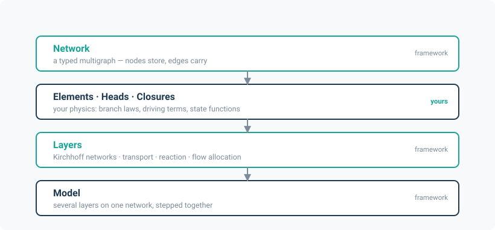

# noodl physics

<p align="center">
  
  
</p>

**Read your EPANET, SWMM or CONTAM model into PyTorch: run many variants in one call and get
exact gradients of any output with respect to the drivers, the initial state and the parameters you mark learnable.**

noodl physics is an open-source framework for differentiable network modelling of physical
systems. Ready-made applications cover buildings, streets, sewers, water mains, water resources
and electrical circuits; the framework underneath lets you compose your own.

```python
import torch
from noodl.apps.water import read_epanet_inp, build_model, water_steady, initial_drivers

net = read_epanet_inp("twoloop_si.inp")                  # an EPANET file
model, state, _ = build_model(net)
water = model.refs.water

# three demands at junction J4, solved in one call (m3/s)
demand = torch.tensor([0.005, 0.010, 0.015], dtype=torch.float64, requires_grad=True)
final = water_steady(model, state, initial_drivers(model, demand={"J4": demand}))
head = water.head.named(final[water.head])["J6"]         # head at J6 (m), one per variant

head.sum().backward()                                    # exact gradient, one extra linear solve
print("head at J6 (m):", [round(h, 3) for h in head.tolist()])
print("d head / d demand:", [round(g, 1) for g in demand.grad.tolist()])
```

```text
head at J6 (m): [48.528, 48.123, 47.669]
d head / d demand: [-75.4, -86.0, -95.5]
```

## Where to start

<div class="grid cards" markdown>

-   **Use an application**

    You have a model file or a building, street, sewer, water main or circuit to simulate.
    Pick the application that matches your reference tool and read its file.

    [:octicons-arrow-right-24: Get started](get-started/index.md) ·
    [Applications](applications/index.md)

-   **Build your own model**

    You want to compose networks, constitutive laws and layers, or add a new physical system.

    [:octicons-arrow-right-24: Concepts](concepts/index.md) ·
    [Extending noodl](project/extending/index.md)

-   **Check the evidence**

    You want to know how closely each application reproduces its reference tool, with
    tolerances and measured errors.

    [:octicons-arrow-right-24: Verification](reference/verification/index.md)

</div>

## Applications

<div class="grid cards" markdown>

-   **[Building airflow and heat](applications/building/index.md)**

    Multi-zone airflow, heat and contaminants. Reads CONTAM and Modelica Buildings models.

-   **[Street air quality](applications/street/index.md)**

    Canyon exchange and routing of pollutants through an urban street network.

-   **[Sewers](applications/sewer/index.md)**

    Gravity hydraulics, headspace air and sulfide. Reads SWMM `.inp` files.

-   **[Water distribution](applications/water/index.md)**

    Pressurised mains, pumps, tanks, demand and quality. Reads EPANET `.inp` files.

-   **[Water resources](applications/water-resources/index.md)**

    Capacity-limited flow allocation and the WSIMOD urban water cycle. Reads WSIMOD configurations.

-   **[Electrical circuits](applications/electrical/index.md)**

    DC, transient and AC circuits and power flow. Reads Modelica and MATPOWER files.

</div>

See the [chooser](applications/index.md) for the reference tool, file formats and maturity of
each, and [File formats](reference/formats.md) for what each reader accepts and refuses.

## What it gives you

| | |
|---|---|
| **One topology layer** | A typed multigraph with incidence, gradient and cycle-basis operators. Edges carry a `kind`, so one network holds several physical systems at once. |
| **Four ways to determine an edge flow** | Solve for a potential, prescribe the flow from a driver, compute it from a closure, or clip a requested flow against capacity. See [the four modes](concepts/four-modes.md). |
| **Composable physics layers** | Kirchhoff solves, transport, reactions and allocation on one network, stepped together. |
| **Batching** | Every solve is batched: a thousand variants, or one network under a thousand weather realisations, is one call. |
| **Exact gradients** | An implicit-function adjoint gives gradients for the cost of one linear solve, not an unrolled tape. |
| **Verified against reference tools** | Code-to-code comparisons with CONTAM, MUNICH, SWMM, EPANET, WSIMOD, the Modelica libraries and pandapower, with tolerances and measured errors written down. |


